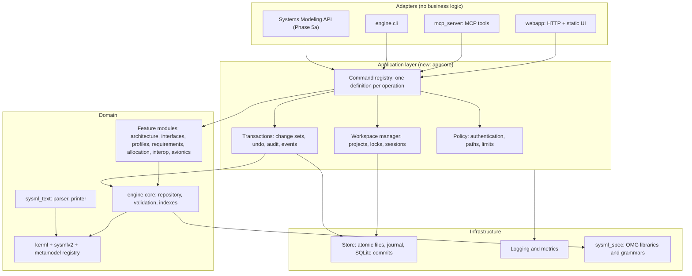
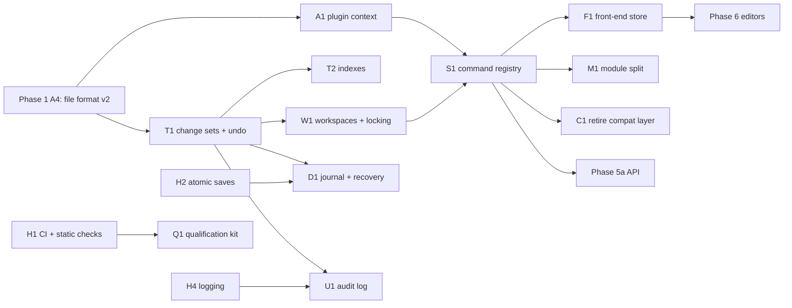

# Architecture review and implementation plan

Reviewed from the standpoint of a software architect delivering engineering
tools to aerospace and automotive programmes. It covers usability,
maintainability, modularity, scalability and reliability, recommends
architecture changes, and breaks them into work packages that implementing
agents can code, test and validate independently.

Snapshot: working branch at `c14f7b5` (Phase 0, Phase 2a and Phase 1 steps
A1–A3 merged; 876 tests passing). Companion documents:
`docs/SPEC_GAP_ANALYSIS.md` (spec conformance plan, Phases 0–7),
`docs/adr/` (decisions), `docs/CONFORMANCE_STATUS.md` (measurements).

This review does not replace the conformance plan. It adds a **production
track** that runs beside it, and it changes two of its phases (5a and 6).

---

## 1. Verdict

The tool is a solid single-user prototype with good bones: clean dependency
direction, a real test suite, a measurable conformance gate, and extension
points. It is **not production grade**. The gaps are not in features but in the
qualities a programme depends on: data safety, concurrency, security,
traceability of changes, performance at realistic model sizes, and evidence
that the tool itself can be trusted.

| Quality | Rating | Main reason |
|---|---|---|
| Modularity | Good, with debts | Layers point the right way; but global registries, three modules over 1,700 lines, and two front ends that each wire the same operations |
| Maintainability | Fair | Strong tests and gates; no static typing checks, no linting, no CI, a growing compatibility layer with no retirement plan |
| Usability | Fair | Rich editors; no autosave or crash recovery, no text editing, whole-tree refresh after each change, few guard rails for large models |
| Scalability | Poor | Everything in memory, undo copies the whole model, deletion and many queries walk the whole model, one project per process |
| Reliability | Poor | No locking on a threaded server, saves are not atomic, no logging, no recovery, no audit trail |
| Security | Poor | No authentication, no origin check on a localhost server, file tools accept any path |
| Qualification evidence | Missing | No tool requirements, no requirement-to-test trace, no coverage measurement, no configuration index |

---

## 2. Findings

Each finding has an ID used by the work packages in section 5.

### 2.1 Strengths to keep

- **Dependency direction is clean.** `kerml` → `sysmlv2` → `engine` →
  `webapp` / `mcp_server`. Nothing in `engine` imports a front end.
  `sysml_text` is pure (no model imports).
- **The spec is the source of truth.** The metamodel registry is generated
  from the OMG reflective models, and conformance is measured, with a baseline
  that cannot regress.
- **Stage gates work.** `python -m tools.gate` blocks merges on tests, script
  syntax and conformance.
- **Extension points exist** for rules, codecs, link kinds, tabs and routes.
- **Standard library only** at runtime, which keeps deployment and supply-chain
  review simple. Keep it.

### 2.2 Reliability and data safety

- **F-01 Race conditions.** The web server is multi-threaded
  (`ThreadingHTTPServer`) and every request reads and writes one global
  `SESSION` with no lock. Two browser tabs, or the browser and an autosave, can
  corrupt the model.
- **F-02 Saves are not atomic.** `Repository.save` and the MCP save tools open
  the target file for writing directly. A crash or full disk mid-write destroys
  the only copy.
- **F-03 No crash recovery.** There is no autosave or journal. A server restart
  loses all unsaved work.
- **F-04 No logging.** No module imports `logging`. Errors reach the browser as
  a message and are then gone. There is no way to investigate a field problem.
- **F-05 No audit trail.** Nothing records who changed what and when. Regulated
  programmes need this for configuration control.
- **F-06 One flaky browser scenario** (`90_avionics_libraries`) was seen during
  Phase 1. A gate that sometimes fails without cause will be ignored.

### 2.3 Scalability and performance

- **F-07 Undo copies the whole model.** Every change serializes the full
  repository (up to 50 copies kept). Cost grows with model size, not change
  size.
- **F-08 Whole-model walks on hot paths.** Deletion (`_with_dependents`) loops
  over the whole tree until nothing changes; many feature queries walk from the
  root; "who references this element" has no index.
- **F-09 The UI reloads the whole tree** after each change. Fine at 2,000
  elements (the avionics example has 1,825), unusable at 100,000.
- **F-10 No size targets or benchmarks.** Performance is checked on one small
  example. Real avionics or vehicle architectures reach 10⁵–10⁶ elements.
- **F-11 One project per process.** `SESSION` is a singleton. No multi-project
  or multi-user operation is possible.

### 2.4 Modularity and maintainability

- **F-12 Global registries filled at import time.** Rules, codecs, link kinds,
  routes and hooks register into module-level lists when a module is imported.
  Load order matters, tests cannot isolate a feature, and two workspaces cannot
  have different plugin sets.
- **F-13 Operations are wired twice.** `webapp/routes/*.py` and
  `mcp_server/tools/*.py` each parse arguments, call the engine, format
  results, and hook undo, labels and warnings. About 120 routes and 130 tools
  are maintained by hand in parallel. Behaviour drifts between them.
- **F-14 Oversized modules.** `engine/architecture.py` (2,497 lines),
  `engine/requirements.py` (2,034), `engine/profiles.py` (1,746),
  `mcp_server/server.py` (1,054), and five front-end plugins over 1,000 lines.
- **F-15 The compatibility layer has no end date.** Phase 1 keeps old attribute
  names (`ends`, `req_id`, `subject`, ...) as properties over the new structure.
  Without a retirement plan the code base carries two APIs forever.
- **F-16 No static checks.** No type checker, no linter, no formatter, no
  import-layer check, and no CI configuration in the repository. Gates run only
  when an agent remembers to run them.
- **F-17 The front end is untyped global scripts.** Plugins communicate through
  `window.studio`. The only automated tests are end-to-end browser scenarios,
  which are slow and the source of F-06.

### 2.5 Security

- **F-18 No authentication and no origin check.** The server binds to
  `127.0.0.1` by default, which is good, but any web page open in the user's
  browser can send requests to it (cross-site request and DNS rebinding). All
  mutating routes are exposed.
- **F-19 No request size limit.** The server reads `Content-Length` bytes
  without a cap.
- **F-20 File tools accept any path.** MCP open/save/import/export tools read
  and write wherever the caller says. An AI agent connected to the MCP server
  can overwrite arbitrary files.
- Already handled, keep: XML import rejects DTDs and entities; guard
  expressions run through an AST whitelist, not `eval`.

### 2.6 Usability

- **F-21 No text view.** SysML v2 users expect to edit text and diagrams side
  by side. (Planned in Phase 6; the parser and printer now make it cheap.)
- **F-22 No autosave, no "unsaved changes" warning, no recovery prompt.**
- **F-23 No global search or command palette**; errors do not carry an
  identifier a user can report.
- **F-24 No review workflow**: no baselines, no change comparison between
  baselines in the UI, no review states.

### 2.7 Qualification evidence (aerospace and automotive)

A modeling tool whose output feeds certification evidence normally needs a tool
classification (DO-330 tool qualification levels for DO-178C projects; tool
confidence level under ISO 26262-8 clause 11). Even at the lowest level a
programme will ask for:

- **F-25** tool operational requirements, each traced to tests;
- **F-26** structural coverage figures for the tests;
- **F-27** a configuration index (exact versions of code, libraries and spec
  artifacts) and reproducible builds;
- **F-28** a known-problems list and a change history per release;
- **F-29** verification performed by someone other than the author.

None of these exist yet. They are cheap to start now and expensive to
reconstruct later.

---

## 3. Recommended architecture changes

### 3.1 Target structure



### 3.2 Changes

| # | Change | Answers | Why this and not something smaller |
|---|---|---|---|
| R1 | **Application layer with a command registry.** Every operation is defined once (name, typed parameters, result, undo label, required permission). HTTP routes, MCP tools, CLI commands and the OpenAPI document are generated from the definitions. | F-13, F-14, F-16 | Removes the parallel hand-written adapters and gives one place for locking, undo, audit and permission checks |
| R2 | **Change-set transactions.** The core mutation API (centralized in Phase 1) records each change (create, delete, set, add or remove relationship). A command runs in a transaction that yields a change set. Undo applies the inverse; the audit log, incremental validation, UI updates and Phase 5a commits all consume the same change sets. | F-05, F-07, F-09, F-24 | Snapshots cannot scale; change sets are also exactly what the Systems Modeling API calls a commit |
| R3 | **Workspace manager.** A workspace owns one project, its indexes, its undo history and a reader–writer lock. Commands take the write lock; queries take the read lock. Sessions refer to workspaces. Requests carry the model revision they were based on and are refused if stale. | F-01, F-11 | The minimum that makes a threaded server correct, and the base for several projects and users |
| R4 | **Durable storage.** Atomic save (temporary file, flush, rename), a write-ahead journal of change sets for crash recovery and autosave, format versions with a tested migration chain, and content checksums. | F-02, F-03, F-22 | Losing a model once ends adoption |
| R5 | **Explicit plugin context.** Registries live in an `AppContext` object. A feature exposes `register(ctx)`; a manifest lists features in order. Module-level registration remains as a thin shim until all features are moved. | F-12 | Makes features testable in isolation and load order explicit |
| R6 | **Indexes in the repository.** By metaclass, by qualified name, and reverse references (who points at an element), maintained from change sets. Deletion and impact queries use them. | F-08 | Removes whole-model walks from hot paths |
| R7 | **Security baseline.** A per-launch token required on every API request, `Origin`/`Host` validation, request size limits, and a workspace root directory that file operations cannot leave. | F-18, F-19, F-20 | Needed even for single-user local use because browsers and AI agents are untrusted callers |
| R8 | **Observability.** Standard `logging` with structured records, an error identifier returned to the user and written to the log, an audit log of change sets (who, when, command, elements), and a health endpoint. | F-04, F-05, F-23 | Field problems cannot be diagnosed otherwise |
| R9 | **Front-end structure.** ES modules instead of global scripts, JSDoc types checked in development, a client store updated from change-set deltas, a virtualized tree, and unit tests for pure logic. No build step in the shipped package. | F-09, F-17, F-06 | Prerequisite for the Phase 6 editors and for large models |
| R10 | **Engineering system.** CI running the gate, a linter, a type checker on new code, an import-layer test, module size limits, coverage measurement, and a time-boxed retirement of the compatibility layer tracked by a metric. | F-15, F-16, F-26 | Makes quality independent of agent discipline |
| R11 | **Qualification kit.** Tool requirements in the repository, each linked to tests; generated trace matrix, coverage report, configuration index and known-problems list per release. | F-25–F-29 | Cheap now, expensive later |
| R12 | **Performance budgets.** Synthetic models at three sizes with budgets per operation, checked by the gate. | F-10 | Scalability claims need numbers |

### 3.3 Effect on the conformance plan

- **Phase 5a** (versioned store and API) is built on R2 and R3: a commit is a
  stored sequence of change sets, and the API is another adapter over the
  command registry. Do not build a separate snapshot-based version store.
- **Phase 6** (editors) is built on R9. The text editor reuses `sysml_text`
  diagnostics and the printer.
- **Phase 1 step A4** (file format v2) continues unchanged. R4 wraps it.
- Phases 2b, 3 and 4 are unaffected, except that new feature code registers
  through R5 and exposes operations through R1 once those land.

---

## 4. Rules for implementing agents

### 4.1 Roles

| Role | Does | Must not |
|---|---|---|
| Orchestrator | Assigns work packages, owns the working branch, runs gates, merges, updates baselines | Write feature code inside a package it will also verify |
| Implementer | Builds one work package on its own branch | Edit files owned by another package, edit `baseline.json` or `targets.json` |
| Verifier | Writes acceptance tests from the package's contract (not from the code), runs fault and load tests, reviews the diff | Fix the code; it reports findings to the implementer |
| Project Owner / System User reviewers | Accept milestones through the GUI and the documents | Review their own changes |

Implementer and verifier for a package are always different agents (F-29).

### 4.2 Workflow

1. Branch `wip/<package-id>` from the working branch
   `claude/sysml-v2-core-engine-OywaD`. Check `git log` shows the expected base.
2. Read the package entry in section 5, the ADRs it names, and the modules it
   touches. If a contract cannot work as written, stop and report; do not
   deviate silently.
3. Commit in logical steps. Push after every milestone and at least hourly.
4. Before reporting: `python -m unittest discover -s tests` and
   `python -m tools.gate --skip-tests` (plus `--phase <id>` when the package has
   targets) must pass.
5. Report: branch and commit, what was built, public API added or changed,
   tests added, every existing test modified and why, measurements, deviations,
   open issues.
6. The orchestrator merges into a temporary branch, runs the full gate, then
   fast-forwards the working branch and updates the baseline.

### 4.3 Standing constraints

- Runtime code uses the Python standard library only (3.10+). Development tools
  may use packages, declared under `[project.optional-dependencies] dev`.
- Layer rule: `kerml` ← `sysmlv2` ← `engine` ← `appcore` ← adapters.
  `sysml_text` imports none of them. An import-layer test enforces this once
  H1 lands.
- New modules stay under 800 lines; new functions have type hints and a
  docstring stating the contract.
- No new module-level registration once A1 (plugin context) lands.
- Every bug fix comes with a test that fails without it.
- A flaky test is a defect: find the cause, never re-run to green.
- Spec-named properties match the spec; compatibility names are marked as such.
- Never weaken a gate, a target or the baseline to pass.

### 4.4 Definition of done

A package is done when its acceptance criteria are met, the verifier's tests
pass, the gate passes on the merged result, documentation for users or
extenders is updated, and its requirement entries (section 5, Q1) are traced to
tests.

---

## 5. Work packages

Sizes use the scale of `docs/SPEC_GAP_ANALYSIS.md` (S ≈ half a wave-1 stream,
M ≈ one, L ≈ two to three).

### Overview and order

| ID | Package | Size | Depends on | Can start |
|---|---|---|---|---|
| H1 | Engineering system: CI, static checks, layer test | S | — | Now |
| H2 | Durable saves and recovery groundwork | S | — | Now |
| H3 | Security baseline | S | — | Now |
| H4 | Logging and error identifiers | S | — | Now |
| Q1 | Qualification kit skeleton | S | H1 | Now |
| P1 | Performance models and budgets | S | — | Now |
| A1 | Plugin context | M | Phase 1 A4 | After A4 |
| T1 | Change-set transactions and undo | L | Phase 1 A4 | After A4 |
| T2 | Repository indexes | M | T1 | After T1 |
| W1 | Workspace manager and locking | M | T1 | After T1 |
| S1 | Command registry and generated adapters | L | A1, T1, W1 | After W1 |
| D1 | Journal, autosave and crash recovery | M | T1, H2 | After T1 |
| U1 | Audit log | S | T1, H4 | After T1 |
| F1 | Front-end modules, store and deltas | L | S1 | After S1 |
| C1 | Compatibility layer retirement | M | S1, Phase 2b | Late |
| M1 | Module decomposition | M | S1 | After S1 |

H1–H4, Q1 and P1 do not touch the core and should start immediately, in
parallel with the remaining Phase 1 and 2b work.



---

### H1 Engineering system (S)

**Goal.** Quality checks run automatically and identically for every agent.

**Build.**
- `.github/workflows/gate.yml`: on push and pull request, Python 3.10 and 3.12,
  run `python -m tools.gate` (with Node and Playwright for the browser
  scenarios) and upload the conformance report.
- `[project.optional-dependencies] dev`: a linter and formatter (ruff), a type
  checker (mypy), coverage.
- `tools/checks/layers.py` and `tests/test_layers.py`: parse imports with `ast`
  and fail on any import that breaks the layer rule in 4.3.
- `tools/conformance/metrics/quality.py`: `quality.max_module_lines` (lower),
  `quality.modules_over_800` (lower), `quality.lint_errors` (lower),
  `quality.type_errors_new_code` (lower), `quality.layer_violations` (lower).
- Type checking is strict for `sysml_text`, `kerml/metamodel.py`, `appcore` and
  every new module; existing modules are added to the strict list as they are
  touched.
- `tools/gate.py` gains `--lint` (on in CI).

**Acceptance.**
- A pull request with a layer violation, a lint error or a failing test is red.
- `quality.layer_violations` is 0 and in the baseline.
- CI finishes in under 15 minutes.

**Verifier.** Plant one violation of each kind on a scratch branch and confirm
each is caught.

---

### H2 Durable saves (S)

**Goal.** A save can never destroy the previous good file.

**Build.** `engine/storage.py`:

```python
def atomic_write_text(path: Path, text: str, *, backup: bool = True) -> None
    """Write to a temp file in the same directory, flush and fsync, keep the
    previous file as <name>.bak when backup is true, then os.replace."""

def read_project_text(path: Path) -> str
    """Read and verify the checksum trailer when present; raise ProjectFileError
    with a user-readable message on truncation or corruption."""
```

- The native JSON gains `"checksum": "sha256:<hex>"` over the canonical element
  payload. Files without a checksum still load.
- `Repository.save/load`, every MCP save/export tool and every web download or
  upload path use these functions. No other code opens project files for
  writing (`tests/test_storage.py` greps for it).
- Format migration chain: `engine/migrations/` with one module per step
  (`v1_to_v2`), a registry, and a fixture per historic version in
  `tests/data/`. Coordinate with Phase 1 A4, which owns the v1→v2 step.

**Acceptance.**
- Fault injection: a write that fails at each stage (open, write, fsync,
  replace) leaves the original file byte-identical.
- A truncated or bit-flipped file is refused with a clear message, and the
  `.bak` loads.
- Every fixture version loads and re-saves in the current version.

---

### H3 Security baseline (S)

**Goal.** Only the intended local user and tools can drive the server; file
access stays inside a workspace directory.

**Build.**
- `webapp/security.py`: a random token generated at launch, printed in the
  start URL and required as a header on every `/api/` request; reject requests
  whose `Host` is not the bound host and whose `Origin` (when present) is not
  the server's own; cap request bodies (default 64 MiB, configurable); security
  headers on static files (`Content-Security-Policy` without inline script
  where feasible, `X-Content-Type-Options`).
- `engine/paths.py`: `WorkspaceRoot` that resolves user paths and refuses any
  that leave the root (including through symbolic links). MCP and CLI file
  tools take paths relative to it. Default root: the directory the server was
  started in; override by option or environment variable.
- A `--host` other than loopback requires `--allow-remote` and prints a warning
  that there is no user management yet.
- `docs/SECURITY.md`: threat model (untrusted web pages, untrusted AI agent,
  untrusted model files), what is and is not protected.

**Acceptance.**
- Requests without the token, with a foreign `Origin`, or over the size cap are
  refused (401, 403, 413) and logged.
- Path traversal attempts (`../`, absolute paths, symlink out of root) are
  refused by every file tool; a test enumerates the tools from the registry so
  new ones are covered automatically.
- All browser scenarios pass with the token flow.

---

### H4 Logging and error identifiers (S)

**Build.**
- `engine/log.py`: `get_logger(name)`, JSON-lines formatter, rotating file
  handler under the workspace root, level from option or environment.
- Every unhandled error in a web route or MCP tool gets a short identifier,
  is logged with its traceback and context (command, revision), and the
  identifier is returned to the caller and shown in the studio's output panel.
- Replace `print` in server start-up and tools with logging.
- `GET /api/health`: version, spec release, workspace state, uptime.
- `quality.print_calls` metric (lower) for runtime packages.

**Acceptance.** A forced error in a route appears in the log with its
identifier, and the same identifier is shown in the browser. Logs contain no
model content above DEBUG level.

---

### Q1 Qualification kit skeleton (S)

**Goal.** Start collecting the evidence a programme will ask for.

**Build.**
- `docs/requirements/TOOL_REQUIREMENTS.md` (or `.sysml`, using the tool on
  itself once Phase 2b lands): tool operational requirements with stable ids
  (`TOR-<area>-<n>`), starting with the acceptance criteria of this document
  and of the conformance phases.
- Tests reference requirements with a marker in the docstring
  (`Verifies: TOR-STORE-003`). `tools/trace.py` builds
  `docs/qualification/TRACE_MATRIX.md` and fails when a requirement has no
  test or a marker names an unknown requirement.
- `tools/coverage_report.py` (development dependency): statement and branch
  coverage per package, written to `docs/qualification/COVERAGE.md`; metric
  `quality.coverage.<package>` (higher) in the baseline.
- `tools/config_index.py`: version, commit, Python version, spec release and
  commit, hashes of shipped files, licence list (MIT plus EPL-2.0 for
  `sysml_spec`).
- `docs/qualification/KNOWN_PROBLEMS.md` and `CHANGELOG.md`, updated at each
  merge.
- `docs/qualification/TOOL_CLASSIFICATION.md`: intended use, what the tool
  output is used for, which errors could go undetected, and the resulting
  expectations (DO-330 and ISO 26262-8 clause 11 are the references; the
  programme makes the final classification).

**Acceptance.** The trace tool runs in the gate; every requirement added by
later packages is traced before that package is done.

---

### P1 Performance models and budgets (S)

**Build.**
- `tools/perf/generate.py`: deterministic synthetic architectures with
  realistic shape (nesting depth, ports per component, connectors, interfaces,
  requirements with links, allocations) at three sizes: S (5,000 elements),
  M (50,000), L (500,000).
- `tools/conformance/metrics/perf.py`: for S and M in the gate, L nightly:
  build, save, load, full validation, single edit with undo, delete with
  dependents, tree page fetch, peak memory.
- Budgets in `targets.json` (phase `perf`). Initial budgets for size M on the
  CI machine: load ≤ 5 s, save ≤ 3 s, single edit ≤ 50 ms, undo ≤ 50 ms,
  delete ≤ 200 ms, tree page ≤ 100 ms, memory ≤ 1.5 GB. Record today's values
  first; packages T1, T2 and F1 are accepted against these budgets.

**Acceptance.** The metric runs; today's numbers are recorded in
`docs/CONFORMANCE_STATUS.md`, including the ones that miss the budget.

---

### A1 Plugin context (M)

**Goal.** No hidden global state; features load from a manifest.

**Contract.**

```python
# appcore/context.py
class AppContext:
    rules: RuleRegistry
    codecs: CodecRegistry
    link_kinds: LinkKindRegistry
    commands: CommandRegistry          # filled by S1
    hooks: HookRegistry                # created, removed, changed
    def load(self, manifest: Sequence[str]) -> None   # dotted module names, in order

# each feature module
def register(ctx: AppContext) -> None: ...
```

- `appcore/manifest.py` lists the built-in features in load order.
- Existing `register_*` functions become shims that write to a default context
  and emit a `DeprecationWarning`; metric `quality.global_registrations`
  (lower) reaches 0 when every feature is moved.
- Tests can build a context with a subset of features.

**Acceptance.** The suite passes with features loaded only through the
manifest; a test builds two contexts with different features in one process
and shows they do not affect each other.

---

### T1 Change-set transactions and undo (L)

**Goal.** Every model change is recorded once and reused for undo, audit,
validation and synchronization.

**Contract.**

```python
# engine/changes.py
@dataclass(frozen=True)
class Change:
    op: Literal["create", "delete", "set", "link", "unlink", "move"]
    element_id: str
    feature: str | None        # spec property name
    old: JsonValue | None
    new: JsonValue | None

@dataclass(frozen=True)
class ChangeSet:
    id: str                    # UUID
    base_revision: int
    changes: tuple[Change, ...]
    label: str
    def inverse(self) -> "ChangeSet": ...

class Transaction:             # context manager; nestable (savepoints)
    def __enter__(self) -> "Transaction": ...
    def __exit__(...): ...      # commit, or roll back on exception

class Repository:
    def transaction(self, label: str = "") -> Transaction: ...
    def apply(self, change_set: ChangeSet) -> None: ...
    revision: int
    def subscribe(self, fn: Callable[[ChangeSet], None]) -> Unsubscribe: ...
```

- The recorder hooks the mutation API that Phase 1 centralized in
  `kerml/elements.py` and `kerml/namespaces.py` (`add_relationship`,
  `remove_relationship`, `add_owned_related_element`, `detach`, `own`) plus
  attribute writes through `engine/properties.py`. Direct attribute writes that
  bypass it are found by a debug mode that compares the model with a replay of
  the recorded changes.
- An exception inside a transaction rolls the model back to the state at entry.
- `engine/undo.py` keeps its public functions but stores change sets, not
  snapshots.
- Change sets serialize to JSON; this is the unit Phase 5a stores as a commit.

**Acceptance.**
- Replay property: for random command sequences on the avionics example and on
  size-S and size-M synthetic models, applying the recorded change sets to a
  copy of the starting model gives a model equal to the result; applying the
  inverses in reverse gives the starting model. Equality is by canonical
  serialization. At least 10,000 random steps in CI, with a fixed seed list.
- A failure injected at any point inside a command leaves the model unchanged.
- P1 budgets for single edit and undo are met at size M.
- All existing undo/redo tests and browser scenarios pass unchanged.

**Verifier.** Writes the replay property test and the failure-injection test
from this contract before reading the implementation.

---

### T2 Repository indexes (M)

**Build.** `engine/indexes.py`: by metaclass (including subclasses), by
qualified name, by short name, and reverse references (element → relationships
and features that point at it). Maintained from change sets; rebuilt on load.
`Repository.remove` and the dependents search use reverse references;
`all_of_kind`, `resolve` and "used by" queries use the indexes.

**Acceptance.** Index contents equal a brute-force computation after every
step of the T1 random sequences; P1 budget for delete is met at size M;
no feature module walks from the root for a lookup an index answers (reviewed,
with a list of remaining walks in the report).

---

### W1 Workspace manager and locking (M)

**Contract.**

```python
# appcore/workspace.py
class Workspace:
    id: str
    repo: Repository
    ctx: AppContext
    def read(self) -> ContextManager[None]      # shared lock
    def write(self, label: str) -> ContextManager[Transaction]   # exclusive lock + transaction

class WorkspaceManager:
    def open(self, path: Path | None) -> Workspace
    def get(self, workspace_id: str) -> Workspace
    def close(self, workspace_id: str, *, discard: bool = False) -> None
```

- The global `SESSION` becomes a view of "the default workspace" for
  compatibility, then is removed by S1.
- Mutating requests carry the revision they were based on (`If-Match`); a stale
  revision gets 409 with the current revision, and the client refreshes.
- Long reads (export, report, validation) take the read lock or work on a
  consistent copy; they never block edits for more than the copy time.

**Acceptance.**
- Stress test: 16 threads issuing mixed reads and writes for 60 s; the final
  model equals a serial replay of the committed change sets; no exception, no
  deadlock (watchdog timeout).
- Two workspaces in one process do not affect each other.

---

### S1 Command registry and generated adapters (L)

**Goal.** One definition per operation; adapters contain no business logic.

**Contract.**

```python
# appcore/commands.py
@dataclass(frozen=True)
class Param:
    name: str
    type: type | str            # str, int, float, bool, ElementRef, enum name, list[...]
    required: bool = True
    doc: str = ""

@dataclass(frozen=True)
class CommandSpec:
    name: str                   # "architecture.connect"
    kind: Literal["query", "mutation"]
    params: tuple[Param, ...]
    returns: str                # name of a result schema
    label: str | Callable[..., str] | None      # undo label for mutations
    permission: str = "edit"
    doc: str = ""

def command(spec: CommandSpec) -> Callable[[Handler], Handler]: ...

class CommandBus:
    def execute(self, workspace: Workspace, name: str, args: Mapping[str, Any],
                *, actor: Actor) -> Result
        """Validate args, check permission, take the read or write lock, run inside
        a transaction (mutations), collect warnings, return Result(value,
        change_set, warnings). Raises CommandError(code, message, details)."""
```

- Generated from the registry: HTTP routes (`POST /api/v1/commands/<name>` and
  REST-style aliases that keep today's paths working), MCP tool definitions,
  CLI sub-commands, `docs/api/openapi.json`, and the command reference in the
  user guide.
- One error model: `{code, message, error_id, details}` with stable codes.
- Migration is feature by feature: architecture first, then interfaces,
  profiles, requirements, allocation, interop, avionics. A feature is migrated
  when its `routes/*.py` and `tools/*.py` contain only generated or declarative
  code. Metric `quality.handwritten_adapters` (lower) tracks the remainder.
- Behavioural equivalence: before migrating a feature, record request/response
  pairs for its existing routes and tools from the test suite; after migration
  the same requests give the same responses.

**Acceptance.**
- Every former route and MCP tool still answers identically (recorded pairs),
  except documented fixes.
- The OpenAPI document validates, and a contract test generated from it passes
  against the running server.
- Adding a new operation requires touching one file; a test proves it appears
  in HTTP, MCP, CLI and the documentation.

---

### D1 Journal, autosave and crash recovery (M)

**Build.** Each committed change set is appended to
`<project>.journal` (JSON lines, flushed) before the command returns. A full
save truncates the journal. On open, if a journal exists and matches the
file's checksum, the studio offers to recover; recovery replays the change
sets. Autosave writes a full file after N changes or T seconds (configurable).
The browser shows saved/unsaved state and warns before closing with unsaved
changes.

**Acceptance.** Kill the server process (`SIGKILL`) at random points during a
scripted editing session, 200 times; after recovery the model equals the model
as of the last acknowledged command every time. A corrupt journal tail is
detected and dropped with a warning; earlier entries are still recovered.

---

### U1 Audit log (S)

**Build.** An append-only log per workspace: timestamp, actor (user or agent
identity as supplied by the adapter), command name, change-set id, affected
element ids, result. Exposed through a query command and a studio panel
(History), with "show what changed" using the change set. Export as CSV.

**Acceptance.** Every mutation in the browser scenarios produces exactly one
audit entry; entries are sufficient to reproduce the model from the starting
file (replay test).

---

### F1 Front-end modules, store and deltas (L)

**Build.**
- Convert `app.js` and plugins to ES modules with explicit imports;
  `window.studio` remains as a thin facade for third-party plugins.
- `static/core/store.js`: client model cache keyed by element id, updated from
  the change-set deltas returned by commands and pushed by a server event
  stream (server-sent events) for changes from other clients or agents.
- Virtualized model tree with lazy children (`tree page` query); search and a
  command palette generated from the command registry.
- JSDoc types on all modules, checked in development with `tsc --checkJs`;
  unit tests for pure modules run under Node's built-in test runner.
- Browser scenarios wait on application events, never on fixed delays; fix the
  root cause of the `90_avionics_libraries` flake.
- Accessibility pass on the shell: keyboard reachability, focus order, labels,
  contrast.

**Acceptance.**
- With the size-M model: first paint of the tree ≤ 1 s, an edit is reflected in
  ≤ 100 ms without a full reload, memory in the browser stays bounded.
- A change made through MCP appears in an open browser without a manual
  refresh.
- The scenario suite passes 20 consecutive runs.

---

### M1 Module decomposition (M)

Split `engine/architecture.py`, `engine/requirements.py`, `engine/profiles.py`,
`mcp_server/server.py` and the front-end plugins over 1,000 lines into
packages with one responsibility per module (model, queries, commands,
validation, import/export). Public names are re-exported from the package so
imports keep working. No behaviour change.

**Acceptance.** `quality.modules_over_800` reaches 0 for runtime packages
(generated files excluded); the suite passes with no test modified.

---

### C1 Compatibility layer retirement (M)

**Build.** Compatibility properties emit `DeprecationWarning` outside the
compatibility module itself. Metric `quality.compat_uses` (lower) counts uses
found by static search plus warnings raised during the test run. Feature
modules move to spec-named properties one by one; when a property has no uses
it is deleted. Saved-file migration is unaffected (it lives in
`engine/migrations`).

**Acceptance.** `quality.compat_uses` is 0, the compatibility properties are
removed, and the metamodel metrics do not regress.

---

## 6. Validation strategy

| Level | What | Where |
|---|---|---|
| Unit | Pure logic of each module | `tests/test_*.py`, Node tests for front-end modules |
| Property | Round trips (parse/print, save/load, change-set replay, index equality) on generated inputs with fixed seeds | `tests/property/` |
| Conformance | Spec corpus metrics and targets | `tools/conformance` |
| Contract | HTTP and MCP against the generated OpenAPI and tool schemas; recorded request/response equivalence | `tests/contract/` |
| Fault injection | Write failures, process kill, corrupt files, exceptions inside commands | `tests/fault/` |
| Concurrency | Multi-threaded stress with serial-replay oracle | `tests/stress/` (short in the gate, long nightly) |
| Performance | Budgets at sizes S and M in the gate, L nightly | `tools/conformance/metrics/perf.py` |
| Security | Token, origin, size cap, path sandbox, hostile model files (deep nesting, huge literals, entity tricks) | `tests/security/` |
| End to end | Browser scenarios on application events | `tests/ui/scenarios/` |
| Acceptance | Project Owner and System User reviews at milestones, using the avionics example and a second, automotive example | review reports in `docs/reviews/` |
| Qualification | Requirement trace, coverage, configuration index, known problems | `docs/qualification/` (generated) |

Coverage expectations for new packages (`appcore`, `engine/changes.py`,
`engine/storage.py`, `engine/indexes.py`): 90% statement and 80% branch.
Existing packages: no decrease.

An automotive example model (for instance a body-control or battery-management
architecture with AUTOSAR-style interfaces and ASIL attributes) should be added
beside the avionics example so that acceptance does not overfit one domain.

---

## 7. Risks

| Risk | Mitigation |
|---|---|
| The production track competes with conformance work for capacity | H-packages are small and independent; T1 and S1 are sequenced after Phase 1 A4, when the core is stable |
| Change-set recording misses a mutation path | Debug mode that checks replay equality; property tests on random command sequences |
| Command migration changes behaviour | Recorded request/response equivalence per feature before and after |
| Performance work without a target | P1 records numbers first; packages are accepted against budgets |
| Two parallel APIs during migrations (registries, commands, compatibility names) | Each migration has a metric that must reach zero and a package that owns reaching it |
| Evidence produced late | Q1 starts now; each package's definition of done includes its trace entries |

---

## 8. Decisions for the product owner

| Decision | Options | Recommendation |
|---|---|---|
| Deployment target | (a) single user, local; (b) small team on one server; (c) multi-tenant service | Design for **(b)**, ship **(a)** first. R3 and R7 are needed for (a) already; user accounts and roles are a later package |
| Order of tracks | Finish conformance first, or interleave | **Interleave:** H1–H4, Q1, P1 now; T1 and W1 straight after Phase 1 A4, before Phase 5a |
| Qualification ambition | None, evidence kit only, or formal qualification data | **Evidence kit** (Q1). Formal qualification is a programme decision and needs an independent organisation |
| Second domain example | Avionics only, or add automotive | **Add automotive** |
