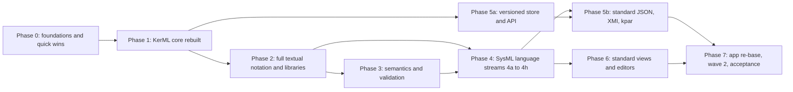

# SysML v2 and KerML: gap analysis and development plan

This document compares the tool with the OMG specifications it is named after
and plans the work needed to turn it into a full SysML v2 application:

- **KerML 1.0** (Kernel Modeling Language): abstract syntax, semantics, textual
  notation, model libraries, model interchange.
- **SysML 2.0**: language, textual and graphical notation, systems and domain
  model libraries.
- **Systems Modeling API and Services 1.0**: the standard repository API.

Snapshot: branch `claude/sysml-v2-core-engine-OywaD` after the avionics merge
(728 tests passing).

Status words used below: **Done** (matches the spec closely enough to build
on), **Partial** (the name or a simplified form exists), **Missing**, and
**Non-standard** (exists but differs from the spec in a way that breaks
interchange).

---

## 1. Bottom line

The tool is a working, SysML v2-flavoured architecture studio with strong
application features: canvas, interfaces, profiles, requirements, allocation,
interop, the avionics pack, the MCP server, and a state machine runner. Measured
against the specifications, it is shallow:

- **Abstract syntax.** Most SysML definition and usage metaclasses exist by
  name (49 of them), plus 28 KerML metaclasses. Almost none of the KerML
  relationships, memberships, derived properties and implied semantics behind
  them exist. Many relationships are stored as plain Python attributes.
- **Textual notation.** The parser reads a small subset and uses two
  non-standard forms (`part def A : B` for specialization, `id="..."` for
  requirement ids).
- **Semantics.** No implied relationships to the model libraries, no
  expression language in the model, no spec validation constraints.
- **Libraries.** One abstract root per kind. Units come from an in-house
  table, not the ISQ/SI libraries.
- **Interchange and API.** Saved files, the REST API and the diagrams are all
  custom. None is the standard JSON/XMI interchange, the Systems Modeling API,
  or the standard graphical notation.

Full conformance means **rebuilding the core under the application**, not
extending the current core. The application layer can survive: the UI and MCP
reach the model through `engine/structure.py` and the feature modules, which
can be re-pointed at a spec-accurate core.

### Conformance at a glance

| Spec conformance point | What it asks for | Status |
|---|---|---|
| Abstract syntax | Every metaclass, property, relationship and constraint of KerML and SysML | **Partial.** Names for most SysML definitions and usages; KerML relationship layer mostly missing |
| Textual notation | Read and write the full KerML and SysML textual grammar | **Partial / Non-standard.** Small subset; two non-standard forms |
| Graphical notation | The standard views and symbols | **Missing.** System Composer-style canvas and Mermaid renderings with SysML v1 names (BDD, IBD) |
| Semantics | Implied library relationships, evaluation, validation constraints | **Missing** |
| Model interchange | Textual notation, standard JSON, XMI, project interchange files (`.kpar`) | **Missing.** Custom JSON (`sysmlv2-core/1`) |
| Systems Modeling API | Projects, branches, commits, tags, elements, queries over REST | **Missing.** Custom REST and MCP tools over one in-memory project |

---

## 2. KerML delta

### 2.1 Root layer (elements, relationships, annotations, namespaces)

| Spec | Tool | Gap |
|---|---|---|
| `Element`: `elementId`, `declaredName`, `declaredShortName`, `aliasIds`, `isImpliedIncluded`, `isLibraryElement`; derived `qualifiedName` | `element_id`, `name`, `short_name`, `qualified_name` | **Partial.** No `aliasIds`, `isImpliedIncluded`, `isLibraryElement`; qualified names do not quote unrestricted names (`'my part'`) |
| `Relationship`: ordered `source`/`target` lists, `ownedRelatedElement`, `owningRelatedElement`, `isImplied` | One `source` and one `target` | **Partial.** No n-ary relationships, owned related elements or `isImplied` |
| `Dependency` (n-ary client/supplier) | — (trace and refine are custom relationships) | **Missing** |
| `Annotation` relationship + annotating elements: `Comment` (`about`, `locale`), `Documentation`, `TextualRepresentation` (`rep language`), `MetadataFeature` | `Annotation` merges the relationship and the annotating element; `Comment`, `Documentation` | **Partial.** A comment cannot be `about` several elements; no `locale`; no `TextualRepresentation` |
| `Namespace`: `membership`, `ownedMember`, `importedMembership`, visibility; name resolution rules | Memberships with visibility and alias; `resolve()` by name, alias and imports | **Partial.** Visibility not enforced; inherited members not resolvable; short names ignored; no library or global scope rules; no name-conflict check |
| `Import`: `MembershipImport` / `NamespaceImport`, `isRecursive`, `isImportAll`, visibility, filtered imports | One `Import` class (namespace, recursive) | **Partial.** No membership imports, `import all`, private imports or filters (`import X::*[@Safety]`) |
| `Package`, `LibraryPackage` (`isStandard`), `ElementFilterMembership` | `Package` | **Partial.** No library packages or filter conditions |
| `OwningMembership` | Created automatically by `own()` | **Done** |

### 2.2 Core layer (types, classifiers, features)

| Spec | Tool | Gap |
|---|---|---|
| `Type`: `isAbstract`, `isSufficient`, `isConjugated`; `feature`, `inheritedMembership`, `inheritedFeature` with redefinition and visibility rules | `Type` with specializations, conjugations, owned and inherited features | **Partial.** Inherited features ignore redefinition (a redefined feature shows twice) and visibility |
| `Specialization`, `Subclassification`, `FeatureTyping`, `Subsetting`, `Redefinition` | `Specialization`, `FeatureTyping`, `Subsetting`, `Redefinition` | **Partial.** `Subclassification` not distinguished from `Specialization` |
| `ReferenceSubsetting`, `CrossSubsetting`, `FeatureChaining`, `FeatureInverting`, `TypeFeaturing` | — | **Missing.** Connector ends use a private `end_contexts` tuple where the spec uses feature chains (`a.p`) |
| `Disjoining`, `Unioning`, `Intersecting`, `Differencing` | — | **Missing** |
| `Conjugation` and conjugated types (flipped directions) | Class exists; only used when copying models | **Partial.** Conjugated types are not computed |
| `Feature`: `isUnique`, `isOrdered`, `isComposite`, `isPortion`, `isVariable`, `isConstant`, `isDerived`, `isEnd`, `direction`, `featuringType` | `is_composite`, `is_portion`, `is_readonly`, `is_derived`, `is_end`, `direction`; `featuring_type` attribute | **Partial.** No `isUnique`, `isOrdered`, `isVariable`, `isConstant` (`is_readonly` is the older flag) |
| `FeatureMembership`, `EndFeatureMembership`, `ParameterMembership`, `ReturnParameterMembership`, `ResultExpressionMembership` | `FeatureMembership` class exists but is never used; features are owned through `OwningMembership` | **Missing in practice.** See 2.5 |
| `Multiplicity` and `MultiplicityRange` as features with bound expressions | A Python `MultiplicityRange` object holding two ints | **Non-standard.** Not a model element; bounds cannot be expressions |

### 2.3 Kernel layer

| Area | Spec | Tool | Gap |
|---|---|---|---|
| Classifiers | `DataType`, `Class`, `Structure`, `Association`, `AssociationStructure` | All except `AssociationStructure` | **Partial.** No association ends or link semantics |
| Connectors | `Connector`, `BindingConnector`, `Succession` | — (SysML `ConnectionUsage` keeps an `ends` list) | **Missing** |
| Behaviors | `Behavior`, `Step` | `Behavior` | **Partial.** No `Step` |
| Functions | `Function`, `Predicate`, `Expression`, `BooleanExpression`, `Invariant` | `Expression` | **Missing** apart from `Expression` |
| Expressions | `LiteralBoolean`, `LiteralInteger`, `LiteralRational`, `LiteralString`, `LiteralInfinity`, `NullExpression`, `OperatorExpression`, `InvocationExpression`, `FeatureReferenceExpression`, `FeatureChainExpression`, `SelectExpression`, `CollectExpression`, `IndexExpression`, `MetadataAccessExpression` | `LiteralExpression`, `FeatureReferenceExpression`, `Invocation`, 13 Python operator built-ins. The parser never produces them and the serializer does not save them | **Missing in practice.** Guards and values are Python strings checked by an AST whitelist |
| Interactions | `Interaction`, `Flow`, `SuccessionFlow`, `PayloadFeature`, `FlowEnd` | — | **Missing** |
| Feature values | `FeatureValue` (`=`, `:=`, `default`), `isInitial`, `isDefault` | `default_value` holds a raw Python value | **Missing** as model elements |
| Metadata | `Metaclass`, `MetadataFeature` | Profiles and stereotypes (a separate, UML-profile-style system) | **Non-standard.** See SysML metadata in 3.2 |
| Packages | `LibraryPackage`, `ElementFilterMembership` | `Package` | **Missing** |

### 2.4 Semantics and KerML libraries

| Spec | Tool | Gap |
|---|---|---|
| Implied relationships: every type implicitly specializes the right library type (for example a `part def` subclassifies `Parts::Part` and a `part` usage subsets `Parts::parts`) | None. User definitions do not specialize any library root, even explicitly | **Missing** |
| Validation constraints defined per metaclass | Model Check has app rules (System Composer, avionics) and a few structural checks; none traced to spec constraints | **Missing** |
| Kernel Semantic Library (`Base`, `Occurrences`, `Objects`, `Performances`, `Links`, `Transfers`, `Clocks`, `Triggers`, `StatePerformances`, ...) | 5 packages, 4 classifiers (`Anything`, `Occurrence`, `Object`, `Performance`) | **Partial** (stubs) |
| Kernel Data Type Library (`ScalarValues`, `Collections`, `VectorValues`) | 5 scalar types | **Partial** |
| Kernel Function Library (`BaseFunctions`, `ScalarFunctions`, `NumericalFunctions`, `SequenceFunctions`, `ControlFunctions`, ...) | — | **Missing** |
| Model-level evaluation of expressions | Guard evaluator (AST whitelist) and unit arithmetic, both outside the metamodel | **Missing** in the model |

### 2.5 Why the relationship gap matters most

The engine stores many relationships as Python attributes:

| Attribute in the tool | What the spec uses |
|---|---|
| `ConnectionUsage.ends`, `end_contexts` | End features with reference subsetting to the connected features, through feature chains |
| `TransitionUsage.transition_source/target/trigger/guard/effect` | Memberships; trigger is an `AcceptActionUsage`, guard an `Expression`, effect an `ActionUsage` |
| `AllocationUsage.allocate_from/to` | Connection ends of the allocation |
| `RequirementDefinition.subject/actors/stakeholders/assumed_constraints/required_constraints` | `SubjectMembership`, `ActorMembership`, `StakeholderMembership`, `RequirementConstraintMembership` |
| `req_id`, `text` | The short name (`<'R1'>`) and the `doc` comment |
| `ViewUsage.exposed` | `Expose` relationships (membership or namespace, optionally recursive) |
| `Usage.featuring_type`, `Feature.default_value` | `TypeFeaturing`, `FeatureValue` |

Standard JSON, XMI, the Systems Modeling API, the textual printer and spec name
resolution all walk relationships. None of them can be built on top of the
attribute model, which is why Phase 1 of the plan rebuilds the core first.

---

## 3. SysML delta

### 3.1 Language areas

| Area | Spec constructs | Tool | Gap |
|---|---|---|---|
| Definitions and usages | `isVariation`, `isVariant`, `isReference` (`ref`), `isIndividual`, `portionKind`, nested usages, redefinition of inherited usages (`part :>> engine : V8;`) | Flags exist; nested usages work | **Partial.** Flags carry no semantics; redefinition of inherited usages missing |
| Attributes and enumerations | `AttributeDefinition`/`Usage`, `EnumerationDefinition`/`Usage`, values with units (`= 2.5 [kg]`) | Attributes and enumeration literals | **Partial.** Values with units are stored in stereotypes and app properties, not as feature values |
| Occurrences | Individuals, snapshots, time slices, event occurrences, successions between occurrences | Flags only | **Missing** |
| Items and parts | `ItemDefinition`/`Usage`, `PartDefinition`/`Usage` | The core of the app | **Done** for structure; item flows missing |
| Ports | `PortDefinition`/`Usage`, directed features, conjugation (`~Port`: `ConjugatedPortDefinition`, `ConjugatedPortTyping`) | Ports with direction and nested interface elements; `is_conjugated` flag; `port_kind` (data, physical, client, server) | **Partial.** No conjugated port typing; `port_kind` is a System Composer concept (map to metadata) |
| Connections and interfaces | `ConnectionDefinition`/`Usage`, `InterfaceDefinition`/`Usage` (a connection between ports), `bind` | Untyped connectors; the app's "interfaces" are `PortDefinition` subclasses | **Partial.** Mapping System Composer interfaces to port definitions is correct. Connectors are not typed by connection or interface definitions; no binding connectors |
| Flows | `FlowDefinition`/`FlowUsage` (`FlowConnection*` in earlier drafts), `SuccessionFlowUsage`, `message`, payloads | Old-name classes exist, unused | **Missing** in practice |
| Allocations | `AllocationDefinition`/`Usage` (`allocate a to b;`) | Custom `Allocation` relationship inside `AllocationSet`/`AllocationScenario` namespaces | **Non-standard** |
| Actions | Parameters, successions (`first a then b`), `fork`/`join`/`decide`/`merge`, `perform`, `send`/`accept`, assignment, `if`/`while`/`for`, `terminate` | `ActionDefinition`/`ActionUsage` classes only | **Missing** |
| States | Nested and parallel states, `entry`/`do`/`exit` actions, transitions with `accept` triggers (`at`, `after`, `when`), guard expressions, effect actions, `exhibit` | `StateDefinition`/`StateUsage`/`TransitionUsage`; non-standard `StateMachineDefinition`, `EventDefinition`, `EventUsage`; string actions; `is_parallel` flag; an executable runner | **Non-standard.** The runner is a useful extra to keep |
| Calculations and constraints | Calc parameters and `return`, result expressions, constraint expressions, `assert constraint` | Classes only | **Missing** |
| Requirements | Short-name id, `doc` text, `subject`, `actor`, `stakeholder`, `assume`/`require constraint`, `frame concern`, `satisfy ... by` (`SatisfyRequirementUsage`), `verify` in a verification objective, derivation connections, refinement metadata, dependencies | Requirement sets (packages), `req_id`/`text` attributes, 15 custom link kinds, suspect-link tracking | **Non-standard.** Every relation is custom; requirement constraints cannot be evaluated |
| Cases | `CaseDefinition`/`Usage` with subject, objective, actors; use cases with `include`; analysis cases with results; verification cases with verdicts | Classes only; the app's "test cases" are custom | **Missing** in practice |
| Views and viewpoints | `Expose` (membership, namespace, recursive), filters, `render`, viewpoints framing concerns, standard view definitions | Classes plus an `exposed` list and an `expose` link | **Missing** in practice |
| Metadata and extension | `MetadataDefinition`/`MetadataUsage` (`#X`, `@X`), annotated-element restrictions, semantic metadata, user-defined keywords | Profiles and stereotypes; property types are System Composer types (`double`, `int8`, `uint64`, ...) | **Non-standard.** Rich and well liked; needs a mapping to metadata |
| Variability | `variation`/`variant`, `VariantMembership`, variant selection | `is_variation`/`is_variant` flags | **Missing** |
| Quantities and units | ISQ and SI libraries, `QuantityValue`, `MeasurementUnit`, `[kg]` unit expressions, quantity types such as `MassValue` | `engine/units.py`: 7 base dimensions (including rad and bit), conversions, compound units | **Non-standard.** The conversion engine is reusable behind the standard libraries |

The tool also defines non-spec metaclasses that need to be removed or mapped
during migration: `ParameterDefinition`/`ParameterUsage` (parameters are
directed features), `StateMachineDefinition`, `EventDefinition`/`EventUsage`,
and the `Copy` relationship (a SysML v1 concept with no v2 counterpart).

### 3.2 SysML model libraries

| Library | Tool |
|---|---|
| Systems Library (`Items`, `Parts`, `Ports`, `Connections`, `Interfaces`, `Allocations`, `Actions`, `States`, `Calculations`, `Constraints`, `Requirements`, `Cases`, `AnalysisCases`, `VerificationCases`, `UseCases`, `Views`, `Metadata`, `Flows`, `StandardViewDefinitions`, ...) | 23 packages, each holding one abstract root with the right name. **Partial** (stubs) |
| Quantities and Units (`ISQ*`, `SI`, `SIPrefixes`, `USCustomaryUnits`, `Quantities`, `MeasurementReferences`, `QuantityCalculations`, ...) | **Missing** (in-house unit table instead) |
| Metadata (`ModelingMetadata`, `RiskMetadata`, `ParametersOfInterestMetadata`, `ImageMetadata`) | **Missing** |
| Analysis (`TradeStudies`, `AnalysisTooling`, `SampledFunctions`, `StateSpaceRepresentation`) | **Missing** |
| Geometry (`SpatialItems`, `ShapeItems`) | **Missing** |
| Cause and Effect, Requirement Derivation | **Missing** |

---

## 4. Notation, interchange and API

### 4.1 Textual notation

**Reads today:** packages; `def`s of 10 kinds plus `enum def`; usages with
type, multiplicity and direction; nested part bodies; `connect a.p to b.q`;
`doc` comments.

**Non-standard:**
- `part def A : B` uses `:` for specialization. The spec uses `:>` or
  `specializes`; `:` means "typed by" on usages.
- `requirement def R id="R1"`. The spec uses a short name: `requirement def <'R1'> R`.

**Missing:** imports and aliases; visibility; `:>`, `:>>`, `::>`; `ref` and
`abstract`; feature values and expressions; units (`[kg]`); metadata (`#`, `@`);
`comment about`; `rep` textual representations; all behavior syntax (`first ...
then`, `succession`, `fork`/`join`, `accept`/`send`, `transition`,
`entry`/`do`/`exit`, `perform`/`exhibit`); requirement bodies (`subject`,
`require constraint`, `assume`, `satisfy ... by`); cases; views (`expose`,
`render`); variability; `allocate`; flows and messages; `bind`; calcs and
constraints with expressions; the entire KerML textual notation.

The exporter writes constructs the parser cannot read as `//` comments, so a
text round trip loses them.

### 4.2 Graphical notation

| Standard view | Tool today |
|---|---|
| General view | Mermaid "BDD" class diagram (SysML v1 name and look) |
| Interconnection view | Interactive canvas (System Composer style) plus Mermaid/DOT "IBD". Closest match, but the symbols are not the v2 notation |
| Action flow view | — |
| State transition view | Read-only Mermaid state diagram; editing through forms |
| Sequence view | — |
| Grid view | Allocation matrix, model tables, requirement tables (custom) |
| Browser view | Model tree (**Done**) |
| Geometry view | — |

Diagrams are not `ViewUsage`s with exposes and filters, so they cannot be
interchanged as views.

### 4.3 Model interchange

| Spec | Tool |
|---|---|
| Textual notation | Subset (4.1) |
| JSON as defined by the API's JSON schema (`@id`, `@type`, every attribute) | Custom `sysmlv2-core/1` |
| XMI against the normative metamodel | — (only SysML **v1** XMI import from Cameo) |
| Project interchange file (`.kpar`: ZIP with `.meta.json` and library dependencies) | — |

### 4.4 Systems Modeling API and Services

| Spec | Tool |
|---|---|
| Projects, branches, commits (immutable versions with change sets), tags | One in-memory project per web session; undo/redo (50 snapshots); save/load JSON |
| Elements and relationships at a commit; project usages (libraries) | Custom REST routes and MCP tools |
| Queries | — (UI search only) |
| Diff and merge between commits | Compare with last saved or with a file; merge |
| REST/HTTP binding (OpenAPI) and OSLC binding | — |

### 4.5 Beyond the spec (keep)

These are application features the specifications do not cover. They should be
re-based on the new core, not rewritten: System Composer parity editors,
avionics pack, MCP server, state machine runner, unit checking and conversion,
compare/merge, SysML v1 XMI import, XLSX/CSV tables, HTML reports,
knowledge-graph export (Turtle, JSON-LD, GraphML, Cypher), undo/redo, and the
Model Check rule framework.

---

## 5. Development plan

### 5.1 Approach

Build a spec-accurate core underneath the application, then re-base the
application on it.

1. **The normative metamodel is the source of truth.** Generate the KerML and
   SysML metaclasses from the OMG machine-readable abstract syntax instead of
   hand-writing them. Hand-write only derived properties and operations.
2. **Relationships are first-class.** The current attribute API (`types`,
   `ends`, `req_id`, `allocate_from`, ...) becomes derived properties over
   relationships, so the UI, MCP and the 728 existing tests keep working
   during the migration.
3. **Load the libraries by parsing the OMG library sources** with our own
   parser. This is also the best parser test.
4. **Measure conformance on a corpus in CI:** the library sources plus the
   official example models. Track parse rate, round-trip rate, schema validity
   and validation false positives per phase.
5. **The engine stays standard-library-only**, as it is today. Development
   tooling (the code generator, schema validation in tests) may use extra
   packages.
6. **The application keeps its vocabulary** (components, interfaces,
   stereotypes) as a facade mapped to spec constructs, with the SysML v2 names
   shown in the inspector.

### 5.2 Phases

Sizes are relative to one wave-1 stream (for example the Interfaces or
Requirements feature): **S** ≈ half a stream, **M** ≈ one stream, **L** ≈ two
to three streams, **XL** ≈ more than three.

#### Phase 0: foundations and quick wins (S)

- Obtain the normative artifacts (KerML and SysML abstract-syntax models,
  textual grammars, model library sources, the API's JSON schema and OpenAPI),
  confirm their licences, and vendor them under `spec/`.
- Conformance harness in `tests/conformance/` with a report script; record
  today's baseline.
- Quick wins in the current parser and exporter: `:>`/`specializes`, short
  names `<'R1'>`, `import`, `abstract`, `ref`, `:>>` redefinition, requirement
  text from `doc`, attribute values with units (`= 2.5 [kg]`). Make the
  exporter write only standard syntax.
- Record the decisions in section 6 as architecture decision records.

**Exit:** the harness runs in CI; the exported avionics example uses only
standard syntax for what it writes.

#### Phase 1: KerML core rebuilt (L, critical path)

- Code generator from the metamodel to `kerml/meta/` and `sysmlv2/meta/`
  (properties, multiplicities, opposites, ordering, derived flags), with
  hand-written derived properties in mixins.
- Root and Core layers as listed in 2.1 and 2.2: n-ary relationships,
  `Dependency`, the `Annotation` relationship, all membership kinds, all
  specialization kinds, the missing feature flags, multiplicity as a feature,
  computed conjugation.
- Spec name resolution: visibility, all import kinds including filters,
  inherited members, redefinition hiding, short names, library scope.
- Compatibility layer: existing attributes re-implemented over relationships.
- Serializer `sysmlv2-core/2`, with automatic migration of `/1` files on load.

**Exit:** all existing tests pass; new tests for derived properties and name
resolution.

#### Phase 2: full textual notation and libraries (L)

- Recursive-descent parser for the full KerML and SysML grammars, with a Pratt
  parser for expressions, source ranges on every element, and error recovery
  (needed by the text editor in Phase 6).
- Pretty printer, so that parse → print → parse is an identity.
- Load the OMG libraries by parsing, replacing `kerml/library.py` and
  `sysmlv2/library.py`, with a cached index to keep startup fast.

**Exit:** every library file parses without errors; round-trip identity on the
corpus; the avionics example exports to text and re-imports without loss
(closes PO-11).

#### Phase 3: semantics and validation (M–L)

- Implied relationships (implicit specialization and subsetting,
  `isImpliedIncluded`), driven by a table taken from the spec.
- Spec validation constraints as Model Check rules tagged with their spec
  names, in a separate "spec" category next to the modeling-guideline and
  domain (avionics) rules.
- Expression evaluation over the Kernel Function Library: arithmetic,
  comparison, boolean, sequence functions, quantities with units (reusing the
  `units.py` conversion engine behind ISQ/SI).
- Feature values, bindings and defaults evaluated.

**Exit:** no false errors on the official example corpus; constraint and
requirement expressions evaluate.

#### Phase 4: SysML language coverage (XL, parallel streams)

Each stream starts once Phase 1 has landed and uses the syntax (Phase 2) and
semantics (Phase 3) for its area.

| Stream | Size | Scope |
|---|---|---|
| 4a Structure and interconnection | M | Occurrences (individual, snapshot, time slice), `ref`, port conjugation, connectors typed by connection and interface definitions, connector ends as feature chains (replacing `end_contexts`), `bind`, flows and messages, allocations as `AllocationUsage` |
| 4b Behavior | L | Actions (successions, control nodes, `perform`, `send`/`accept`, assignment, `if`/loops, `terminate`); states (nested and parallel, `entry`/`do`/`exit` actions, `accept` triggers with `at`/`after`/`when`, guards, effects, `exhibit`); runner re-based on standard states; migrate `StateMachineDefinition` and `EventDefinition` |
| 4c Requirements and cases | M | Short-name ids, `doc` text, `subject`/`actor`/`stakeholder`, `assume`/`require`; satisfy, verify, derive, refine and trace mapped to the standard constructs; concerns and `frame`; use, analysis and verification cases with objectives and verdicts |
| 4d Calculations and constraints | M | Calc and constraint definitions with parameters and results, `assert`, parametric evaluation. This is the base for analysis roll-ups (mass, power, MTBF, latency) |
| 4e Metadata and extension | M | `MetadataDefinition`/`MetadataUsage` (`#`, `@`), annotated-element restrictions, semantic metadata, user keywords. Profiles become metadata libraries; stereotype properties become attributes typed by `ScalarValues`/ISQ. The profile editor UI stays |
| 4f Views and viewpoints | M | `expose`, filters, `render`, viewpoints and concerns, standard view definitions; every diagram becomes a `ViewUsage` |
| 4g Variability | M | `variation`/`variant`, `VariantMembership`, variant selection and validation, configurations in the UI |
| 4h Domain libraries | S–M | Quantities and Units, ModelingMetadata, RiskMetadata, TradeStudies, AnalysisTooling, Requirement Derivation, Cause and Effect: loaded and used by the app |

#### Phase 5: interchange and API (L)

- **5a, versioned store and API** (can start after Phase 1): a SQLite store
  (standard library) of immutable commits, branches and tags, with the undo
  stack over the working copy. Systems Modeling API REST binding: projects,
  branches, commits, tags, elements, relationships, queries, diff and merge,
  with an OpenAPI document. MCP tools on top.
- **5b, interchange formats** (after 4a): standard JSON per the API schema,
  XMI export and import against the normative metamodel, `.kpar` projects with
  library dependencies. Re-target the SysML v1 XMI import to the standard
  constructs.

**Exit:** exported JSON validates against the schema; a model exported from
another SysML v2 tool imports cleanly; the API passes contract tests generated
from the OpenAPI document.

#### Phase 6: graphical notation and editors (L–XL)

- Rendering in the SysML v2 graphical notation (symbols, compartments, `~`
  conjugation, keywords).
- Views: General (replaces BDD), Interconnection (current canvas re-skinned),
  State transition editor, Action flow editor, Sequence, Grid (the existing
  matrices), Browser (the tree). Geometry last.
- A text editor pane with highlighting, diagnostics and completion, kept in
  sync with the diagrams.

**Exit:** each view is editable and saved as a `ViewUsage`; Project Owner and
System User accept it through the GUI.

#### Phase 7: application re-base, wave 2 and acceptance (M)

- Re-point the System Composer layer and the avionics pack at the standard
  constructs; migrate saved projects; re-author the avionics example as
  standard `.sysml`.
- Build the wave-2 features on spec constructs: analysis roll-ups (4d),
  views and spotlight (4f), variants and parameters (4g), behavior editors
  (Phase 6).
- Close SU-6 (allocation matrix shows shared-definition internals once per
  usage).
- Project Owner and System User acceptance against a conformance checklist.

### 5.3 Sequencing

The critical path is Phase 0 → 1 → 2 → 3 → 4b → 6 → 7. Phase 5a runs alongside
Phases 2 to 4, and the Phase 4 streams run in parallel with each other.

### 5.4 Milestones

| Milestone | After | What you can do |
|---|---|---|
| M1 | Phase 0 | Export standard SysML v2 text; see a conformance baseline |
| M2 | Phases 1–2 | Open and save any SysML v2 textual model; standard libraries loaded |
| M3 | Phase 3, streams 4a, 4c, 4e | Spec-accurate structure, requirements and metadata in the existing editors |
| M4 | Phase 5 | Standard JSON, XMI and `.kpar`; API with commits and branches |
| M5 | Streams 4b, 4d, 4f, 4g, Phases 6–7 | Behavior, analysis, views and variants in the standard views: the full application |

### 5.5 Effort

The estimate is calibrated on wave 1 of this project. Six parallel streams
added about 37,000 lines, about 6,200 per stream including tests. They were
built in about two days and accepted after about a week of integration and
fixes, so integration and acceptance added roughly 30–40% on top of the build.

| Tier | Phases | Stream-equivalents (with overhead) | Elapsed time, 6 parallel agents |
|---|---|---|---|
| 1. Standard text in and out (M1–M2) | 0, 1, 2 | about 8 | 3–4 weeks (mostly serial) |
| 2. Spec-accurate core for today's features, plus interchange and API (M3–M4) | Tier 1 + 3, 4a, 4c, 4e, 4h, 5 | about 18 in total | 7–8 weeks in total |
| 3. Full application (M5) | Tier 2 + 4b, 4d, 4f, 4g, 6, 7 | about 33 in total (range 28–38) | 11–14 weeks in total |

That is roughly 150,000–200,000 lines of code and tests, two to three times
the current codebase of about 65,000 lines. Phases 1 and 2 are the least
parallel part, which is why tier 1 takes proportionally longer.

The estimate assumes usage limits like those during wave 1 and a Project Owner
and System User review at each milestone. The largest uncertainty is the long
tail of making every library file and example model parse and validate.

### 5.6 Risks

| Risk | Mitigation |
|---|---|
| The specifications are large and the effort can drift | Corpus metrics per phase; every milestone ships something usable |
| The rebuild breaks the working application | Compatibility layer, the existing test suite as the gate, migration tests for saved projects |
| Ambiguities in the specifications | Use the OMG pilot implementation's behaviour as the reference |
| Full libraries slow down startup | Cached parsed index; lazy loading |
| Licences of vendored spec artifacts | Check in Phase 0 before vendoring |
| A hand-written parser for the full grammar is a lot of work | Accepted to keep the engine dependency-free; the library corpus tests it |

---

## 6. Decisions needed

These supersede the earlier "a subset parser is enough" decision, which was made
for a personal prototype.

| Decision | Options | Recommendation |
|---|---|---|
| Conformance target | (a) all points including the full graphical notation; (b) abstract syntax, textual notation, interchange and API, with the most-used standard views | **(b) first**, then the remaining views |
| Metaclasses | Generated from the normative metamodel, or hand-written | **Generated** |
| Existing saved projects | Migrate on load, or drop compatibility | **Migrate on load** |
| Engine dependencies | Standard library only, or allow packages such as a parser generator | **Standard library only** |
| UI vocabulary | System Composer terms, SysML v2 terms, or both | **Both:** System Composer terms in editors, SysML v2 names in the inspector |
