# SysML v2 Core Engine — Visual User Guide

This is a hands-on, diagram-driven tour of every capability in the
engine. Every section ends with a runnable snippet (Python and/or the
matching MCP tool call) so you can reproduce it yourself.

> **Modelling an architecture in the browser?** Start with
> [chapter 4, *Studio: System Composer workflow*](#4-studio-system-composer-workflow):
> a map of the studio's tabs and a click-by-click tutorial that builds a
> small avionics model (architecture → interfaces → profile → requirements
> → allocation → report) without writing any code.

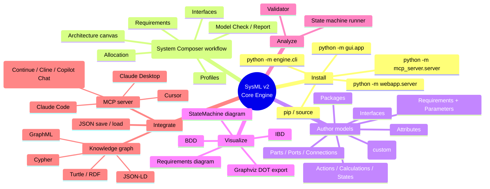

---

## 1. Install & run

```bash
git clone <repo>
cd REQUIREMENT-FORMALISER
python -m unittest discover -s tests -v     # all pass (browser scenarios need Node + Playwright)

# Four surfaces, pick any:
python -m engine.cli examples/vehicle.sysml  # parse + validate + print
python -m webapp.server                      # web GUI (browser; no deps)
python -m gui.app                            # desktop GUI (needs Tk)
python -m mcp_server.server                  # MCP over stdio (for AI agents)
```

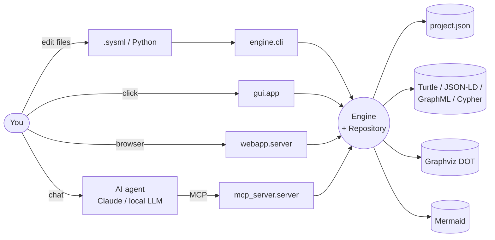

---

## 2. The Definition / Usage pattern

Every domain concept in SysML v2 has two halves. Remember this — it's
the rule that explains the whole metamodel.

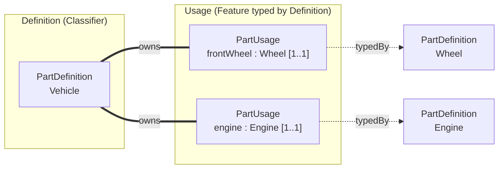

| Kind             | Definition class          | Usage class             |
|------------------|---------------------------|-------------------------|
| structure        | `PartDefinition`          | `PartUsage`             |
| item             | `ItemDefinition`          | `ItemUsage`             |
| attribute        | `AttributeDefinition`     | `AttributeUsage`        |
| port             | `PortDefinition`          | `PortUsage`             |
| interface        | `InterfaceDefinition`     | `InterfaceUsage`        |
| connection       | `ConnectionDefinition`    | `ConnectionUsage`       |
| action           | `ActionDefinition`        | `ActionUsage`           |
| state            | `StateDefinition`         | `StateUsage`            |
| calculation      | `CalculationDefinition`   | `CalculationUsage`      |
| constraint       | `ConstraintDefinition`    | `ConstraintUsage`       |
| requirement      | `RequirementDefinition`   | `RequirementUsage`      |
| parameter        | `ParameterDefinition`     | `ParameterUsage`        |
| enumeration      | `EnumerationDefinition`   | `EnumerationUsage`      |

---

## 3. Two GUIs — desktop and web

You can drive the engine through a **desktop** GUI (Tkinter) or a
**browser** GUI (web frontend). Both expose the same capabilities.

### 3a. Web frontend (recommended if Tk isn't installed)

```bash
python -m webapp.server          # listens on http://127.0.0.1:8765
```

Open the URL in any browser — Chrome, Firefox, Edge, Safari. The
backend is stdlib-only (no `pip install`); the frontend's Tailwind and
Mermaid are vendored in `webapp/static/vendor/` (no `npm`, works offline).

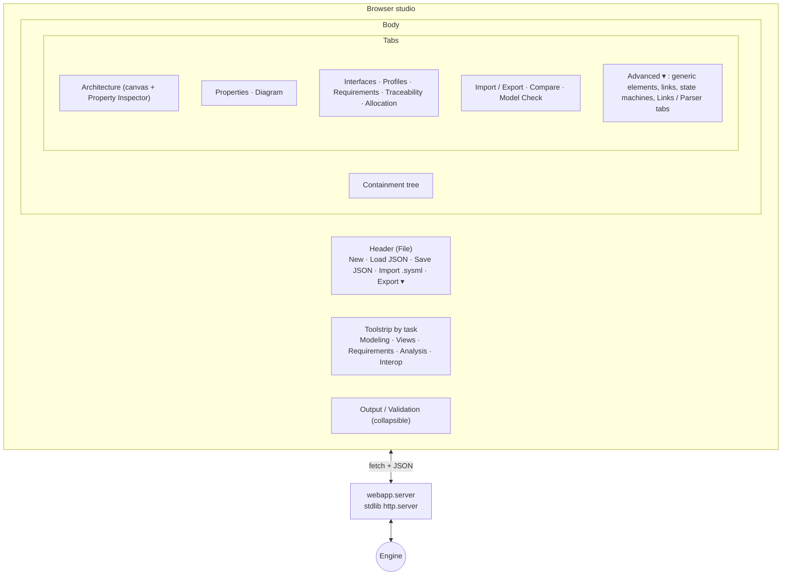

The studio's System Composer-style editors (architecture canvas,
interfaces, profiles, requirements, allocation, interop) are described in
[chapter 4](#4-studio-system-composer-workflow). The generic SysML element
commands of the original web frontend (one *Add* button per element kind,
*Link…*, *Define / Apply stereotype…*, the state-machine commands) and the
*Links* and *Parser* tabs are in the **Advanced ▾** menu at the right of
the tab bar; every dialog is an in-page modal.

Shortcuts: **F5** validate · **Ctrl+Z / Ctrl+Y** undo / redo · **Ctrl+L** create link ·
**Ctrl+E** fire event · **Del** delete.

### 3b. Desktop GUI (Tkinter)

```bash
python -m gui.app
```

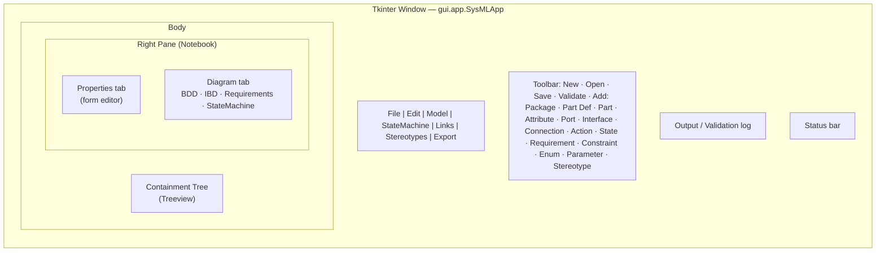

If Tkinter is missing, install it (`sudo apt install python3-tk` on
Debian/Ubuntu, `brew install python-tk` on macOS, or re-run the
Windows Python installer with *tcl/tk and IDLE* checked) — or just use
the web frontend, it has no Tk dependency.

**Workflow** (identical in both GUIs):

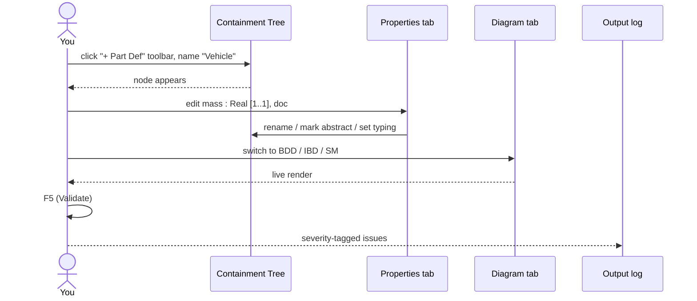

Key shortcuts: **F2** rename · **Del** delete · **F5** validate · **Ctrl+L** create link · **Ctrl+E** fire event.

---

## 4. Studio: System Composer workflow

The web studio (`python -m webapp.server`, then open
http://127.0.0.1:8765) follows MATLAB System Composer: you draw
architectures on a canvas, type ports with interfaces, classify components
with profiles and stereotypes, trace requirements, allocate functions to
hardware and check the result, all with the mouse and the keyboard.

### 4a. Where things are

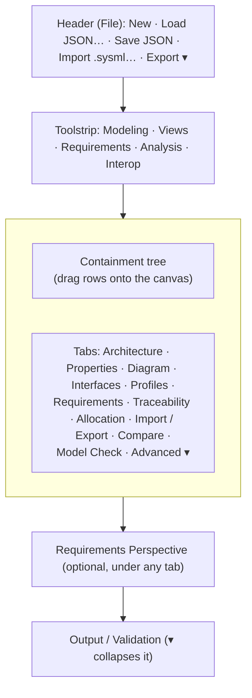

| You want to… | Toolstrip button / tab | Details |
|---|---|---|
| Draw architectures: components, ports, connectors, reference components, Group, Arrange | **Modeling ▸ New model…**, tab **Architecture** (canvas toolstrip, Property Inspector on the right) | [features/architecture.md](features/architecture.md) |
| Define interfaces, value types, ARINC 429 / AFDX / MIL-STD-1553 / discrete / analog templates, adapters | **Modeling ▸ Interface Editor** (tab **Interfaces**, Alt+I) | [features/interfaces.md](features/interfaces.md) |
| Define profiles and stereotypes (DAL, ATA chapter, mass, power, MTBF…), apply them, enter values | **Modeling ▸ Profile Editor**, **Apply stereotypes…**; values in tab **Properties** | [features/profiles.md](features/profiles.md) |
| Author requirements, link them (Implement, Verify, Derive…), see traceability and suspect links | **Requirements ▸ Requirements**, **Req Perspective** (Alt+Shift+R), **Traceability** | [features/requirements.md](features/requirements.md) |
| Allocate functions to partitions and hardware | **Modeling ▸ Allocation** (tab **Allocation**) | [features/allocation.md](features/allocation.md) |
| Check the model, generate a report, exchange tables / SysML text / XMI, compare and merge | **Analysis ▸ Validate**, **Model Check** (Ctrl+Shift+K); **Interop ▸ Import / Export**, **Compare** | [features/interop.md](features/interop.md) |
| Generic SysML elements, typed links, state machines, the Links and Parser tabs | **Advanced ▾** at the end of the tab bar | chapters 5–11 |

**Undo / redo.** Every change, from any tab, is one named step of a single
history: the *Edit* buttons at the left of the toolstrip and the canvas's
Undo / Redo show what they will undo ("Undo Set Avionics.LRU.mass of FMS",
"Undo Allocate ComputeNavigation → FMS"); Ctrl+Z / Ctrl+Y work everywhere
outside text fields. Adding an element and naming it in place is one step.
New project and Load replace the model and start a fresh history: use
Save JSON before them.

**Every view stays current.** A value typed in the Properties tab shows at
once on the canvas (blocks, badges, the Property Inspector), in the undo
buttons and in Model Check, without reloading the page.

### 4b. Tutorial: a small avionics model, GUI only

The steps below build an air data → navigation → display chain as a
functional and a physical architecture, type the bus with an ARINC 429
word, classify the LRUs, trace requirements, allocate the functions and
report. They use only clicks, drags and the keyboard. (The same steps run
automatically as the wave gate, `tests/ui/scenarios/99_avionics_e2e.mjs`.)

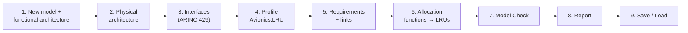

**1. New model and the functional architecture.**
Click **Modeling ▸ New model…**, name the model `AircraftAvionics`, keep
*System*, set *Root architecture* to `FunctionalArch` and press Enter. The
**Architecture** tab shows the empty architecture.
Click **Component** in the canvas toolstrip and type `AcquireAirData`
(Enter); repeat for `ComputeNavigation` and `DisplayFlightData`.
Select a block and click **Out** (or **In**) in the *Port* section, then
type the port name: `AcquireAirData.airData` (out),
`ComputeNavigation.airData` (in), `ComputeNavigation.navSolution` (out),
`DisplayFlightData.navSolution` (in). Click **Arrange** to lay the blocks
out, then drag from each output port to the matching input port to draw
the connectors. (Dropping a connector on a block or on the frame edge
creates the matching port for you.)

**2. The physical architecture.**
Select `AircraftAvionics` in the containment tree, open **Advanced ▾ ▸
Generic element ▸ Part Def** and name it `PhysicalArch`; then pick
`AircraftAvionics::PhysicalArch` in the canvas's **Open** list. Add the
LRUs `ADIRU`, `FMS` and `CDS` as in step 1, the ports `ADIRU.airData`
(out), `FMS.airData` (in), `FMS.navData` (out), `CDS.navData` (in),
**Arrange** and connect them. Press Escape: the Property Inspector now
summarizes the architecture (3 components, 2 connectors).

**3. Interfaces.**
Click **Modeling ▸ Interface Editor** and choose **Template… ▸ ARINC 429
word**: the interface `A429Word` (label, SDI, data, SSM, parity) appears.
Drag `A429Word` from the editor's list, hold it over the **Architecture**
tab until the canvas opens, and drop it on the `ADIRU.airData` port. For
the other end, click the port `FMS.airData` and pick `A429Word` in the
Property Inspector's *Interface* list. The connector now carries the
interface's colour; its inspector lists the interface.

**4. Profile and stereotype values.**
Click **Modeling ▸ Profile Editor ▸ New Profile**, name it `Avionics`.
**New Stereotype** `LRU`, *Applies to* `Component`. **Add Property** three
times and edit the table: `mass` (unit `kg`), `power` (unit `W`), `dal`
(type *enumeration*, literals `A, B, C, D, E`).
Back on the canvas, click a block of `PhysicalArch` and press Ctrl+A to
select all three LRUs, then **Modeling ▸ Apply stereotypes…** (scope
*Selected elements*) ▸ OK. Each block shows a `«LRU»` badge.
Select `FMS`, click **Properties tab ↗** in the Property Inspector and
type the values in the *Stereotypes* section: mass `7` (Enter), power
`120`, dal `B`. Values may carry a compatible unit: `9 lb` for the ADIRU's
mass is stored as 4.08 kg. Return to **Architecture**: the inspector shows
`mass 7 kg`, `power 120 W`, `dal B`.

**5. Requirements and traceability.**
Click **Requirements ▸ Requirements ▸ New Set**, name the set
`AvionicsSystemRequirements` with ID prefix `SYS-`. Click **Add** (or
press Insert) and type the summary of `SYS-1` (Enter); add `SYS-2` and
`SYS-3` the same way. Requirement text goes in the detail pane on the
right (Ctrl+Enter saves).
Click **Req Perspective** (Alt+Shift+R): the requirements stay visible
under the canvas. Drag the row `SYS-1` onto the `ADIRU` block, `SYS-2`
onto `FMS`, `SYS-3` onto `CDS`: each drop creates an *Implement* link, the
blocks show a `1 req` badge and the *Implemented* column reaches 100 %.
**Traceability** shows the matrix and diagram. Editing a linked
requirement later marks its links *suspect* (change impact); review them
and use **Clear Suspect**.

**6. Allocation.**
Click **Modeling ▸ Allocation ▸ New Set**, name it `FunctionsToLRUs`,
source `FunctionalArch`, target `PhysicalArch`. Click the matrix cells
`AcquireAirData → ADIRU`, `ComputeNavigation → FMS` and
`DisplayFlightData → CDS`. The *Coverage* panel shows 100 %. Clicking a
function's row header highlights its LRU on the canvas.

**7. Model Check.**
Click **Analysis ▸ Model Check** (Ctrl+Shift+K). The tab's badge counts
the findings (errors, warnings, info); filter them by severity, rule or
text and click a finding to see its element in context: a component,
port or connector opens on the canvas with the element selected, anything
else (a requirement, an interface) opens in **Properties**. Fix one in its
editor (for example give a requirement its text) and the count goes down.

**8. Report.**
Click **Interop ▸ Import / Export ▸ Generate Report**: the HTML report
(model summary, architecture diagrams, components, interfaces,
requirements and traceability, validation) is previewed in the tab;
**Download HTML** saves it.

**9. Save and load.**
**Save JSON** in the header downloads `project.json`. **New** starts an
empty project; **Load JSON…** opens the file again with every
architecture, interface, stereotype value, requirement link and
allocation.

### 4c. Keyboard

| Where | Keys |
|---|---|
| Everywhere | Ctrl+Z / Ctrl+Y undo / redo · F5 validate · Alt+I Interface Editor · Alt+Shift+R Requirements Perspective · Ctrl+Shift+K Model Check |
| Canvas | Enter open a component · Alt+↑ up one level · F2 rename · Delete delete · Ctrl+C / Ctrl+V / Ctrl+D copy, paste, duplicate · Ctrl+G group · Ctrl+A select all · arrows nudge · Space fit · +/− zoom · Shift+drag a port to move it |
| Requirements | Insert add · Shift+Insert add child · Alt+Shift+arrows move / indent · Ctrl+Enter save the text |
| Interface Editor | Insert add element · Alt+↑ / Alt+↓ reorder |
| Dialogs | Enter OK · Escape cancel |

---

## 5. Authoring a model — three vehicles in three ways

The same model can be built in three equivalent ways.

### 5a. Textual `.sysml`

```sysml
package Vehicles {
    attribute def Mass;
    port def MechanicalPort;
    part def Engine {
        attribute power : Mass;
        port shaft     : MechanicalPort;
    }
    part def Vehicle {
        attribute mass : Mass;
        part engine    : Engine;
    }
}
```

Run: `python -m engine.cli vehicle.sysml`.

### 5b. Python builder

```python
from engine import Repository
from sysmlv2 import (
    AttributeDefinition, AttributeUsage,
    PartDefinition, PartUsage,
    PortDefinition, PortUsage,
)
repo = Repository("VehicleProject")
Mass = repo.add(AttributeDefinition(name="Mass"))
Mech = repo.add(PortDefinition(name="MechanicalPort"))
Engine = repo.add(PartDefinition(name="Engine"))
Engine.own(AttributeUsage(name="power", typed_by=Mass))
Engine.own(PortUsage(name="shaft", typed_by=Mech))
Vehicle = repo.add(PartDefinition(name="Vehicle"))
Vehicle.own(AttributeUsage(name="mass", typed_by=Mass))
Vehicle.own(PartUsage(name="engine", typed_by=Engine))
repo.validate()
repo.save("vehicle.json")
```

### 5c. MCP (driven by an AI agent)

```jsonc
// Tool calls an LLM would emit
{"name": "sysml_create_element", "arguments": {"kind": "PartDefinition",        "name": "Vehicle"}}
{"name": "sysml_create_element", "arguments": {"kind": "AttributeDefinition",   "name": "Mass"}}
{"name": "sysml_create_element", "arguments": {"kind": "AttributeUsage",
                                                "name": "mass", "parent": "Vehicle",
                                                "properties": {"typed_by": "Mass"}}}
{"name": "sysml_validate"}
```

---

## 6. Block Definition Diagram (BDD)

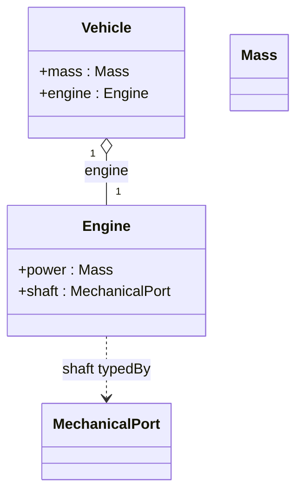

GUI: Diagram tab → BDD. Programmatic: `engine.bdd(repo.root_package)` returns Graphviz DOT.

---

## 7. Internal Block Diagram (IBD)

Internal structure of one part: nested usages + ports + connections.

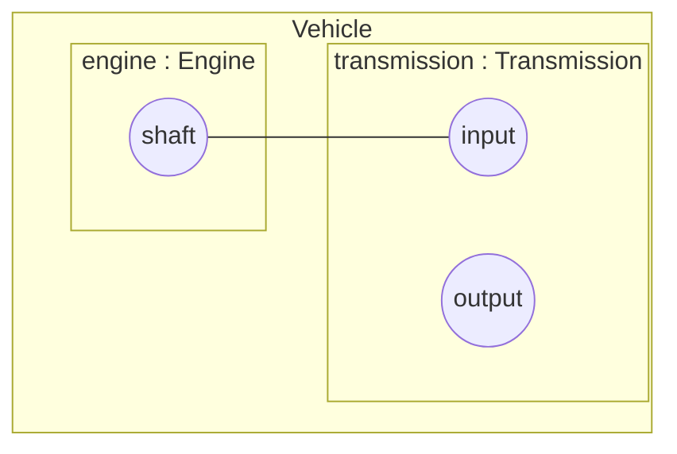

```python
from sysmlv2 import ConnectionUsage
v = ...   # PartDefinition
v.own(ConnectionUsage(name="drivetrain", ends=[engine_shaft, trans_input]))
```

GUI: select a Part, switch Diagram tab to **IBD**.

---

## 8. Requirements with subject / stakeholders / actors

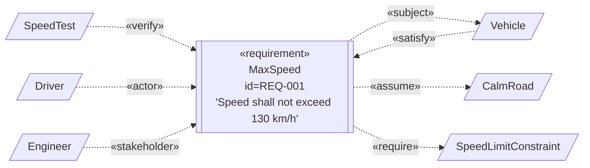

```python
from engine import create_link
from sysmlv2 import RequirementDefinition, VerificationCaseDefinition

req = RequirementDefinition(name="MaxSpeed", req_id="REQ-001",
                            text="Speed shall not exceed 130 km/h.")
project.own(req)
create_link("subject",     req, vehicle)
create_link("satisfy",     vehicle, req)
create_link("verify",      VerificationCaseDefinition(name="SpeedTest"), req)
create_link("actor",       req, driver)
create_link("stakeholder", req, engineer)
```

The **15 link kinds**, all addressable by name:

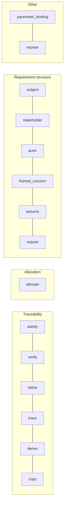

GUI: **Links** menu → Create link… (Ctrl+L). MCP: `sysml_link kind=… source=… target=…`.

---

## 9. Parameters on actions / calculations / constraints

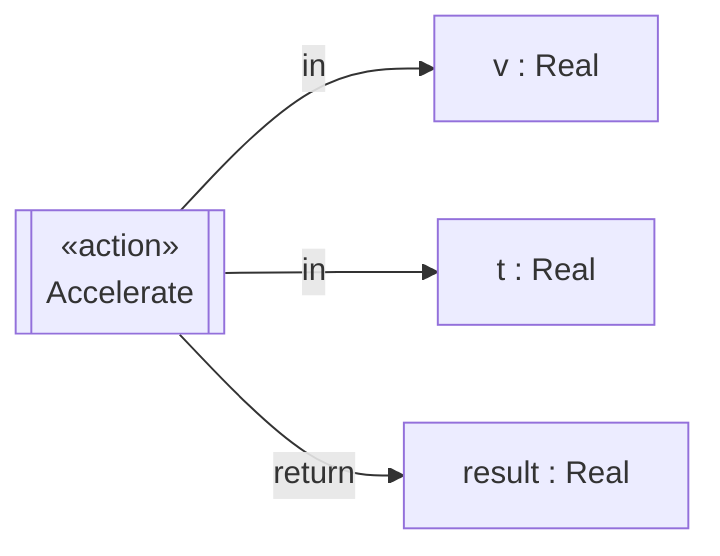

```python
from sysmlv2 import ActionDefinition, AttributeDefinition, ParameterUsage
Real = AttributeDefinition(name="Real")
accel = ActionDefinition(name="Accelerate")
accel.own(ParameterUsage(name="v",      parameter_kind="in",     typed_by=Real))
accel.own(ParameterUsage(name="t",      parameter_kind="in",     typed_by=Real))
accel.own(ParameterUsage(name="result", parameter_kind="return", typed_by=Real))
```

`parameter_kind` is `in`, `out`, `inout`, or `return`. MCP: `sysml_add_parameter`.

---

## 10. State machines — one per Part (or many)

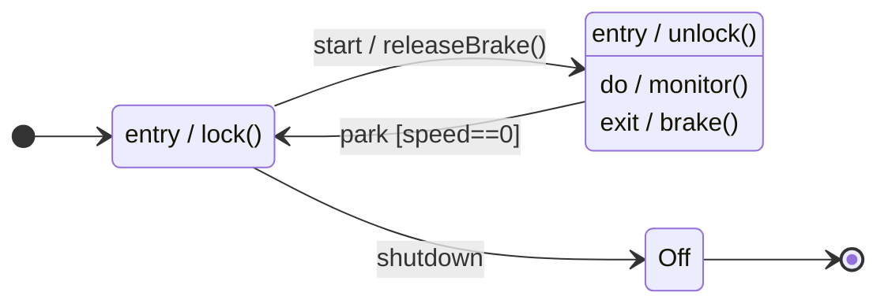

```python
sm = vehicle.attach_state_machine("VehicleSM")
parked  = sm.add_state("Parked",  entry="lock()", is_initial=True)
driving = sm.add_state("Driving", entry="unlock()", do="monitor()", exit="brake()")
off     = sm.add_state("Off", is_final=True)
sm.add_transition(parked,  driving, trigger="start", effect="releaseBrake()")
sm.add_transition(driving, parked,  trigger="park",  guard=lambda c: c.get("speed", 0) == 0)
sm.add_transition(parked,  off,     trigger="shutdown")

r = sm.runner()
r.fire("start")          # → Driving
r.fire("park", speed=10) # guard blocks → stays Driving
r.fire("park", speed=0)  # → Parked
r.fire("shutdown")       # → Off (final)
```

**Runtime sequence inside `fire("park", speed=0)`:**

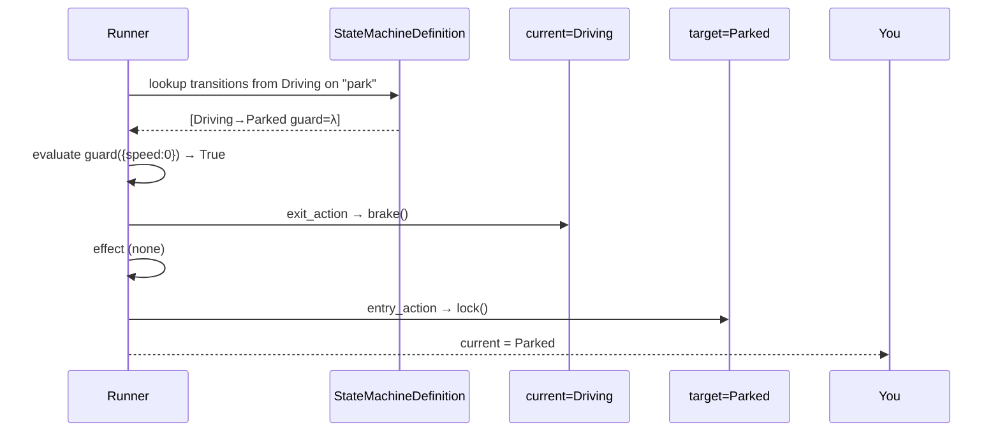

GUI: **StateMachine** menu (Attach, Add state, Add transition, Fire event Ctrl+E, Reset).
MCP: `sysml_attach_state_machine`, `sysml_add_state`, `sysml_add_transition`, `sysml_fire_event`, `sysml_state_machine_status`, `sysml_reset_state_machine`.

---

## 11. Custom stereotypes (your own profile, in 4 lines)

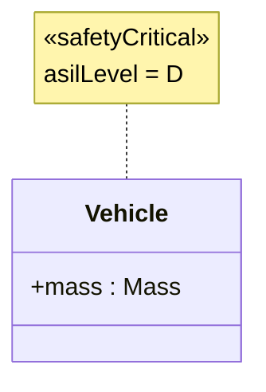

```python
from kerml.stereotypes import Stereotype
from sysmlv2 import PartDefinition

safety = Stereotype(name="safetyCritical", applies_to=[PartDefinition])
safety.define_tag("asilLevel", default="QM")
project.own(safety)

safety.apply(vehicle, {"asilLevel": "D"})   # validated at apply time
```

Stereotypes round-trip through JSON, appear in every diagram, and serialize to the knowledge-graph as `:stereotype` edges with tag values.

---

## 12. Validation

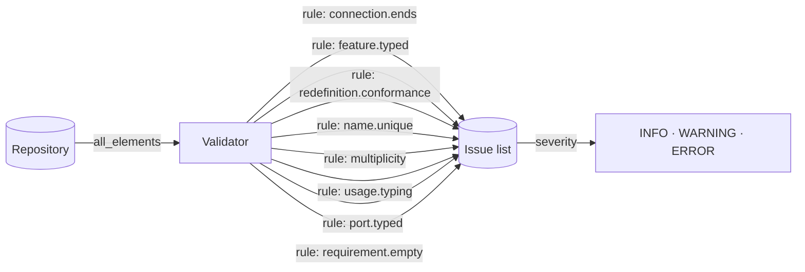

Every message names its element (`Port 'airData' has no interface ...`). `feature.typed`
only reports plain KerML features: a SysML usage without a definition (an inline
component, a connector, an inline function, a port without an interface) is implicitly
typed by its library definition, as in System Composer, so it is not a modelling gap.
Ports without an interface are reported once, by `port.typed`.

```bash
python -m engine.cli examples/vehicle.sysml          # validates by default
```

GUI: **F5** or Model → Validate. MCP: `sysml_validate`.

---

## 13. Knowledge graph export

Export the entire project as a graph any KG tool can ingest.

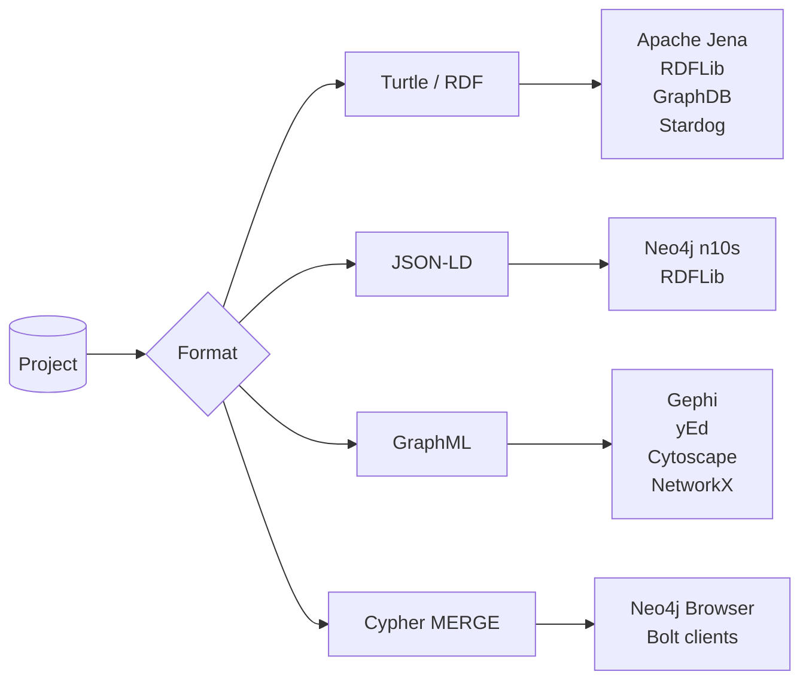

```python
from engine import export_knowledge_graph
print(export_knowledge_graph(repo.root_package, "turtle")[:200])
```

GUI: **Export** menu → Knowledge graph: turtle / json-ld / graphml / cypher.
MCP: `sysml_export_graph format="turtle"`.

Every node is `:Kind` with `name`, `qualified_name`, etc. Every link is
a typed edge — `owns`, `specializes`, `subsets`, `redefines`,
`typedBy`, `satisfies`, `verifies`, `refines`, `traces`,
`derivesFrom`, `connects`, `imports`, `stereotype`, ... — so SPARQL,
Cypher, Gremlin queries all work.

Example Cypher (after loading the export):

```cypher
// Every part that satisfies a 'safety' requirement
MATCH (p:PartDefinition)-[:SATISFIES]->(r:RequirementDefinition)
WHERE r.text CONTAINS "safety"
RETURN p.name, r.req_id, r.text;
```

---

## 14. MCP — drive everything from an AI agent

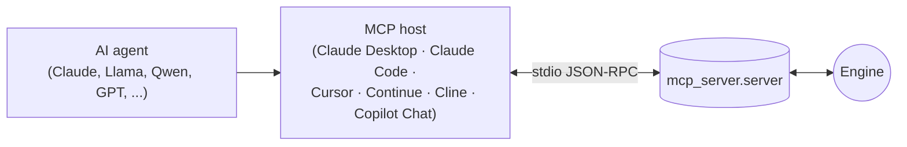

The server speaks the MCP 2024-11-05 protocol over stdio (stdlib only,
zero deps). It exposes **30+ tools** across these families:

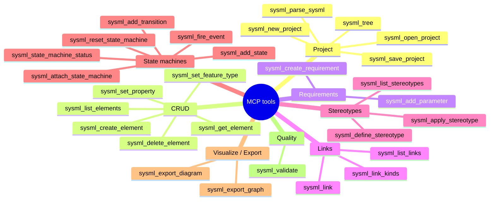

Wire-up (workspace-level, bundled in `.vscode/mcp.json`):

```jsonc
{ "servers": { "sysmlv2-core": {
  "type": "stdio",
  "command": "python", "args": ["-m", "mcp_server.server"],
  "cwd": "${workspaceFolder}",
  "env": { "PYTHONPATH": "${workspaceFolder}" }
}}}
```

See [LOCAL_LLM_VSCODE.md](LOCAL_LLM_VSCODE.md) for Ollama + Continue / Cline / Copilot Chat setup.

---

## 15. End-to-end example — "Design and verify a vehicle"

```mermaid
sequenceDiagram
    actor Eng as Engineer
    participant LLM as AI agent (local Llama / Claude)
    participant MCP as MCP server
    participant E as Engine

    Eng->>LLM: "Make me a SysML v2 model of an EV with a battery, an electric motor,<br/>a state machine for the powertrain, a max-range requirement, and tests."
    LLM->>MCP: sysml_new_project name="EV"
    LLM->>MCP: sysml_create_element kind=PartDefinition name=Vehicle
    LLM->>MCP: sysml_create_element kind=PartDefinition name=Battery, parent=Vehicle
    LLM->>MCP: sysml_create_element kind=PartDefinition name=Motor,   parent=Vehicle
    LLM->>MCP: sysml_link kind=allocate source=Motor target=Vehicle
    LLM->>MCP: sysml_attach_state_machine part=Vehicle name=PowertrainSM
    LLM->>MCP: sysml_add_state state_machine=PowertrainSM name=Off, is_initial=true
    LLM->>MCP: sysml_add_state state_machine=PowertrainSM name=Drive
    LLM->>MCP: sysml_add_transition state_machine=PowertrainSM source=Off target=Drive, trigger=keyOn
    LLM->>MCP: sysml_create_requirement name=MaxRange req_id=REQ-1 text="At least 400 km", subject=Vehicle
    LLM->>MCP: sysml_link kind=satisfy source=Vehicle target=MaxRange
    LLM->>MCP: sysml_validate
    LLM->>MCP: sysml_export_diagram kind=bdd
    LLM->>MCP: sysml_export_graph format=turtle
    MCP-->>LLM: { issue_count: 0, dot: "...", turtle: "..." }
    LLM-->>Eng: "Here's the BDD, the requirements graph, and the state machine. Saved."
```

That's the loop: human → LLM → MCP → engine → diagrams / KG → human.
Every step above is also reachable from the GUI menus and the Python
API.

---

## 16. Cheat sheet

The *GUI / Web* column names the desktop GUI's menus. In the web studio the
generic element, link, stereotype and state-machine commands are under
**Advanced ▾** (chapter 3a); the System Composer workflow is indexed in
chapter 4a and summarized in the last rows.

| Task                            | Python                                   | GUI / Web                    | MCP tool                       |
|---------------------------------|------------------------------------------|------------------------------|--------------------------------|
| Launch UI                       | —                                        | `python -m gui.app` / `python -m webapp.server` | —                          |
| New project                     | `Repository("X")`                        | File ▸ New / header *New*    | `sysml_new_project`            |
| Open / Save JSON                | `Repository.load/save`                   | File ▸ Open/Save             | `sysml_open_project / save`    |
| Parse `.sysml`                  | `engine.parse(src, into=...)`            | File ▸ Import .sysml         | `sysml_parse_sysml`            |
| Add element                     | `Repository.add(cls(name=…))`            | Toolbar ▸ Kind               | `sysml_create_element`         |
| Type a feature                  | `f.add_type(t)`                          | Properties ▸ Typed by        | `sysml_set_feature_type`       |
| Add parameter                   | `act.own(ParameterUsage(...))`           | Links ▸ Add parameter        | `sysml_add_parameter`          |
| Connect ports                   | `ConnectionUsage(ends=[a,b])`            | Toolbar ▸ Connection         | `sysml_connect`                |
| Create typed link               | `engine.create_link("satisfy",a,b)`      | Links ▸ Create link (Ctrl+L) | `sysml_link`                   |
| Create requirement              | `RequirementDefinition(...)`             | Links ▸ New requirement      | `sysml_create_requirement`     |
| Define stereotype               | `Stereotype("x"); project.own(s)`        | Stereotypes ▸ Define         | `sysml_define_stereotype`      |
| Apply stereotype                | `s.apply(target, {…})`                   | Stereotypes ▸ Apply          | `sysml_apply_stereotype`       |
| Attach state machine            | `part.attach_state_machine("SM")`        | StateMachine ▸ Attach        | `sysml_attach_state_machine`   |
| Add state / transition          | `sm.add_state(...)`/ `add_transition`    | StateMachine ▸ Add …         | `sysml_add_state/_transition`  |
| Fire event                      | `sm.runner().fire("e", …)`               | StateMachine ▸ Fire (Ctrl+E) | `sysml_fire_event`              |
| Validate                        | `Validator().validate(repo)`             | Model ▸ Validate (F5)        | `sysml_validate`               |
| Export DOT                      | `engine.bdd/ibd/state_machine/...`       | Diagram ▸ Export DOT…        | `sysml_export_diagram`         |
| Export knowledge graph          | `export_knowledge_graph(root, "turtle")` | Export ▸ Knowledge graph     | `sysml_export_graph`           |
| Draw an architecture ([doc](features/architecture.md)) | `engine.architecture`     | Web: tab *Architecture*      | `sysml_new_architecture`, `sysml_add_component`, `sysml_connect_ports` |
| Interfaces, bus templates ([doc](features/interfaces.md)) | `engine.interfaces`    | Web: *Interface Editor* (Alt+I) | `sysml_create_interface`, `sysml_assign_interface` |
| Profiles, stereotype values ([doc](features/profiles.md)) | `engine.profiles`      | Web: *Profile Editor*, tab *Properties* | `sysml_add_stereotype`, `sysml_set_stereotype_property` |
| Requirements, trace links ([doc](features/requirements.md)) | `engine.requirements` | Web: *Requirements*, *Req Perspective* | `sysml_add_requirement`, `sysml_link_requirement` |
| Allocation ([doc](features/allocation.md)) | `engine.allocation`                     | Web: *Allocation*            | `sysml_create_allocation_set`, `sysml_allocate` |
| Model Check, report, tables ([doc](features/interop.md)) | `engine.interop`         | Web: *Model Check*, *Import / Export* | `sysml_model_check`, `sysml_generate_report` |
| Undo / redo                     | `engine.undo`                            | Web: *Undo / Redo*, Ctrl+Z / Ctrl+Y | `sysml_undo` / `sysml_redo` |
