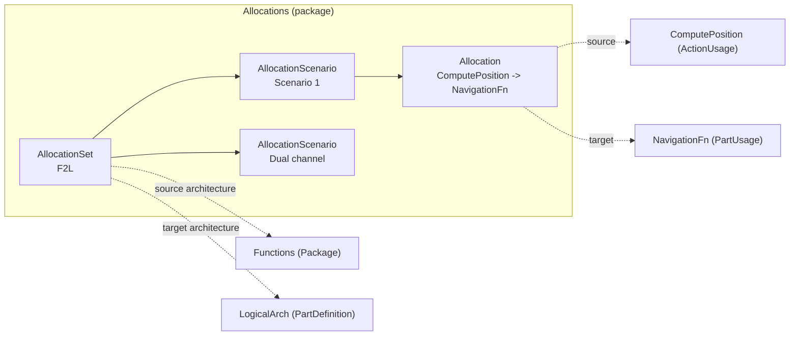
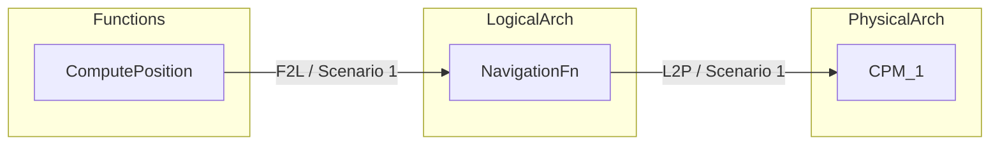

# Allocation Editor

The Allocation Editor maps the elements of one architecture onto another, the
way MATLAB System Composer's Allocation Editor does: functions onto logical
components, logical components onto LRUs / IMA modules, software partitions
onto processing modules, logical buses onto physical networks. In an avionics
programme this is the ARP4754A "function to item" and "item to hardware"
allocation that later feeds mass, power and latency budgets.

Files: `engine/allocation.py` (model, queries, persistence, validation),
`webapp/routes/allocation.py` (HTTP API), `webapp/static/plugins/50-allocation.js`
(Allocation tab + inspector section), `mcp_server/tools/allocation.py` (MCP tools).

## Concepts

| Term | Model element | Notes |
|------|---------------|-------|
| Allocation set | `AllocationSet` (kind `AllocationSet`) in the project package `Allocations` | name, description (= its documentation), source architecture, target architecture, *require complete coverage* flag |
| Scenario | `AllocationScenario` owned by a set | alternative allocations of the same two architectures; a set always keeps at least one (default `Scenario 1`) |
| Allocation | `ArchitectureAllocation` (kind `Allocation`) owned by a scenario | `source` -> `target`; at most one per (source, target) pair in a scenario; an ordinary element (documentation, stereotypes, `tool_data`) |
| Architecture | a `PartDefinition` (System Composer architecture model) or a `Package` | a package works well for a functional architecture made of actions |
| Allocatable element | component (`PartUsage`, `PartDefinition` inside a package), port (`PortUsage`), connector (`ConnectionUsage`), function (an action that is not a state, transition or calculation, or any kind whose name contains `Function`) | requirements, attributes, states and the like are refused |



Allocations hold their ends by object, so renaming a component shows up in
the matrix, the tree badges and every query at once. Deleting an element (or
anything that contains it) deletes its allocations; deleting an architecture
keeps the set but flags it in validation until you pick another architecture.

## Using the editor

Open the **Allocation** tab. The toolstrip runs along the top; the allocation
set browser is on the left, the allocation matrix in the centre and the
Properties / Coverage / Chain panel on the right.

### Create an allocation set

1. Click **New Set** (toolstrip, or the button in the empty editor).
2. Enter a name, choose the **source** and **target** architectures (every
   top-level `PartDefinition` and every package of the project is listed),
   optionally rename the first scenario, add a description and tick
   **Require complete coverage**.
3. Click **Create**. The set appears in the browser with its first scenario
   open in the matrix.

To change a set later, use the **Allocation set** card in the Properties panel
(name, source, target, description, coverage flag, then **Apply**). Changing
an architecture that existing allocations use asks for confirmation and
deletes the allocations that no longer fit.

### Manage scenarios

| Task | How |
|------|-----|
| New scenario | **New Scenario** (named `Scenario N` by default) |
| Duplicate (with allocations, descriptions and stereotypes) | select a scenario, **Duplicate** |
| Rename | **Rename**, double-click the item, or **F2** in the browser; also the **Scenario** card |
| Delete set / scenario | select it, **Delete** or the **Delete** key; confirm in the dialog (the last scenario of a set cannot be deleted) |
| Switch scenario | click it in the browser, or select it in the containment tree |

The browser is keyboard friendly: arrow keys move between items, Enter opens
one, F2 renames, Delete deletes.

### Allocate

Rows are the source architecture's elements and columns the target
architecture's, both in model hierarchy order (indented; click the ▾ twisty of
a row to collapse its children).

* **Click an empty cell** to allocate the row element to the column element;
  **click an allocated cell** (purple square) to deallocate.
* **Alt+click** (or Ctrl+click) an allocated cell to select it without
  changing it.
* With a cell focused: arrow keys move, **Space**/**Enter** toggle,
  **Delete** deallocates, **Escape** clears the selection.
* The Σ column and the *Per target* row count allocations per element.

Every new allocation is selected: the **Allocation** card shows its source,
target, scenario, stereotypes and description, with **Save description**,
**Deallocate** and **Inspector ▸** (opens the generic Properties inspector on
the allocation, where stereotypes are applied and their values edited).

### Filter the matrix

| Filter | Where |
|--------|-------|
| Element kinds per axis (Components, Ports, Connectors, Functions) | **Element kinds** chips, *Rows* and *Columns* |
| Allocated only / unallocated only (rows and columns separately) | **Show** drop-downs |
| Name filter | *Filter rows…* / *Filter columns…* above the matrix |
| Reset everything | **Clear filters** |

Parents of the elements that pass the filters stay visible in grey italics so
the hierarchy remains readable; their cells are not clickable.

### Stereotypes on allocations

Define a stereotype that applies to allocations: with the profiles editor
choose *applies to: Allocation*, or with **Define stereotype…** enter
`Allocation` as the applies-to kind. Then select an allocation (Alt+click its
cell), click **Inspector ▸** and apply the stereotype there. Applied
stereotypes are listed on the Allocation card, copied by **Duplicate** and
exported in the CSV.

### Coverage, chain and navigation

* **Coverage** (toolstrip or panel tab): percentage of source elements that
  are allocated (leaf elements of the row kinds, untick *leaf elements only*
  for all), the list of unallocated sources (click one to select its row) and
  a bar per target element with its allocation count.
* **Chain**: for the selected row, column or allocation, follows allocations
  through every set (function -> logical component -> LRU, and back) and draws
  the path as a Mermaid flowchart grouped by architecture, with the steps
  listed below it.
* Clicking a **row or column header** selects that element in the whole
  studio, tints its allocated counterparts and emits
  `highlight {ids, color: "#8b5cf6", reason: "allocation"}` for the canvas.
* **Show** (toolstrip) / **Show in architecture** emits `navigate {id}` and
  switches to the architecture canvas when one is installed (otherwise to the
  Properties tab).
* Every component, port, connector and function gets an **Allocations**
  section in the Properties inspector listing what it is allocated to / from
  (with set and scenario) and an **Open in Allocation Editor** button.
* **Export** downloads the scenario's allocations as CSV (set, scenario,
  source, target, kinds, qualified names, stereotypes, description).

Allocations, sets and scenarios also appear in the containment tree
(`Allocations` package) with badges such as `NavigationFn → CPM_1`.

### Validation

**Validate** (F5) reports:

| Rule | Severity | Meaning |
|------|----------|---------|
| `allocation.coverage` | warning | a leaf source component is not allocated in a scenario of a set marked *require complete coverage* (reported on the component) |
| `allocation.set.source` / `allocation.set.target` | error | the set has no source / target architecture (e.g. it was deleted) |
| `allocation.set.scenarios` | warning | the set has no scenario |
| `allocation.ends` | error | an allocation lost its source or target |
| `allocation.duplicate` | error | the same pair is allocated twice in a scenario |
| `allocation.scope` | error | an end is not part of the set's architecture |
| `allocation.owner` | error | an allocation is not owned by a scenario of a set |

The editing APIs refuse these situations up front with clear messages
(HTTP 400/404/409, MCP `ok: false`).

## Multi-level allocation



Create one set per level (for example `F2L`: Functions -> LogicalArch and
`L2P`: LogicalArch -> PhysicalArch). The chain view and
`allocation_chain(element)` follow allocations across every scenario of every
set, forwards from the element and backwards to it.

## HTTP API

References are element ids or qualified names (URL-encode them in paths).
Where a scenario is expected, a set reference selects its first scenario.

| Method | Path | Body / query | Result |
|--------|------|--------------|--------|
| GET | `/api/allocation/architectures` | | candidate architectures |
| GET | `/api/allocation/sets` | | sets with scenarios and allocation counts |
| POST | `/api/allocation/sets` | `{name, source, target, description?, require_complete_coverage?, scenario?}` | set |
| GET | `/api/allocation/sets/<set>` | | set |
| PATCH | `/api/allocation/sets/<set>` | `{name?, description?, source?, target?, require_complete_coverage?, force?}` | set (409 without `force` when allocations would be dropped) |
| DELETE | `/api/allocation/sets/<set>` | | `{deleted}` |
| POST | `/api/allocation/sets/<set>/scenarios` | `{name?}` | scenario |
| POST | `/api/allocation/scenarios` | `{set, name?}` | scenario |
| PATCH | `/api/allocation/scenarios/<scenario>` | `{name?, description?}` | scenario |
| DELETE | `/api/allocation/scenarios/<scenario>` | | `{deleted}` (409 for the last one) |
| POST | `/api/allocation/scenarios/<scenario>/duplicate` | `{name?}` | scenario |
| POST | `/api/allocation/allocate` | `{scenario, source, target}` | allocation |
| POST | `/api/allocation/deallocate` | `{scenario, source, target}` or `{allocation}` | confirmation |
| POST | `/api/allocation/toggle` | `{scenario, source, target}` | `{allocated, allocation}` |
| GET | `/api/allocation/scenarios/<scenario>/matrix` | `rows`, `cols` (kinds, comma separated), `show`, `col_show` (`all`/`allocated`/`unallocated`), `q`, `col_q` | `{set, scenario, rows, columns, allocations}` |
| GET | `/api/allocation/scenarios/<scenario>/allocations` | | allocations |
| GET | `/api/allocation/scenarios/<scenario>/coverage` | `kinds`, `leaves` (1/0) | coverage report |
| GET | `/api/allocation/scenarios/<scenario>/map` | | `{target_id: [source_id, ...]}` |
| GET | `/api/allocation/allocated_to/<element>` | `scenario?` | target elements |
| GET | `/api/allocation/allocated_from/<element>` | `scenario?` | source elements |
| GET | `/api/allocation/element/<element>` | `scenario?` | `{category, to: [...], from: [...]}` |
| GET | `/api/allocation/chain/<element>` | `direction` (`LR`/`TB`) | `{nodes, edges, mermaid}` |

Generic endpoints also work: `GET /api/element/<allocation>` includes an
`allocation` object and a badge; `PATCH /api/element/<scenario or set>` with
`name` goes through the same uniqueness checks; `DELETE /api/element/<id>`
cascades to allocations; `/api/save` and `/api/load` persist everything;
`/api/export/<format>` contains `allocatedTo` edges.

## MCP tools

| Tool | Arguments |
|------|-----------|
| `sysml_list_allocation_sets` | |
| `sysml_create_allocation_set` | `name, source, target, description?, require_complete_coverage?, scenario?` |
| `sysml_update_allocation_set` | `set, name?, description?, source?, target?, require_complete_coverage?, force?` |
| `sysml_delete_allocation_set` | `set` |
| `sysml_create_allocation_scenario` | `set, name?` |
| `sysml_rename_allocation_scenario` | `scenario, name` |
| `sysml_duplicate_allocation_scenario` | `scenario, name?` |
| `sysml_delete_allocation_scenario` | `scenario` |
| `sysml_allocate` / `sysml_deallocate` | `scenario, source, target` |
| `sysml_allocated_to` / `sysml_allocated_from` | `element, scenario?` |
| `sysml_allocation_coverage` | `scenario, kinds?, leaves_only?` |
| `sysml_allocation_matrix` | `scenario, rows?, cols?, show?, text?` |
| `sysml_allocation_map` | `scenario` |
| `sysml_allocation_chain` | `element, direction?` |

Example: `sysml_allocate {"scenario": "Allocations::L2P::Scenario 1",
"source": "LogicalArch::FMS::NavigationFn", "target": "PhysicalArch::IMA_1::CPM_1"}`.

## Python API

```python
from engine import Repository
from engine import allocation as A

s = A.create_allocation_set(repo, "L2P", logical, physical, require_complete_coverage=True)
sc = s.scenarios[0]                                # "Scenario 1"
A.allocate(repo, sc, nav_fn, cpm1)                 # AllocationError on bad input
alt = A.duplicate_scenario(repo, sc, "Dual CPM")
A.allocated_to(nav_fn)                             # every scenario of the project
A.allocated_from(cpm1, sc)                         # one scenario
A.coverage(sc)["unallocated"]
A.matrix(sc, rows="component,port", show="unallocated")
A.allocation_chain(compute_position)["mermaid"]
```

`AllocationError` subclasses `ValueError` and carries an HTTP-style `status`
(400 invalid, 404 not found, 409 conflict).

### Analysis contract

```python
A.allocation_map(scenario) -> {target_id: [source_id, ...]}
```

For every target element with at least one allocation, the ids of the source
elements allocated to it, in allocation order and without duplicates. The
analysis feature uses it for resource budgets: for example the processing
load of each CPM is the sum of the `load` property of the partitions
allocated to it, and the mass of each LRU the sum over its allocated
components. Targets with nothing allocated are absent.

## Persistence and integration

* Sets, scenarios and allocations are model elements saved by class path; the
  serializer codec `allocation` stores the architecture / end references and
  the coverage flag. Stereotype applications, documentation and `tool_data`
  persist like on any element.
* `engine.register_removal_hook` deletes allocations whose source or target is
  removed; every creation path calls `engine.notify_created`.
* Knowledge graph: `allocatedTo` edges (source -> target, with `set`,
  `scenario` and `allocation` properties) in every export format.
* Element JSON (web API and MCP): allocations carry `allocation` and a badge
  `source → target`; sets carry `allocation_set` and a `source → target` badge;
  scenarios a `N alloc` badge; allocatable elements an `allocation_category`.
* `Allocation` is registered as a creatable kind so stereotypes can be limited
  to allocations with `applies_to: ["Allocation"]`.

## System Composer parity

| Feature id | Status | Notes |
|------------|--------|-------|
| allocation-set-model | closed | named sets with description, source and target architecture, several per project |
| allocation-scenarios | closed | default *Scenario 1*; create, rename, duplicate, delete (last one protected) |
| allocation-object | closed | first-class `Allocation` element, one per pair per scenario, stereotypes, documentation |
| allocatable-element-kinds | closed | components, ports, connectors, functions; other kinds refused with a message |
| allocation-matrix | closed | hierarchical rows/columns, click to allocate/deallocate, counts per row and column |
| allocation-editor-layout | closed | toolstrip, set/scenario browser, matrix, properties panel |
| matrix-filters | closed | kinds per axis, allocated/unallocated per axis, name filters, collapse, clear |
| allocation-queries | closed | `allocated_to`, `allocated_from`, `allocations`, HTTP + MCP |
| synchronize-changes | closed | live references (renames), removal hook (deletions), validator for deleted architectures |
| multi-level-allocation-chain | closed | chain across all sets with Mermaid view |
| allocation-coverage-analysis | closed | coverage report + `allocation.coverage` warning for sets requiring complete coverage |
| allocation-based-analysis | closed | `allocation_map(scenario)` contract |
| model-navigation | closed | highlight event, Show in architecture, inspector section, tree selection sync |
| allocation-export | closed (extra) | CSV export of a scenario |
| allocation-set-files | deferred | System Composer stores sets in separate `.mldatx` files referencing separate model files; here sets live in the single project JSON (single-project prototype) |
| canvas-allocation-gestures | deferred | allocating by dragging between components on the architecture canvas belongs to the canvas feature; it can call `POST /api/allocation/allocate` |
| default-allocation-stereotype | deferred | System Composer can stamp a default stereotype on new allocations; profiles' created hook can do this once it supports allocations |
| variant-aware-allocation | deferred | allocations to variant choices are not filtered by the active variant (variants feature not built yet) |
| undo-redo | deferred | allocation edits are not on an undo stack in this branch; the architecture feature owns undo |

## Known limitations

* The profiles feature matches the *Allocation* stereotype category by kinds
  starting with `Allocation`, which also includes `AllocationSet` and
  `AllocationScenario`; stereotypes meant for allocations could therefore be
  offered for sets and scenarios too.
* `Allocation` is also creatable through the generic `POST /api/element` /
  `sysml_create_element` (needed for the core *Define stereotype* applies-to
  list); such an allocation has no ends and is reported by `allocation.ends`.
* Reference components share their definition's internals: an element inside
  a reused definition appears under every usage and its allocation shows in
  every such row.
* Column hierarchy is shown by indentation dots only; only rows collapse.
