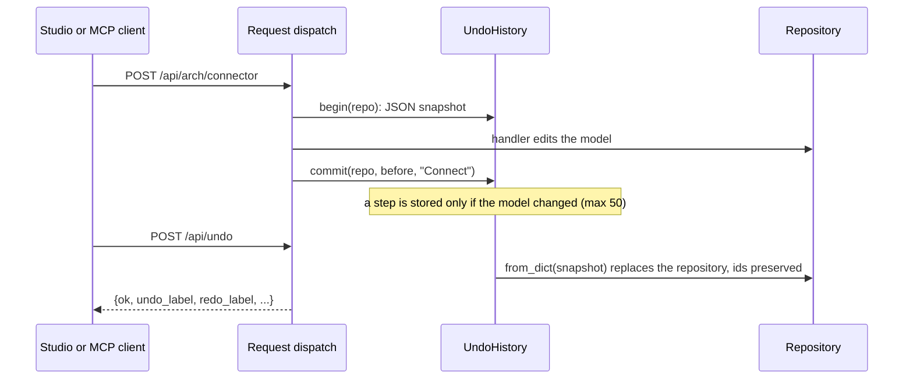

# Architecture modeling (System Composer style)

Build the logical and physical architecture of a system — for example an
avionics suite of LRUs, IMA modules, sensors and displays — as components with
directional ports, connected by validated connectors, nested to any depth,
reusable as reference components, and undoable at every step.

| Layer | File |
|-------|------|
| Metamodel additions | `sysmlv2/definitions.py` (`PortUsage.port_kind`, `ConnectionUsage.end_contexts`) |
| Shared structure reading | `engine/structure.py` (`connector_ends`, `context_of`, `is_component`) |
| Engine (editing, rules, layout, view model, codecs) | `engine/architecture.py` |
| Undo / redo history | `engine/undo.py` |
| Parser / IBD fixes | `engine/parser.py`, `engine/diagram.py`, `engine/diagram_mermaid.py` |
| HTTP API | `webapp/routes/architecture.py`, `webapp/routes/undo.py` |
| Studio UI | `webapp/static/plugins/10-canvas.js` + `webapp/static/plugins/canvas/*.js` |
| MCP tools | `mcp_server/tools/architecture.py` |
| Tests | `tests/test_architecture*.py`, `tests/ui/scenarios/10_canvas_architecture.mjs` |

## Concepts

System Composer terms map onto SysML v2 as follows (the cross-feature contract
in `docs/EXTENDING.md`):

| System Composer | SysML v2 element | Notes |
|-----------------|------------------|-------|
| Model type | project setting `model_type` | `system` (default): data + physical ports. `software`: data + client/server ports |
| Architecture | `PartDefinition` | the root composition; any part definition can be opened |
| Component | `PartUsage` inside an architecture/component | *inline* when untyped, *reference* when typed by a `PartDefinition` |
| Reference component | `PartUsage` typed by a `PartDefinition` | ports and internals live on the definition and are shared by every usage |
| Port | `PortUsage` | `direction` in / out / inout; `port_kind` data / physical / client / server; interface = its type |
| Boundary port | a port of the composition you are looking inside | an *input* boundary port feeds the inside, an *output* one is fed from the inside |
| Connector | `ConnectionUsage` owned by the composition | `ends[0]` = source port, `ends[1]` = target port, `end_contexts[i]` = the sub-component the port is reached through (None = boundary port) |


`end_contexts` is what tells two usages of one definition port apart: `s1.val`
and `s2.val` are the same `PortUsage` (owned by the `Sensor` definition)
reached through different components. It is persisted by the `arch.connector`
codec; connectors saved without it get their contexts inferred from ownership.
Deleting a component also deletes the connectors that reached it through
`end_contexts`.

### Connection rules (checked on every edit and by the validator)

| Rule | Where | Validator rule id |
|------|-------|-------------------|
| Data flows from an output (or an input boundary port seen from inside) to an input (or an output boundary port seen from inside); inout works both ways. Drawn backwards, the connector is turned around automatically | 400 | `arch.connector.direction` |
| An input has at most one incoming data connector; outputs may branch (fan-out) | 409 | `arch.port.multiple-drivers` |
| Physical ports connect only to physical ports and are non-directional | 400 | `arch.connector.kind` |
| Client ports connect to server ports (roles flip on boundary ports); the client is stored first | 400 | `arch.connector.kind` |
| No connector from a port to itself | 400 | `arch.connector.self` |
| Both ends belong to the composition or to its direct sub-components (deeper ends are reached through new boundary ports, see cross-hierarchy) | 400 | `arch.connector.scope` |
| The same two ends cannot be connected twice | 409 | – |
| Port kinds must be allowed by the model type | 400 | `arch.port.kind` |
| A usage's own port may not reuse a name of its definition's ports | – | `arch.port.unique` |
| Both ends typed by unrelated interfaces | allowed | `arch.connector.interface` (warning) |

Names of components and ports are unique among their siblings: new ones are
auto-numbered (`Component`, `Component1`, …; ports `In`, `Out`, `Conn`,
`Client`, `Server`), and renames to a taken name are refused (409 on the
architecture API, 400 on the generic `PATCH /api/element`). Names may not
contain `::`, `.`, tabs or line breaks.

## Using the studio

The plugin adds three things to the studio; the graphical canvas editor builds
on the same API.

**Toolstrip**

- *Model: New model…* — project name, architecture type (System or Software)
  and the name of the root architecture. *Model: System / Software* shows the
  current type; click it to switch (refused while ports use kinds the new type
  does not allow, unless you tick the override).
- *Edit: ↶ Undo / ↷ Redo* — undo any model change, including edits made by
  other features; the tooltip names the step. Keyboard: **Ctrl+Z**, **Ctrl+Y**
  or **Ctrl+Shift+Z** (outside text fields). Up to 50 steps; *New* and
  *Load JSON* start a fresh history.

**Architecture inspector** (Properties tab, shown for an architecture or a
component selected in the tree)

| Task | How |
|------|-----|
| Drill down / up | *Open* on a component row; breadcrumbs at the top go back up |
| Add a component | *+ Component*; leave the name empty for auto-numbering, pick a part definition under *Reference* for a reference component |
| Rename a component | edit its name in the Components table and press Tab/Enter |
| Add a port (boundary port of what you are looking at) | *+ Port*: name, direction, kind, interface; on a reference component the port goes to the shared definition unless *Only on this component* is ticked |
| Change a port | edit name / direction / kind / interface in the Ports table, or select the port in the tree; changes that would break connectors are refused |
| Connect | *Connect…*, pick the two ends (boundary ports and the sub-components' ports are listed); direction is fixed automatically |
| Delete | × on a port or connector row; *Delete* / *Delete selected* for components (a confirmation dialog; undo with Ctrl+Z) |
| Duplicate / copy | *Duplicate* (this component) or tick rows and *Duplicate selected*: deep copy with new names; connectors between the copied components come along |
| Create component from selection | tick rows, *Group selected…* |
| Expand (decompose) | *Expand* on an inline component with children |
| Save as reference / inline | *Save as reference…* on an inline component; *Inline* on a reference component |
| Arrange | *Arrange*: left-to-right layers following the data flow |

Selecting a port or connector in the tree shows its own editor (direction,
kind, interface; endpoints, kind, problems, delete). Broken connectors are
listed with their problem in red. The IBD in the Diagram tab draws the
selected composition with boundary ports on the frame.

## HTTP API

Ids may be element ids or qualified names. Errors answer `{"error": message}`
with 400 (invalid), 404 (unknown element) or 409 (conflict).

| Method | Path | Body / query | Result |
|--------|------|--------------|--------|
| POST | `/api/new` | `{name, type?: "system"\|"software"}` | new project |
| GET | `/api/arch/model-type` | | `{type, allowed_port_kinds, types, port_kinds}` |
| POST | `/api/arch/model-type` | `{type, force?}` | same; 409 when ports conflict |
| GET | `/api/arch/roots` | | `{roots, definitions, model_type}` |
| POST | `/api/arch/architecture` | `{name?, package?}` | element summary |
| GET | `/api/arch/view/<composition>` | `?path=id,id,...` (drill path) | view model (below) |
| GET | `/api/arch/tree/<composition>` | | model-browser tree with ports and drill paths |
| GET | `/api/arch/can-connect` | `?composition&source_component&source_port&target_component&target_port` | `{ok, reason, kind, swapped}` (no change) |
| POST | `/api/arch/component` | `{composition, name?, definition?, layout?}` | component view |
| PATCH | `/api/arch/component/<id>` | `{name?, definition?: id\|null}` | component view |
| POST | `/api/arch/port` | `{owner, name?, direction?, kind?, interface?, usage_only?, side?, offset?}` | port view |
| PATCH | `/api/arch/port/<id>` | `{name?, direction?, kind?, interface?: id\|null, force?}` | port view |
| POST | `/api/arch/connector` | `{composition, source: {component?, port}, target: {component?, port}, name?}` | connector view |
| PATCH | `/api/arch/connector/<id>` | `{name?, points?: [[x, y], ...] \| null}` | connector view |
| POST | `/api/arch/delete` | `{ids}` | `{deleted}` (one undo step) |
| POST | `/api/arch/duplicate` | `{ids, target?, offset?: [dx, dy]}` | `{components}` |
| POST | `/api/arch/group` | `{composition, component_ids, name?}` | the new component |
| POST | `/api/arch/expand` | `{component}` | `{components}` (moved ids) |
| POST | `/api/arch/save-as-reference` | `{component, name?, package?}` | `{definition, component}` |
| POST | `/api/arch/inline` | `{component}` | component view |
| POST | `/api/arch/auto-layout` | `{composition}` | `{positions: {id: {x, y, w, h}}}` |
| POST | `/api/arch/layout` | `{items: [{id, x, y, w?, h?} \| {id, side, offset} \| {id, points}]}` | `{updated}` (validated before anything is written) |
| POST | `/api/undo`, `/api/redo` | | `{ok, reason?, can_undo, can_redo, undo_label, redo_label, undo_depth, redo_depth, limit}` |
| GET | `/api/undo/state` | | the same state |

A port endpoint's `port` is a port id, a qualified name, or the port's name
on that component (`{"component": "<id>", "port": "airData"}`); omit
`component` for a boundary port of the composition. A `component` deeper in
the hierarchy is reached by adding boundary ports on each component in between
(cross-hierarchy connection; refused through reference components).

Element JSON (`GET /api/element/<id>`) gains `badges` (`ref`/`inline`,
`leaf`/`composite`, `SM` for components; direction and kind for ports),
`port_kind` for ports and `end_contexts` for connectors; the generic
`PATCH /api/element/<id>` accepts `{"props": {"port_kind": "physical"}}`
(validated against the model type).

### View model (`GET /api/arch/view/<id>`)

```json
{
  "model_type": "system", "allowed_port_kinds": ["data", "physical"],
  "composition": {"id": "...", "name": "FMS", "kind": "PartUsage", "definition": null,
                  "is_reference": false, "edit_owner_id": "...", "shared_by": 0,
                  "breadcrumbs": [{"id": "...", "name": "AircraftSystem", "kind": "PartDefinition"},
                                  {"id": "...", "name": "FMS", "kind": "PartUsage"}],
                  "badges": ["inline", "composite"], "style": {}, "stereotypes": []},
  "boundary_ports": [{"id": "...", "name": "air", "direction": "in", "kind": "data",
                      "interface": {"id": "...", "name": "AirData"}, "side": "left", "offset": 0.5,
                      "on_definition": false, "badges": ["in"], "style": {}, "stereotypes": []}],
  "components": [{"id": "...", "name": "Guidance", "definition": null, "is_reference": false,
                  "layout": {"x": 160, "y": 60, "w": 160, "h": 90}, "has_children": false,
                  "has_state_machine": false, "from_definition": false,
                  "ports": [{"id": "...", "name": "air", "side": "left", "offset": 0.5, "...": "..."}],
                  "badges": ["inline", "leaf"], "style": {}, "stereotypes": []}],
  "connectors": [{"id": "...", "name": "Connector", "label": "AirData", "kind": "data",
                  "source": {"component_id": null, "port_id": "..."},
                  "target": {"component_id": "...", "port_id": "..."},
                  "interfaces": ["AirData"], "points": null, "issues": []}]
}
```

Components without a stored layout get a deterministic grid position; ports
without one go inputs left, outputs right (clients right, servers and physical
ports left), evenly spaced. `badges` / `style` / `stereotypes` come from the
element summaries, so profiles and other features decorate the canvas too.

### Undo / redo



`webapp.core.register_mutation_hook(fn)` runs `fn(method, path, body)` before
every non-GET request; `webapp/routes/undo.py` uses it, so every feature's
edits are undoable without extra code. Failed requests and read-only POSTs
leave no step. Undo replaces the session repository (`Session.set_repo`), so
plugin runtime state in `session().plugin_state` is reset; the history itself
is kept.

## MCP tools

| Tool | Purpose |
|------|---------|
| `sysml_set_model_type` | `type` system/software, `force` |
| `sysml_new_architecture` | root architecture (`name`, `package`) |
| `sysml_add_component` | `composition`, `name?`, `definition?` (reference) |
| `sysml_rename_element` | unique rename |
| `sysml_add_port` | `owner`, `name?`, `direction`, `kind`, `interface?`, `usage_only?` |
| `sysml_update_port` | `port`, `name?`, `direction?`, `kind?`, `interface?`, `clear_interface?`, `force?` |
| `sysml_connect_ports` | `composition`, `source_component?`, `source_port`, `target_component?`, `target_port`, `name?` (same rules as the web API) |
| `sysml_arrange` | auto-layout |
| `sysml_group` / `sysml_expand` | create component from selection / its inverse |
| `sysml_save_as_reference` / `sysml_inline_component` | reference components |
| `sysml_duplicate` | deep copy, optional `target` composition |
| `sysml_delete_elements` | batch delete as one step |
| `sysml_arch_view` / `sysml_arch_tree` | view model / model browser |
| `sysml_undo` / `sysml_redo` | history (each architecture tool is one step; edits made by core tools in between are undone as one step of their own) |

Example (an agent building an air-data chain):

```json
{"name": "sysml_new_architecture", "arguments": {"name": "AircraftSystem"}}
{"name": "sysml_add_component", "arguments": {"composition": "AircraftSystem", "name": "ADC"}}
{"name": "sysml_add_port", "arguments": {"owner": "AircraftSystem::ADC", "name": "airData", "direction": "out"}}
{"name": "sysml_connect_ports", "arguments": {"composition": "AircraftSystem", "source_component": "AircraftSystem::ADC",
  "source_port": "airData", "target_component": "AircraftSystem::FMS", "target_port": "air"}}
```

## Python API

```python
from engine import Repository
from engine import architecture as A
from engine.undo import tracked, undo

repo = Repository("Avionics")
A.set_model_type(repo, "system")
root = A.create_architecture(repo, "AircraftSystem")
adc = A.add_component(repo, root, "ADC")
fms = A.add_component(repo, root, "FMS")
A.add_port(repo, adc, "airData", "out")
A.add_port(repo, fms, "air", "in")
A.add_port(repo, root, "pwr28V", kind="physical")          # boundary port
A.connect(repo, root, {"component": adc, "port": "airData"}, {"component": fms, "port": "air"})
nav = A.group(repo, root, [fms], "NavUnit")                # create component from selection
NavDef = A.save_as_reference(repo, nav)                     # reusable PartDefinition
A.auto_layout(repo, root)
view = A.view(repo, root)                                   # canvas view model
```

Other functions: `rename`, `set_definition`, `update_port`, `delete_elements`,
`duplicate`, `expand`, `inline_component`, `apply_layout`, `can_connect`,
`classify`, `connector_problems`, `component_badges`, `model_tree`,
`architecture_roots`. All raise `ArchitectureError` (with `.status`) before
changing anything. `engine.undo.UndoHistory` / `tracked(session, label)` give
any front end the same undo history.

### Textual notation

The parser reads directions, nested inline components and connectors inside
part definitions; types may be declared later in the file:

```sysml
package Avionics {
    part def AircraftSystem {
        in port pitot : AirData;
        part adc : ADC;
        part fms { in port air : AirData; out port route; }
        connect pitot to adc.pitot;
        connect adc.airData to fms.air;
    }
    part def ADC { in port pitot : AirData; out port airData : AirData; }
    port def AirData;
}
```

## System Composer parity

| Feature id | Status | Notes |
|------------|--------|-------|
| architecture-model-types | closed | `system` / `software` per project, persisted; `POST /api/new {type}`; allowed port kinds per type; *Function* elements are out of scope |
| component-blocks | closed | create / rename / delete with unique sibling names and auto-numbering; deep duplicate and copy-paste (`duplicate` with `target`); badges `ref` / `inline` / `leaf` / `composite` / `SM` |
| directional-ports | closed | in / out / inout plus port kind data / physical / client / server; unique names; parser `in port` / `out port` / `inout port` and `connect a.b to c.d` in part defs |
| architecture-boundary-ports | closed | a composition's ports are its boundary ports when viewed from inside; added from the inspector or `POST /api/arch/port`; reference definition ports appear on every usage |
| draw-connectors | closed (API + inspector) | dialog-based connecting with automatic orientation and `can-connect` feedback; drawing by dragging on the canvas comes with the canvas editor |
| connector-branching | closed | outputs fan out; an input accepts one driver |
| cross-hierarchy-connections | closed | ends deeper in inline components get boundary ports created level by level (reused when already routed); refused through reference components |
| physical-ports-connectors | closed | physical ↔ physical only, non-directional, drawn undirected in the IBD |
| drill-down-breadcrumbs | closed (API + inspector) | view model with breadcrumbs, honouring the drill path through reference components |
| model-browser | closed (API) | `GET /api/arch/tree/<id>`; in the studio the containment tree plus the inspector serve as browser until the canvas pane lands |
| create-component-from-selection | closed | `group` with boundary ports per crossing connector (shared for fan-out / one source); inverse `expand` |
| reference-components | closed | save as reference (new `PartDefinition` in the model's package) and inline (this usage only); retyping re-attaches connectors by port name |
| auto-layout | closed | layered left to right by connector direction, cycle-safe; ports re-spread inputs left / outputs right |
| layout persistence | closed | `tool_data.layout` (components), `tool_data.port_layout` (ports), `tool_data.points` (connectors); batch API |
| undo-redo | closed | every web mutation (any feature), 50 steps, cleared on new/load; MCP tools too |
| IBD diagram fixes | closed | edges attach to the drawn port nodes of typed parts; boundary ports on the frame |
| graphical canvas editing (drag/resize, drag-to-connect, rubber band, zoom) | deferred | built next on this branch by the canvas engineer on top of the view model and layout API |
| connector routing editor | deferred | points are stored and returned; interactive routing belongs to the canvas |
| adapters / bus element mapping | deferred | belongs to the interfaces feature |
| variant components | deferred | belongs to the variants feature |
| software *Function* elements | deferred | out of scope by assignment |
