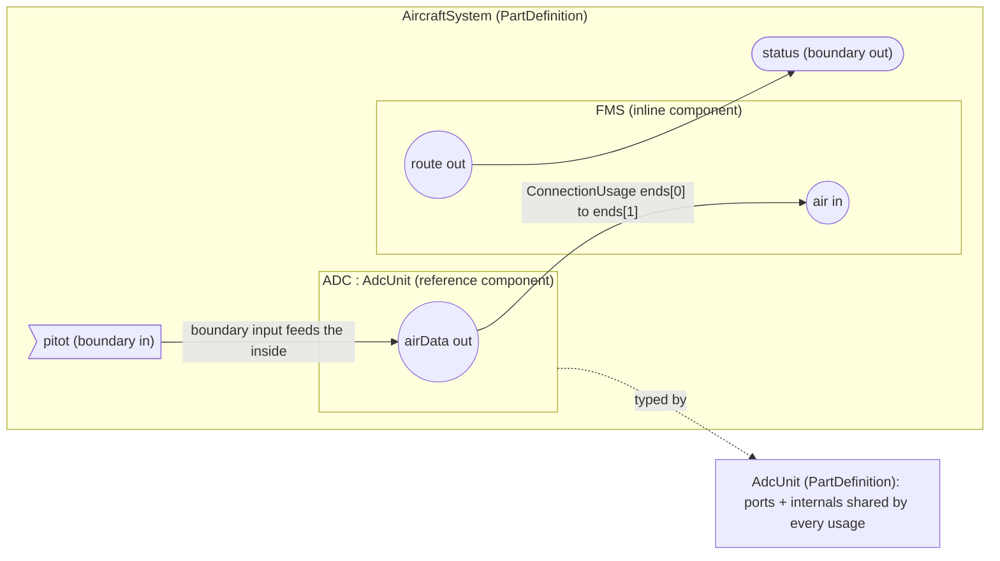
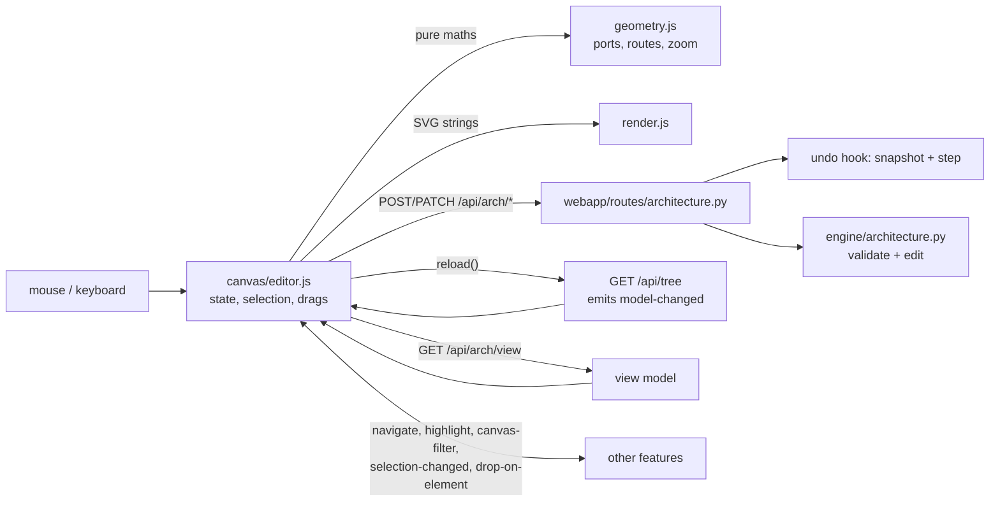
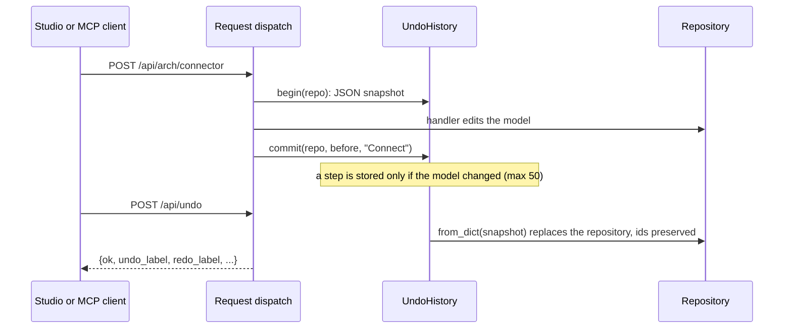

# Architecture modeling (System Composer style)

Build the logical and physical architecture of a system — for example an
avionics suite of LRUs, IMA modules, sensors and displays — on an interactive
canvas: components with directional ports, connected by validated connectors,
nested to any depth, reusable as reference components, and undoable at every
step. The same operations are available over HTTP, as MCP tools and in Python.

| Layer | File |
|-------|------|
| Metamodel additions | `sysmlv2/definitions.py` (`PortUsage.port_kind`, `ConnectionUsage.end_contexts`) |
| Shared structure reading | `engine/structure.py` (`connector_ends`, `context_of`, `is_component`) |
| Engine (editing, rules, layout, view model, codecs) | `engine/architecture.py` |
| Undo / redo history | `engine/undo.py` |
| Parser / IBD fixes | `engine/parser.py`, `engine/diagram.py`, `engine/diagram_mermaid.py` |
| HTTP API | `webapp/routes/architecture.py`, `webapp/routes/undo.py` |
| Canvas (Architecture tab) | `webapp/static/plugins/10-canvas.js` → `canvas/editor.js` (controller), `geometry.js` (routing, placement, zoom maths), `render.js` (SVG), `toolstrip.js`, `dock.js` (Property Inspector), `ui.js` (toasts, menu, inline editor), `styles.js` |
| Other studio pieces | `canvas/undo.js` (Undo / Redo), `canvas/model.js` (New model, model type), `canvas/inspector.js` (Properties-tab tables), `canvas/common.js` (shared clipboard, helpers) |
| MCP tools | `mcp_server/tools/architecture.py` |
| Tests | `tests/test_architecture*.py`, `tests/ui/10_canvas_geometry.test.mjs` (node unit tests), `tests/ui/scenarios/10_canvas_*.mjs` (browser) |

Core files touched (small, additive): `webapp/core.py` (`register_mutation_hook`
/ `begin_mutation` for undo snapshots), `webapp/server.py` (dispatch calls
`begin_mutation` for non-GET requests; `api_new` accepts `type`; `api_parse`
passes `repo=` so parsed elements reach `notify_created`), `mcp_server/server.py`
(`sysml_parse` passes `repo=` for the same reason), `docs/EXTENDING.md`
(the `drop-on-element` event and the drag data type), `webapp/static/app.js`
(`studio.dialog` instead of `window.prompt` / `confirm`, `registerUnsavedCheck` with
warnings on New / Load, `project-changed` / `project-saved` events) and
`webapp/static/styles.css` (`btn-danger`).

## Concepts

System Composer terms map onto SysML v2 as follows (the cross-feature contract
in `docs/EXTENDING.md`):

| System Composer | SysML v2 element | Notes |
|-----------------|------------------|-------|
| Model type | project setting `model_type` | `system` (default): data + physical ports. `software`: data + client/server ports |
| Architecture | `PartDefinition` | the root composition; any part definition can be opened |
| Component | `PartUsage` inside an architecture/component | *inline* when untyped, *reference* when typed by a `PartDefinition` |
| Reference component | `PartUsage` typed by a `PartDefinition` | ports and internals live on the definition and are shared by every usage |
| Port | `PortUsage` | `direction` in / out / inout; `port_kind` data / physical / client / server; interface = its type |
| Boundary port | a port of the composition you are looking inside | an *input* boundary port feeds the inside, an *output* one is fed from the inside |
| Connector | `ConnectionUsage` owned by the composition | `ends[0]` = source port, `ends[1]` = target port, `end_contexts[i]` = the sub-component the port is reached through (None = boundary port) |



`end_contexts` is what tells two usages of one definition port apart: `s1.val`
and `s2.val` are the same `PortUsage` (owned by the `Sensor` definition)
reached through different components. It is persisted by the `arch.connector`
codec; connectors saved without it get their contexts inferred from ownership.
Deleting a component also deletes the connectors that reached it through
`end_contexts`.

### Connection rules (checked on every edit and by the validator)

| Rule | Where | Validator rule id |
|------|-------|-------------------|
| Data flows from an output (or an input boundary port seen from inside) to an input (or an output boundary port seen from inside); inout works both ways. Drawn backwards, the connector is turned around automatically | 400 | `arch.connector.direction` |
| An input has at most one incoming data connector; outputs may branch (fan-out) | 409 | `arch.port.multiple-drivers` |
| Physical ports connect only to physical ports and are non-directional | 400 | `arch.connector.kind` |
| Client ports connect to server ports (roles flip on boundary ports); the client is stored first | 400 | `arch.connector.kind` |
| No connector from a port to itself | 400 | `arch.connector.self` |
| Both ends belong to the composition or to its direct sub-components (deeper ends are reached through new boundary ports, see cross-hierarchy) | 400 | `arch.connector.scope` |
| The same two ends cannot be connected twice | 409 | – |
| Port kinds must be allowed by the model type | 400 | `arch.port.kind` |
| A usage's own port may not reuse a name of its definition's ports | – | `arch.port.unique` |
| Both ends typed by unrelated interfaces | allowed | `arch.connector.interface` (warning) |

Names of components and ports are unique among their siblings: new ones are
auto-numbered (`Component`, `Component1`, …; ports `In`, `Out`, `Conn`,
`Client`, `Server`), and renames to a taken name are refused (409 on the
architecture API, 400 on the generic `PATCH /api/element`). Names may not
contain `::`, `.`, tabs or line breaks.

## Using the canvas (Architecture tab)

The **Architecture** tab is the first tab and the one shown at start-up. It
opens the architecture you last viewed (else the first one with components).

```
┌ toolstrip: Component | Port | Connect | Edit | Layout | View ────────────────┐
│ breadcrumbs  AircraftSystem › FMS        [banners]          Open [▾ arch]    │
├──────────────────────────────────────────────────────────┬───────────────────┤
│  canvas: frame with boundary ports, blocks, connectors   │ Property          │
│  (grid, pan, zoom)                                       │ Inspector (dock)  │
│  status: counts · zoom · hint                            │                   │
└──────────────────────────────────────────────────────────┴───────────────────┘
```

| Task | How |
|------|-----|
| Start an architecture | With no architecture the canvas offers **New architecture**; type its name in place. Another one (a functional, logical or physical architecture for allocation sets): **＋ New architecture** next to *Open ▾*, the *＋ New architecture…* entry at the end of *Open ▾*, or right-click the background → *New architecture…*. An empty frame appears with a unique suggested name; Enter creates and opens it (one undo step; a taken name is refused and can be corrected), Escape returns to the previous view. *Model: New model…* in the studio toolstrip starts a new System or Software project |
| Open another architecture or definition | **Open ▾** at the right of the breadcrumb bar; or click it in the containment tree (the canvas follows the tree) |
| Add a component | **Component** (toolstrip; placed at a free spot in view), or right-click the background → *Add Component here*; type the name, Enter (Escape keeps `Component`, `Component1`, …) |
| Add a reference component | Drag a part definition from the containment tree onto the canvas background |
| Assign an interface to a port | Drag an interface from the **Interfaces** tab's list (hold it over the **Architecture** tab to switch to the canvas) or from the containment tree, and drop it on the port; the port and its connectors take the interface colour and the connector label shows the name |
| Link a requirement | Drag a requirement (Requirements editor grip, Requirements Perspective dock row) onto a block or another canvas element (see docs/features/requirements.md) |
| Rename | Double-click a name (block, port label, connector label, frame title) or select and press **F2**; Enter commits, Escape cancels. A taken name is refused with a message |
| Add a port | Select one or more blocks, then **In / Out / InOut / Physical** (**Client / Server** in a Software model); or right-click a block → *Add port*; or the **+ In / + Out …** buttons of the Property Inspector |
| Add a boundary port | **Boundary ▾** (port on the frame of what you are viewing), or right-click the background → *Boundary port* (placed on the nearest frame edge) |
| Connect | Drag from a port to another port. While dragging, valid targets turn green and invalid ones fade (hover one to read why in the status line); releasing on an invalid one shows the server's reason in a red toast and changes nothing. Data connectors are turned around automatically when drawn from input to output |
| Connect to a new port | Release the drag on a block (a matching port is created on its nearest edge: an input for an output, same interface) or on the frame edge (a new boundary port) |
| Connect by clicking | **Connect** mode: click a source port, then a target port / block / frame edge; Esc leaves the mode. Right-click a port → *Start connection here* does the same |
| Select | Click; **Shift/Ctrl+click** adds or removes; drag on the background draws a selection box; **Ctrl+A** selects all components. The selection is the studio's (`studio.setSelection`) so the Properties-tab tables tick the same rows |
| Move | Drag selected blocks (snapped to a 10 px grid, **Alt** to place freely) or nudge with the arrow keys (**Shift** = 1 px). Saved when you drop |
| Resize | Drag the bottom-right corner of a block. *Auto size* (context menu or Inspector) returns to the automatic size that grows with the ports |
| Move a port along the border | **Shift+drag** (or Alt+drag) the port to any edge; or right-click → *Side*; or the Inspector's *Side* |
| Route a connector | Select it, drag the square handles on its middle segments; right-click → *Reset route* returns to automatic routing (which avoids other blocks) |
| Drill down / up | Double-click a block (or select it and press **Enter**) to open it: an inline component's inside, or the shared definition of a reference component. Breadcrumbs, the ⬆ button or **Alt+↑** go back |
| Create component from selection | Select blocks → **Group** (Ctrl+G); crossing connectors are routed through new ports; name it in place. **Expand** is the inverse |
| Reference components | **Save as Ref** (asks for the definition name) / **Inline** on the selected component. To reuse a type for a second channel (FCC-L / FCC-R), pick it as the component's **Reference** in the Property Inspector: the component's own ports that the definition also has (same name) are merged into the definition's ports and their connectors, inside and outside, stay connected (the log names the merged ports; one undo step). Own ports with other names stay as usage-only ports (dashed name field in the Inspector) |
| Copy / paste / duplicate | **Copy** (Ctrl+C), **Paste** (Ctrl+V, into the composition being viewed; context menu *Paste inside* targets a block), **Duplicate** (Ctrl+D). Copies are deep (ports, internals, stereotypes) with fresh names |
| Delete | **Delete** / Backspace, the toolstrip or the context menu (no confirmation: undo with Ctrl+Z) |
| Undo / redo | **Undo / Redo** in the canvas toolstrip (tooltips name the step) or Ctrl+Z / Ctrl+Y |
| Arrange | **Arrange**: left-to-right layers following the data flow, then fit to view. Cycles (bidirectional A429 / AFDX links) are broken with as few backward connectors as possible, so they never create one layer per block; big networks wrap their layers into bands (like lines of text, at most ⌈√n⌉ + 2 layers side by side) shaped for the canvas, so 30 LRUs with 90 connectors fit a 1400 × 900 window at about 40 % zoom. Small diagrams keep one row |
| Zoom and pan | Mouse wheel (around the pointer), **− / 100% / +**, **Fit** (or tap **Space**); pan by dragging with **Space** held, the middle button or the **Pan** hand tool |
| Inspect and edit properties | The **Inspector** dock edits the selection: a component's name, reference, ports (name, direction, kind), size; a port's name, direction, kind, interface (SysML definitions and the interface dictionary's interfaces and value types), side; a connector's name, ends, interfaces, problems, route; or, with nothing selected, the composition's summary. *Properties tab ↗* opens the full studio inspector |
| Context menu | Right-click anything, or **Shift+F10** / the Menu key for the selection; arrow keys move in the menu |

### Keyboard (canvas focused)

| Keys | Action |
|------|--------|
| Delete / Backspace | delete the selection |
| Ctrl+C / Ctrl+V / Ctrl+D | copy / paste / duplicate components |
| Ctrl+A / Ctrl+G | select all components / group the selection |
| Ctrl+Z / Ctrl+Y (Ctrl+Shift+Z) | undo / redo (studio shortcuts) |
| F2 / Enter / Alt+↑ | rename / open the selected component / up one level |
| Arrow keys (Shift) | nudge selected blocks by 10 px (1 px) |
| + / − / 0 / Space | zoom in / out / 100% / fit (hold Space and drag to pan) |
| Escape | cancel a drag or connection, leave Connect/Pan mode, clear the selection |
| Shift+F10 / Menu | context menu |

### What you see

| Element | Drawing |
|---------|---------|
| Frame | the composition being viewed with its name, stereotypes and kind (architecture, inline component, or `: Definition — shared by n`); its own ports sit on its edges as boundary ports, labels outside |
| Component | rounded block: «stereotypes» above the bold name, `: Definition` below it for a reference component plus a link marker bottom-left, a hierarchy marker top-right when it has sub-components, other badges (e.g. `SM`, profile badges) as pills; fill / stroke / text colour / dash / short icon from the element summary `style` |
| Port | glyph on the block edge: input = hollow arrow pointing in, output = filled arrow pointing out, inout = double arrow, physical = diamond, client = circle, server = square; coloured by its interface (`style.stroke` from profiles/interfaces, else a stable colour per interface name); name inside the block |
| Connector | orthogonal elbow line; data with an arrowhead, physical thicker without one, client/server dashed; label = interface name(s), prefixed by a user-given name (`airBus : AirData`); invalid stored connectors are red and dashed with the problem as tooltip |

### Working with other features

| Contract (docs/EXTENDING.md) | Canvas behaviour |
|------------------------------|------------------|
| `navigate {id}` | opens the composition that shows the element and selects it (`GET /api/arch/locate/<id>`) |
| `select` (tree) | selects the element when it is on the canvas; otherwise a component, port, connector or part definition is revealed in its composition |
| `highlight {ids, color, reason}` / `null` | glow in that colour on listed components, ports and connectors; banner with the reason and a clear button |
| `canvas-filter {ids, label, hide?}` / `null` | other components (and connectors to them) are dimmed, or hidden with *hide others*; banner with the label, count and a clear button that emits `canvas-filter null` |
| `selection-changed` | both ways: canvas selection → `studio.setSelection` (+ `selectElement` for the primary element); another feature's selection is shown on the canvas |
| `model-changed` | the current view is reloaded (falls back to another architecture when it was deleted) |
| HTML5 drop of `application/x-sysml-element` | on a block, port or connector: `studio.emit("drop-on-element", {dragged_id, target_id})` — the canvas only reports it: the requirements feature links a dropped requirement, the interfaces feature assigns an interface dropped on a port; a part definition on the background: new reference component; anything else on the background: `drop-on-element` with the composition as target. Containment-tree rows are draggable. Holding such a drag over the **Architecture** tab for 300 ms opens the canvas (spring-loaded tab), so drags can start in another tab (Interface Editor, Requirements editor) |

### Studio toolstrip and Properties tab

- *Model: New model…* — project name, architecture type (System or Software)
  and the name of the root architecture. *Model: System / Software* shows the
  current type; click it to switch (refused while ports use kinds the new type
  does not allow, unless you tick the override).
- *Edit: ↶ Undo / ↷ Redo* — undo any model change, including edits made by
  other features. Up to 50 steps; *New* and *Load JSON* start a fresh history.
- Unsaved changes: every recorded change, undo or redo since the last *Save JSON*
  (or *New* / *Load JSON*) makes the project dirty (`dirty` in the undo state). Header
  *New*, *Load JSON…* and *Model: New model…* then show a styled warning before
  replacing the project; *Save JSON* clears it. The studio uses styled dialogs only
  (no `window.prompt` / `confirm`), including the core *Add* buttons and element delete.
- After *New* or *Load JSON* the canvas fits the opened architecture (zoom remembered
  for the old project's compositions is dropped, even when a reloaded file reuses ids).
- The **Architecture** section of the Properties tab shows the same
  composition as tables (components, boundary ports, connectors) with the same
  operations — handy for keyboard-only editing and bulk renames.

## How the canvas works



- Every edit is a request to the architecture API (so it is validated, undoable
  and visible to MCP clients); the canvas then reloads the tree, which emits
  `model-changed`, and redraws from the new view model. Requests that are
  expected to fail are not sent: connections are checked first with
  `GET /api/arch/connect-targets` (one call per drag, all ports of the view)
  and names against the view.
- While dragging, only the moved blocks' transforms and their connectors' paths
  are updated (requestAnimationFrame); a model change arriving mid-drag is
  applied after the drop.
- The frame is fitted around the components (min 520 × 320); connectors use
  orthogonal routes with stubs out of the ports, bending in the free channel
  closest to the middle so they do not run under other blocks; manual routes
  are kept as `points`.
- Measured with 60 components and 200 connectors (`10_canvas_perf.mjs`,
  headless Chromium): full redraw about 30–40 ms, dragging a block with 24
  connectors under 1 ms of work per frame.

## HTTP API

Ids may be element ids or qualified names. Errors answer `{"error": message}`
with 400 (invalid), 404 (unknown element) or 409 (conflict).

| Method | Path | Body / query | Result |
|--------|------|--------------|--------|
| POST | `/api/new` | `{name, type?: "system"\|"software"}` | new project |
| GET | `/api/arch/model-type` | | `{type, allowed_port_kinds, types, port_kinds}` |
| POST | `/api/arch/model-type` | `{type, force?}` | same; 409 when ports conflict |
| GET | `/api/arch/roots` | | `{roots, definitions, model_type}` |
| POST | `/api/arch/architecture` | `{name?, package?}` | element summary |
| GET | `/api/arch/view/<composition>` | `?path=id,id,...` (drill path) | view model (below) |
| GET | `/api/arch/tree/<composition>` | | model-browser tree with ports and drill paths |
| GET | `/api/arch/can-connect` | `?composition&source_component&source_port&target_component&target_port` | `{ok, reason, kind, swapped}` (no change) |
| GET | `/api/arch/connect-targets` | `?composition&source_component&source_port` | `{source, targets: [{component_id, port_id, ok, reason, kind, swapped}]}` for every other port of the view (no change) |
| GET | `/api/arch/locate/<id>` | | `{composition, select}`: where the canvas shows an element (nulls when it is not in an architecture) |
| POST | `/api/arch/component` | `{composition, name?, definition?, layout?}` | component view |
| PATCH | `/api/arch/component/<id>` | `{name?, definition?: id\|null}` | component view + `merged_ports` (names of the component's own ports merged into the new definition's same-named ports, their connectors re-attached) |
| POST | `/api/arch/port` | `{owner, name?, direction?, kind?, interface?, usage_only?, side?, offset?}` | port view |
| PATCH | `/api/arch/port/<id>` | `{name?, direction?, kind?, interface?: id\|null, force?}` | port view |
| POST | `/api/arch/connector` | `{composition, source: {component?, port}, target: {component?, port}, name?}`; one end may instead be `{component?, new_port: true \| {name?, side?, offset?}}` | connector view (+ `created_port` for a new port) |
| PATCH | `/api/arch/connector/<id>` | `{name?, points?: [[x, y], ...] \| null}` | connector view |
| POST | `/api/arch/delete` | `{ids}` | `{deleted}` (one undo step) |
| POST | `/api/arch/duplicate` | `{ids, target?, offset?: [dx, dy]}` | `{components}` |
| POST | `/api/arch/group` | `{composition, component_ids, name?}` | the new component |
| POST | `/api/arch/expand` | `{component}` | `{components}` (moved ids) |
| POST | `/api/arch/save-as-reference` | `{component, name?, package?}` | `{definition, component}` |
| POST | `/api/arch/inline` | `{component}` | component view |
| POST | `/api/arch/auto-layout` | `{composition, view?: {w, h}}` (`view` = canvas size in screen px; default 870 × 480) | `{positions: {id: {x, y, w, h}}}` (only positions are stored; user-set sizes are kept; deterministic) |
| POST | `/api/arch/layout` | `{items: [{id, x, y, w?, h?} \| {id, side, offset} \| {id, points}]}` | `{updated}` (validated before anything is written; a move keeps a size set earlier, `w`/`h` null return to the automatic size) |
| POST | `/api/undo`, `/api/redo` | | `{ok, reason?, dirty, revision, can_undo, can_redo, undo_label, redo_label, undo_depth, redo_depth, limit}` |
| GET | `/api/undo/state` | | the same state (`dirty`: changed since the last save, new or load) |
| POST | `/api/undo/saved` | | marks the current model as saved (`dirty` false); the studio calls it after *Save JSON* |

A port endpoint's `port` is a port id, a qualified name, or the port's name
on that component (`{"component": "<id>", "port": "airData"}`); omit
`component` for a boundary port of the composition. A `component` deeper in
the hierarchy is reached by adding boundary ports on each component in between
(cross-hierarchy connection; refused through reference components). A
`new_port` end creates the port on that direct sub-component (on its
definition for a reference component) or, without `component`, a boundary
port; it mirrors the other end's kind and interface with the opposite role and
nothing is created when the connection is refused.

Element JSON (`GET /api/element/<id>`) gains `badges` (`ref`/`inline`,
`leaf`/`composite`, `SM` for components; direction and kind for ports),
`port_kind` for ports and `end_contexts` for connectors; the generic
`PATCH /api/element/<id>` accepts `{"props": {"port_kind": "physical"}}`
(validated against the model type).

### View model (`GET /api/arch/view/<id>`)

```json
{
  "model_type": "system", "allowed_port_kinds": ["data", "physical"],
  "composition": {"id": "...", "name": "FMS", "kind": "PartUsage", "definition": null,
                  "is_reference": false, "edit_owner_id": "...", "shared_by": 0,
                  "breadcrumbs": [{"id": "...", "name": "AircraftSystem", "kind": "PartDefinition"},
                                  {"id": "...", "name": "FMS", "kind": "PartUsage"}],
                  "badges": ["inline", "composite"], "style": {}, "stereotypes": []},
  "boundary_ports": [{"id": "...", "name": "air", "direction": "in", "kind": "data",
                      "interface": {"id": "...", "name": "AirData"}, "side": "left", "offset": 0.5,
                      "on_definition": false, "badges": ["in"], "style": {}, "stereotypes": []}],
  "components": [{"id": "...", "name": "Guidance", "definition": null, "is_reference": false,
                  "layout": {"x": 160, "y": 60, "w": 160, "h": 90}, "sized": false, "has_children": false,
                  "has_state_machine": false, "from_definition": false,
                  "ports": [{"id": "...", "name": "air", "side": "left", "offset": 0.5, "...": "..."}],
                  "badges": ["inline", "leaf"], "style": {}, "stereotypes": []}],
  "connectors": [{"id": "...", "name": "Connector", "label": "AirData", "kind": "data",
                  "source": {"component_id": null, "port_id": "..."},
                  "target": {"component_id": "...", "port_id": "..."},
                  "interfaces": ["AirData"], "points": null, "issues": []}]
}
```

A connector's `label` is what System Composer draws on the line: its interface
name(s), prefixed SysML-style by a name you gave it (`airBus : AirData`);
auto-generated names (`Connector1`, `connect_a_b`) are not drawn. The IBD in
the Diagram tab uses the same label (`engine.architecture.connector_label`).
`sized` tells whether the user resized the block.

Components without a stored layout get a deterministic grid position; ports
without one go inputs left, outputs right (clients right, servers and physical
ports left), evenly spaced. `badges` / `style` / `stereotypes` come from the
element summaries, so profiles and other features decorate the canvas too.

### Undo / redo



`webapp.core.register_mutation_hook(fn)` runs `fn(method, path, body)` before
every non-GET request; `webapp/routes/undo.py` uses it, so every feature's
edits are undoable without extra code. Failed requests and read-only POSTs
leave no step. Undo replaces the session repository (`Session.set_repo`), so
plugin runtime state in `session().plugin_state` is reset; the history itself
is kept.

## MCP tools

| Tool | Purpose |
|------|---------|
| `sysml_set_model_type` | `type` system/software, `force` |
| `sysml_new_architecture` | root architecture (`name`, `package`) |
| `sysml_add_component` | `composition`, `name?`, `definition?` (reference) |
| `sysml_rename_element` | unique rename |
| `sysml_add_port` | `owner`, `name?`, `direction`, `kind`, `interface?`, `usage_only?` |
| `sysml_update_port` | `port`, `name?`, `direction?`, `kind?`, `interface?`, `clear_interface?`, `force?` |
| `sysml_connect_ports` | `composition`, `source_component?`, `source_port`, `target_component?`, `target_port`, `name?`, `source_element?`, `target_element?` (same rules as the web API; elements select bus interface elements) |
| `sysml_connect_to_new_port` | connect `source_*` to a new port on `target_component` (or a new boundary port without it); `port_name?`, `name?`, `side?`, `offset?` |
| `sysml_connect_targets` | read-only: every port a connector from the source may end at, with `ok`, `reason`, `label` |
| `sysml_set_layout` | move / resize components, move ports along the border, route connectors (`items` as `POST /api/arch/layout`) |
| `sysml_arch_locate` | the composition that shows an element and what to select there |
| `sysml_arrange` | auto-layout |
| `sysml_group` / `sysml_expand` | create component from selection / its inverse |
| `sysml_save_as_reference` / `sysml_inline_component` | reference components |
| `sysml_duplicate` | deep copy, optional `target` composition |
| `sysml_delete_elements` | batch delete as one step |
| `sysml_arch_view` / `sysml_arch_tree` | view model / model browser |
| `sysml_undo` / `sysml_redo` | history (each architecture tool is one step; edits made by core tools in between are undone as one step of their own) |

Example (an agent building an air-data chain):

```json
{"name": "sysml_new_architecture", "arguments": {"name": "AircraftSystem"}}
{"name": "sysml_add_component", "arguments": {"composition": "AircraftSystem", "name": "ADC"}}
{"name": "sysml_add_component", "arguments": {"composition": "AircraftSystem", "name": "FMS"}}
{"name": "sysml_add_port", "arguments": {"owner": "AircraftSystem::ADC", "name": "airData", "direction": "out"}}
{"name": "sysml_connect_to_new_port", "arguments": {"composition": "AircraftSystem", "source_component": "AircraftSystem::ADC",
  "source_port": "airData", "target_component": "AircraftSystem::FMS"}}
{"name": "sysml_set_layout", "arguments": {"items": [{"id": "AircraftSystem::FMS", "x": 420, "y": 80}]}}
```

## Python API

```python
from engine import Repository
from engine import architecture as A
from engine.undo import tracked, undo

repo = Repository("Avionics")
A.set_model_type(repo, "system")
root = A.create_architecture(repo, "AircraftSystem")
adc = A.add_component(repo, root, "ADC")
fms = A.add_component(repo, root, "FMS")
A.add_port(repo, adc, "airData", "out")
A.add_port(repo, fms, "air", "in")
A.add_port(repo, root, "pwr28V", kind="physical")          # boundary port
A.connect(repo, root, {"component": adc, "port": "airData"}, {"component": fms, "port": "air"})
air_out = A.resolve_port(adc, "airData")
port, conn = A.connect_new_port(repo, root, (adc, air_out), None)   # new boundary output, connected
A.connect_targets(root, (adc, air_out))                     # [{port_id, ok, reason, ...}] for every port
nav = A.group(repo, root, [fms], "NavUnit")                # create component from selection
NavDef = A.save_as_reference(repo, nav)                     # reusable PartDefinition
A.auto_layout(repo, root)
A.apply_layout(repo, [{"id": adc.element_id, "x": 400, "y": 80}])
view = A.view(repo, root)                                   # canvas view model
A.locate(conn)                                              # {"composition": root, "select": conn}
```

Other functions: `rename`, `set_definition` (with `merged_ports` to preview the port merge), `update_port`, `delete_elements`,
`duplicate`, `expand`, `inline_component`, `can_connect`, `classify`,
`connector_problems`, `component_badges`, `model_tree`, `architecture_roots`.
All raise `ArchitectureError` (with `.status`) before changing anything.
`engine.undo.UndoHistory` / `tracked(session, label)` give any front end the
same undo history.

### Textual notation

The parser reads directions, nested inline components and connectors inside
part definitions; types may be declared later in the file:

```sysml
package Avionics {
    part def AircraftSystem {
        in port pitot : AirData;
        part adc : ADC;
        part fms { in port air : AirData; out port route; }
        connect pitot to adc.pitot;
        connect adc.airData to fms.air;
    }
    part def ADC { in port pitot : AirData; out port airData : AirData; }
    port def AirData;
}
```

## System Composer parity

| Feature id | Status | Notes |
|------------|--------|-------|
| architecture-model-types | closed | `system` / `software` per project, persisted; `POST /api/new {type}`; allowed port kinds per type; the canvas offers the matching port buttons |
| component-blocks | closed | create (toolstrip, context menu, drag a definition from the tree), rename in place, delete; unique auto-numbered names; style / stereotype / badge decoration |
| directional-ports | closed | in / out / inout plus physical / client / server, drawn with direction glyphs; parser `in port` / `out port` / `inout port` |
| architecture-boundary-ports | closed | ports on the frame edge, added from the toolstrip, the context menu or by dropping a connector on the frame edge |
| graphical-canvas-editing | closed | drag to move (snap), resize, Shift+drag ports along the border, drag port-to-port to connect with live validity feedback, rubber band and Shift/Ctrl selection, zoom / pan / fit, context menus, keyboard shortcuts |
| draw-connectors | closed | drag or Connect mode; invalid targets dimmed with the reason; drop on a block / frame edge creates the matching port |
| connector-branching | closed | outputs fan out; an input accepts one driver |
| cross-hierarchy-connections | closed (API, MCP) | ends deeper in inline components get boundary ports created level by level; on the canvas, connect level by level (or drop on a block to create the port) |
| physical-ports-connectors | closed | physical ↔ physical only, non-directional, drawn as thicker lines without arrowheads |
| connector-routing-editor | closed (basic) | orthogonal auto-routing that avoids other blocks; drag middle segments to reroute (`points`), *Reset route* |
| drill-down-breadcrumbs | closed | double-click / Enter to open, breadcrumbs, Alt+↑; reference components open their shared definition |
| model-browser | closed | the containment tree acts as model browser: the canvas follows its selection and its rows can be dragged onto the canvas; *Open ▾* lists the architectures; `GET /api/arch/tree` / `sysml_arch_tree` for clients |
| drag-and-drop onto the canvas | closed | HTML5 drops of any element (`drop-on-element`): interfaces onto ports (assigned by the interfaces feature), requirements onto elements (linked by the requirements feature), part definitions onto the background; the Architecture tab is spring-loaded so drags can start in other tabs |
| property-inspector | closed | docked Property Inspector on the canvas (component, port, connector, composition, multi-selection) plus the full Properties tab |
| create-component-from-selection | closed | Group (Ctrl+G) with boundary ports per crossing connector; Expand as the inverse |
| reference-components | closed | save as reference / inline; reference marker and `: Definition` on the block; setting an existing component's Reference merges its same-named ports into the definition's and keeps the connectors |
| copy-paste | closed | Ctrl+C / Ctrl+V / Ctrl+D, paste inside a component; deep copies with fresh names |
| auto-layout | closed | Arrange: layered left to right by connector direction (greedy feedback-arc ordering for cycles, barycenter ordering in each layer), packed into bands shaped for the canvas for big or cyclic networks, then fit |
| layout-persistence | closed | `tool_data.layout` (components; sizes only when resized), `tool_data.port_layout`, `tool_data.points`; survives save / load and page reloads |
| undo-redo | closed | every web mutation (any feature), 50 steps, cleared on new/load; MCP tools too; canvas toolstrip and Ctrl+Z / Ctrl+Y |
| highlight / view filter hooks | closed | `highlight` glow and `canvas-filter` dim/hide with banners (the requirements, interfaces and allocation features emit `highlight`; `canvas-filter` is ready for architecture views) |
| IBD diagram fixes | closed | edges attach to the drawn port nodes of typed parts; boundary ports on the frame |
| adapters / bus element mapping | deferred | belongs to the interfaces feature |
| variant components | deferred | belongs to the variants feature |
| software *Function* elements | deferred | out of scope by assignment; only the software model type and its port kinds exist |
| annotations / areas on the canvas | deferred | System Composer's free-text annotations and grouping areas are not modelled yet |
| connector label editing on the line | deferred | connectors are renamed in place (double-click the label), but labels cannot be dragged along the line |
| minimap, alignment guides, multi-level undo of view state | deferred | zoom/pan/selection are view state and are not part of the undo history |
