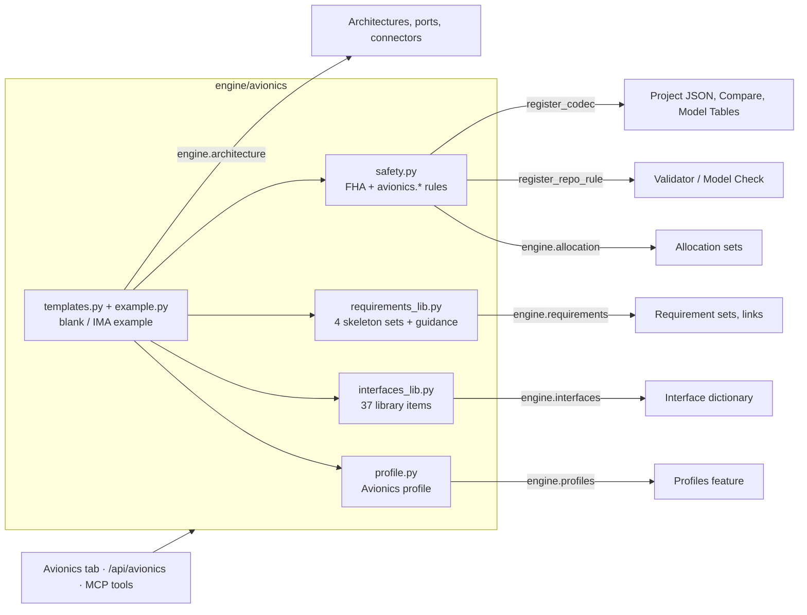

# Avionics domain pack

The avionics content on top of the studio's features: the **Avionics profile**, a library of
avionics **interfaces** (ARINC 429 / 664 / 825 / 653, MIL-STD-1553B, discrete, analog, power), ARP4754A
and DO-178C **requirement** skeletons with verification guidance per DAL, a **Functional Hazard
Assessment** table, **safety / DAL rules** that run in Model Check, **project templates** (a blank
avionics project and a complete IMA avionics example) and the **Avionics** tab that drives all of it.
Everything works from the web studio, over HTTP, as MCP tools and in Python, is saved in the project
JSON, and is one named, undoable step per edit.

| Layer | File |
|-------|------|
| Profile (stereotypes, reading values, DAL helpers, mass / power roll-up) | `engine/avionics/profile.py` |
| Interface library | `engine/avionics/interfaces_lib.py` |
| Requirement skeletons, verification guidance, requirement rules | `engine/avionics/requirements_lib.py` |
| FHA table, DAL mapping, safety rules, `safety_check` | `engine/avionics/safety.py` |
| Templates (`blank`, `ima_example`), project overview | `engine/avionics/templates.py` |
| The complete example | `engine/avionics/example.py` |
| HTTP API | `webapp/routes/avionics.py` |
| Studio UI (Avionics tab, File > New from template, inspector section) | `webapp/static/plugins/90-avionics.js` |
| MCP tools | `mcp_server/tools/avionics.py` |
| Tests | `tests/test_avionics_engine.py`, `test_avionics_example.py`, `test_avionics_http.py`, `test_avionics_mcp.py`, `tests/ui/scenarios/90_avionics_*.mjs` |

The pack uses the public APIs of the other features (`engine.profiles`, `interfaces`, `requirements`,
`allocation`, `architecture`) and re-implements none of them: the example is built with the same calls
a script would make, never from hand-written JSON.



## Using it in the studio

### New from template

**New from template…** in the header (next to *New*) opens a chooser:

| Template | You get |
|----------|---------|
| **Blank avionics project** | the Avionics profile, the whole interface library, the four requirement skeleton sets, an empty FHA table and an empty `SystemArchitecture` |
| **Complete IMA avionics example** | the model described under [The complete example](#the-complete-example); it opens on the physical architecture |

The project name follows the chosen template until you type your own. Like *New*, the command replaces
the project (a warning lists unsaved changes), starts a fresh undo history and emits `project-changed`.

### The Avionics tab

| View | What it does |
|------|--------------|
| **Start** | template cards (with what they build), the state of this project (profile present or missing, library items present, requirement sets, FHA rows, safety counts) with the buttons that fix what is missing, and a mass / power / DAL roll-up per architecture |
| **Interface library** | every library item grouped (types, ARINC 429, 664, MIL-STD-1553B, discrete, analog, 825, 653, power) with its label numbers and whether it is in the project. Tick items and **Import selected**, or **Import all missing**; value types and enumerations a selection needs come with it, and imported items cannot be picked twice. A banner reminds you that label numbers are typical |
| **Requirement library** | the four skeleton sets with prefix and size; tick sets, optionally force one DAL for every entry, **Import selected**. Below: the verification guidance per DAL and the requirement rules |
| **FHA** | the Functional Hazard Assessment as an editable table: function (list), failure condition, flight phase, effect, classification (list), the assigned DAL, the probability objective, and the items the function is allocated to (links open them). Cells save when you leave them (Enter commits, Escape reverts, a refused value goes back and the reason is in the Output log). **Add row…** opens a dialog, ✕ deletes after a confirmation |
| **Safety check** | the `avionics.*` rule results with severity, rule title and id, message and one link per element the issue names (the link shows the element on the canvas or in Properties). Filters: severity, rule, text |

Other places:

* **Toolstrip**: *Modeling > Avionics* and *Analysis > Safety Check* open the tab. They appear in projects that
  use the Avionics profile or an FHA (the toolstrip is one row at 1600 px with no room to spare); the tab and the
  header command are always there.
* **Canvas**: blocks show a `DAL x` badge (the DAL of the component or of its definition), `SM` when the definition
  has a state machine, and `n req`. Drill into a reference component to see the definition's internals: IMA cabinet
  → core module → partition → software items.
* **Properties tab**: an *Avionics safety* section on FHA rows and on elements with a DAL lists the rules that name
  the element. FHA rows are ordinary elements (containment tree `FHA`, badges for classification and DAL) and can be
  edited in the Properties tab like any element.
* **Model Check** lists the same rules with their titles; every edit of a DAL (Properties tab, canvas inspector,
  Model Tables) is picked up by Model Check, the Safety check and the canvas without reloading.

## The Avionics profile

Created through the Profiles feature, edited afterwards in the Profile Editor. `ensure_profile` is idempotent
and never changes a stereotype or property that exists.

| Stereotype | Applies to | Base | Properties |
|------------|-----------|------|-----------|
| `Equipment` (abstract) | Component | | `mass` kg, `powerNominal` W, `powerPeak` W, `mtbf` h, `failureRate` FIT, `partNumber`, `manufacturer`, `ataChapter`, `dal` (A..E, default E), `certificationBasis` (TSO / ETSO), `do160Categories` |
| `LRU` | Component | Equipment | default port stereotype `DataBusPort` |
| `Sensor`, `Display`, `Actuator`, `Computer`, `Switch`, `Gateway`, `PowerSupply` | Component | LRU | `measurand`; `diagonal` in; `stroke` mm, `maxForce` N; `processor`, `memory` kB; `portCount`, `switchingLatency` us; `protocols`; `outputVoltage` V, `ratedPower` W |
| `LRM` (IMA module) | Component | Equipment | `slot`, `cores`, `memory` kB, `partitioningMark`; default port stereotype `DataBusPort` |
| `Partition` (ARINC 653) | Component | | `partitionId`, `dal`, `timeWindow` ms, `period` ms, `memory` kB, `partitioningMark` |
| `SoftwareItem` (CSCI) | Component | | `dal`, `language`, `sloc`, `version` |
| `LogicalItem` | Component | | `dal` (function / item level of the logical architecture) |
| `DataBusPort` | Port | | `busType`, `label` (ARINC 429 label / CAN id), `virtualLink`, `rtAddress` (0..31) |
| `BusLink` | Connector | | `busType`, `bandwidth` Mbit/s, `latency` ms, `length` m |
| `AvionicsRequirement` | Requirement | | `level` (System, Item, HLR, LLR), `dal`, `derived`, `safetyRelated`, `verificationMethod` (Test, Analysis, Inspection, Demonstration, Review, Similarity) |

Values are checked and converted by the profiles feature: `9 lb` into `mass` is stored as 4.08 kg, `1 MB` into a
kB property as 1000, `2*15` as 30. An element carries **one** Equipment-derived stereotype (a second would repeat
every Equipment property); pick the most specific. Equipment values live on the **part definitions** (reference
components) and the profiles feature lets usages inherit them: `ADC1 : AirDataComputer` shows `«Computer»`, its mass
and its DAL, and a value set on the usage overrides the definition's. In Python `profile.read(e, "dal")` is what is
stored on the element itself (`get_property_value(..., inherit=False)`), `profile.effective(e, "dal")` adds what it
inherits (plain `get_property_value`); the rules use `effective`.

`verificationMethod` is a superset of the Requirements feature's own *Verification method* column (it adds review and
similarity); the rules prefer the column when it is set.

## Interface library

37 items in nine groups, importable with one click. They are ordinary interface-dictionary items, so they are edited,
assigned to ports (drag from the Interface Editor onto a canvas port) and checked for compatibility like any other.

> **Label numbers, word layouts and ranges are typical values** taken from common ARINC 429 / 664 / 825 / 653 and
> MIL-STD-1553B practice. **Verify every one against your programme's interface control document (ICD).**

| Group | Items |
|-------|-------|
| Value types, enumerations | `AltitudeFt`, `RadioAltitudeFt`, `AirspeedKt`, `MachNumber`, `TemperatureDegC`, `VerticalSpeedFpm`, `AngleDeg`, `CourseDeg`, `LatitudeDeg`, `LongitudeDeg`, `GroundSpeedKt`, `AccelerationG`, `DistanceNmi`; `Ssm429`, `DiscreteLevel`, `NetworkId`, `BusSelect`, `QueuingDiscipline`, `PortValidity` |
| ARINC 429 | `A429Word` (label, SDI, data, SSM, parity); label sets `A429AirData` (203 pressure altitude, 204 baro-corrected altitude, 205 Mach, 206 computed airspeed, 210 true airspeed, 211 TAT, 212 vertical speed, 213 SAT), `A429Inertial` (310 latitude, 311 longitude, 312 ground speed, 320 heading, 322 track, 324 pitch, 325 roll, 331 / 332 / 333 accelerations), `A429Navigation` (001 distance to go, 100 selected course, 114 desired track), `A429RadioAltitude` (164), `A429Gnss` (076, 103, 110, 111, 112) |
| ARINC 664 part 7 | `A664Message`: virtual link id, BAG (ms), Lmax (bytes), jitter (us), sub-VL, network A / B / both, sequence number, payload |
| MIL-STD-1553B | `M1553BMessage`: RT address, T/R, subaddress, word count, rate (Hz), bus A / B, data words, status word |
| Discrete | `DiscreteLine`: level (open / ground / 28 V), active low, asserted, valid |
| Analog | `AnalogVoltage` (0-10 V), `AnalogCurrent` (4-20 mA), `SynchroSignal` (angle, excitation voltage and frequency) |
| ARINC 825 | `A825Frame`: 29-bit identifier, priority, DLC, data |
| ARINC 653 | `A653SamplingPort`, `A653QueuingPort` |
| Power | `Power28VDCBus`, `Power115VAC400Hz`, `HydraulicSupply` (physical interfaces) |

Importing is idempotent: an existing item of the same name is skipped (`on_conflict: skip`) or the library item is
created as `Name_1` (`rename`, element types follow the new names). The Interface Editor's own *Template…* menu
creates a word named `A429Word` too: importing the library afterwards keeps that one and reports it as skipped.

## Requirement library

| Key | Set (prefix) | Content |
|-----|--------------|---------|
| `arp4754a-system` | `SystemRequirements` (`SYS-`) | functional, performance, safety (1E-9 / 1E-7 / 1E-5 per flight hour), interface, environmental (DO-160), design constraints, derived |
| `arp4754a-item` | `ItemRequirements` (`ITM-`) | item function, interfaces per bus, reliability and built-in test, safety and assurance, physical |
| `do178c-hlr` | `SoftwareHighLevelRequirements` (`HLR-`) | behaviour, timing and resources, robustness, data and interfaces, initialisation, derived |
| `do178c-llr` | `SoftwareLowLevelRequirements` (`LLR-`) | algorithms, data, tasks and interrupts, coding constraints, derived |

Each entry has a type, a verification method, the avionics attributes (level, DAL, derived, safety related) and a
`<placeholder>` statement. Skeleton requirements are created with status *draft*, so the coverage rules stay quiet
until you approve them. The DAL of each entry is a typical level: set it from your FHA, or force one level for the
whole import.

### Verification guidance per DAL (validator guidance, not the text of the standards)

| DAL | Failure condition | DO-178C objectives (with independence) | Structural coverage | System-level methods |
|-----|-------------------|----------------------------------------|---------------------|----------------------|
| A | Catastrophic | 71 (30) | MC/DC | test, analysis, demonstration |
| B | Hazardous | 69 (18) | decision | test, analysis, demonstration |
| C | Major | 62 (5) | statement | all, including inspection and review |
| D | Minor | 26 (2) | none | all |
| E | No safety effect | 0 | none | all |

## Functional hazard assessment and safety rules

The FHA is model data: a package `FHA` (kind `FhaTable`) with one `FhaEntry` per failure condition, named by its
FHA id (`FHA-3`). Each row holds the **function** (a reference to a component of the functional architecture or an
action), the failure condition, the flight phase(s), the effect and the classification; the assigned DAL follows
from the classification, and so does the probability objective.

| Classification | Assigned DAL | Probability objective (per flight hour) |
|----------------|--------------|------------------------------------------|
| Catastrophic | A | < 1E-9 |
| Hazardous | B | < 1E-7 |
| Major | C | < 1E-5 |
| Minor | D | no requirement |
| No Safety Effect | E | none |

Flight phases: All, Ground, Takeoff, Climb, Cruise, Descent, Approach, Landing (comma separated; `All` stands for
every phase). The DAL of a **function** with several failure conditions is the most stringent one.

Rows are saved by the registered codec `avionics.fha`, appear in Compare and in Model Tables (the *Elements* sheet,
with `classification`, `failure_condition`, ... columns and a `fha_function ID` reference column), come back from an
XLSX / CSV round trip, and each edit is one named undo step (*Set classification of FHA-9 to Catastrophic*).

| Rule id | Severity | Reports |
|---------|----------|---------|
| `avionics.dal.requirement` | error | a component implements a requirement of DAL X but has a lower DAL (a warning when it has none) |
| `avionics.dal.allocation` | error | a function is allocated to an item of lower DAL than its FHA classification demands, and the items are not a valid decomposition (one issue per allocation layer: function to logical item, logical item to hardware) |
| `avionics.dal.partitioning` | warning | items of different DAL on one IMA module or partition without the `partitioningMark` |
| `avionics.dal.hosting` | error | a module or partition has a lower DAL than an item it hosts |
| `avionics.dal.decomposition` | info | hint: the items form a valid DAL decomposition (independence must be shown), or redundant channels (two usages of one definition) could be decomposed |
| `avionics.fha.unallocated` | warning | a failure condition without a function, or whose function is not allocated to any item |
| `avionics.fha.invalid` | error | an FHA row holds a classification or flight phase outside the standard lists (hand-edited tables) |
| `avionics.equipment.reliability` | info | MTBF and failure rate (FIT) of one equipment differ by more than 5 % |
| `avionics.req.verification` | warning | a DAL A-D functional / performance / interface / safety software requirement is not verified by test; a DAL A / B system or item requirement is verified by inspection or review only |
| `avionics.req.unverified`, `avionics.req.unimplemented` | warning | a DAL A-C requirement past draft that no test case verifies / no design element implements, directly or through a parent |
| `avionics.req.derived` | info | a derived requirement without rationale |
| `avionics.req.safety-dal` | warning | a safety related requirement at DAL E |

Each issue names the elements involved and the rule (`elements`, first the one to show). Requirements without the
`AvionicsRequirement` stereotype and projects without avionics data produce nothing.

**DAL decomposition** follows the options of ARP4754A 5.2.3: A = A + C or B + B, B = B + D or C + C, C = C + E or D + D,
and needs independence between the items. The studio cannot prove independence; it treats usages of one definition as
redundant channels, accepts a decomposition when their levels fit one of these options (an info hint instead of an
error), and hints at the chance for functions of level A and B whose channels already meet the full level.

## The complete example

`File > New from template > Complete IMA avionics example`, `POST /api/new/avionics {"template": "ima_example"}`,
`sysml_create_avionics_project` or `python -m engine.avionics.example out.json`.

| Part | Content |
|------|---------|
| Interfaces | the whole library; an interface on every one of the 175 ports |
| `Equipment` package | 16 part definitions with the Avionics stereotypes and realistic values: air data computer (3.6 kg, 30 W, MTBF 40000 h, DAL B), inertial reference unit, radio altimeter, GNSS receiver, sidestick, remote data concentrator, AFDX switch, flight control computer (DAL A), display unit, elevator and aileron actuators, power supply, two core processing modules, a cabinet power module, the IMA cabinet |
| `PhysicalArchitecture` | 24 components: ADC1/2, IRU1/2, RA1/2, GPS1/2, SidestickCapt/FO, RDC1/2, SW_A / SW_B, IMA_Cabinet, FCC_L / FCC_R, PFD, ND, EICAS, ElevAct, AilAct, PSU1 / PSU2; 73 connectors: 14 ARINC 429, 16 AFDX (every end system on networks A and B), 8 MIL-STD-1553B, 6 discrete, 6 analog (0-10 V, 4-20 mA, synchro), 23 power |
| IMA | `IMA_Cabinet` → CPM1 (flight management and flight warning partitions), CPM2 (display management and maintenance partitions), PSM; four partitions with time window, period and memory, eight software items with DAL, language and SLOC; the modules carry the partitioning mark |
| Flight control | `FlightControlComputer` holds a command lane and a monitor lane (DAL A software items) and the `FccModes` state machine (PowerUp, Standby, Engaged, Degraded, Passive, Failed; 9 transitions) |
| `FunctionalArchitecture` / `LogicalArchitecture` | 13 functions and 12 logical items (with their DAL), connected by the data they exchange |
| Requirements | `SystemRequirements` (27), `ItemRequirements` (13), `SoftwareHighLevelRequirements` (7), `SoftwareLowLevelRequirements` (6), 18 test cases; implement links to logical items, equipment, partitions and software items, verify links from test cases, derive / refine links between the levels |
| Allocation | `FunctionsToLogical` (13 allocations) and `LogicalToPhysical` (25: to hardware and to IMA partitions), both with complete coverage |
| FHA | 21 failure conditions over the 13 functions: 4 catastrophic, 8 hazardous, 4 major, 4 minor, 1 without safety effect |

**Deliberate open gaps**: *GNSS integrity monitoring* is implemented by nothing; *Detect erroneous air data*, *GNSS
integrity monitoring*, *Concentrator conversion*, *Software memory budget* and *Division guard* have no test case; the
test case `TC-FccLatency` failed, `TC-IruAccuracy` and `TC-NetworkRedundancy` are unexecuted. Model Check therefore
reports 0 errors, 6 warnings (the requirement gaps) and 7 info hints (DAL decomposition). Lower the DAL of the
`FlightControlComputer` definition to C and the rules report `avionics.dal.requirement` and `avionics.dal.allocation`
errors at once; Undo takes them away.

The example passes Model Check without errors, saves and loads byte-identically, survives the XLSX round trip with
*Compare* reporting no differences (layout included) and every composition is laid out without overlapping blocks.

## HTTP API

Errors answer `{"error": message}` with 400, 404 or 409. FHA rows are addressed by element id, qualified name or FHA id.

| Method | Path | Body / query | Result |
|--------|------|--------------|--------|
| GET | `/api/avionics/templates` | `?counts=1` | `{templates}` (what each builds) |
| POST | `/api/new/avionics` | `{template: blank\|ima_example, name?}` | new project (replaces the current one, no undo step, fresh history): `{name, root_id, architectures, open}` |
| GET | `/api/avionics/info` | | profile, libraries, requirement sets, FHA, safety counts, equipment roll-up, architectures |
| GET / POST | `/api/avionics/profile` | | state / create or complete the profile |
| GET | `/api/avionics/interfaces/library` | | catalog with `present` per item and the ICD warning |
| POST | `/api/avionics/interfaces/import` | `{names?, groups?, on_conflict?: skip\|rename}` | `{created, skipped, renamed, dependencies}` |
| GET | `/api/avionics/requirements/library` | | skeleton sets (`present`), guidance per DAL, rules |
| POST | `/api/avionics/requirements/import` | `{sets?: [key], dal?}` | `{sets, requirements}` |
| GET | `/api/avionics/fha` | | rows, vocabularies, DAL mapping, class counts, function choices |
| POST | `/api/avionics/fha` | `{failure_condition, function?, flight_phase?, effect?, classification?, fha_id?, notes?}` | the row |
| PATCH / DELETE | `/api/avionics/fha/<row>` | any of the fields | the row / `{deleted}` |
| GET | `/api/avionics/safety` | `?severity=&rule=&element=` | `{issues, counts, by_rule, rules}`; an issue has `elements` |

Element JSON gains `badges` (`DAL x` on components and requirements; classification and DAL on FHA rows),
`avionics_dal` and, on FHA rows, `fha {classification, dal, function, ...}`; `PATCH /api/element/<row>` accepts
`classification`, `failure_condition`, `flight_phase`, `effect`, `fha_function`. Undo labels: *Add the Avionics
profile*, *Import A429AirData, A664Message (8 items)*, *Import requirement sets ...*, *Add FHA row FHA-22*, *Set
classification of FHA-9 to Catastrophic*, *Clear the function of FHA-9*, *Edit the failure condition of FHA-9*,
*Delete FHA row FHA-22*.

## MCP tools

| Tool | Purpose |
|------|---------|
| `sysml_list_avionics_templates`, `sysml_create_avionics_project` | templates; replace the project with one (`template`, `name`) |
| `sysml_avionics_overview` | profile, libraries, FHA, safety counts, mass / power roll-up |
| `sysml_ensure_avionics_profile` | create or complete the profile |
| `sysml_list_interface_library`, `sysml_import_interface_library` | the library; import (`names`, `groups`, `on_conflict`) |
| `sysml_list_requirement_library`, `sysml_import_requirement_library` | skeleton sets and guidance; import (`sets`, `dal`) |
| `sysml_fha_list`, `sysml_fha_set_row`, `sysml_fha_delete_row` | the FHA; add (omit `row`) or update a row, `clear_function`; delete |
| `sysml_safety_check` | the avionics rules, filtered by `severity`, `rule`, `element` |

Editing tools are one undo step each (`sysml_undo`).

```json
{"name": "sysml_create_avionics_project", "arguments": {"template": "ima_example"}}
{"name": "sysml_safety_check", "arguments": {"severity": ["error", "warning"]}}
{"name": "sysml_fha_set_row", "arguments": {"row": "FHA-9", "classification": "Catastrophic"}}
{"name": "sysml_safety_check", "arguments": {"rule": "avionics.dal.allocation"}}
```

## Python API

```python
from engine import Repository
from engine.avionics import profile as AP, interfaces_lib, requirements_lib, safety as SF, templates, example

repo = templates.create_project("blank", "MyAircraft")        # or "ima_example" / example.build_example()
AP.ensure_profile(repo)                                        # idempotent
interfaces_lib.import_library(repo, groups=["a429", "a664"])   # selection + the types it needs
requirements_lib.import_requirement_set(repo, "do178c-hlr", dal="B")

d = ...                                                        # a PartDefinition made with engine.architecture
AP.apply(repo, d, "Computer", {"mass": "3.6 kg", "dal": "B", "mtbf": 40000})
AP.effective_dal(usage_of_d)                                   # "B": a usage reads its definition

row = SF.add_fha_row(repo, function=fn, failure_condition="Loss of air data", classification="Hazardous")
SF.update_fha_row(repo, row, classification="Catastrophic")
SF.safety_check(repo)["issues"]                                # each names its elements and rule
SF.valid_decomposition("A", ["B", "B"])                        # True
```

Importing `engine.avionics` registers the FHA codec and the rules, so any project that uses them loads and validates
without further setup. Errors are `FhaError`, `InterfaceError`, `ProfileError`, `RequirementsError` (all `ValueError`s
with a `status`).

## System Composer parity

| Feature | Status | Notes |
|---------|--------|-------|
| avionics-profile | closed | equipment, IMA, software, bus and requirement stereotypes with units, DAL, TSO, DO-160 |
| interface-library | closed | ARINC 429 (label sets), 664, 825, 653, MIL-STD-1553B, discrete, analog, power; one-click import |
| requirement-library | closed | ARP4754A system / item and DO-178C HLR / LLR skeletons with the Requirements feature's attributes |
| fha-table | closed | model data with codec, Compare, Model Tables, undo labels; editable in the GUI |
| dal-rules | closed | requirement DAL, FHA allocation, partitioning mark, hosting, decomposition hints, verification guidance |
| project-templates | closed | File > New from template: blank avionics project, complete IMA example |
| complete-example | closed | functional, logical, physical architectures, IMA, requirements, allocation, FHA, state machine |
| Equipment value inheritance by usages | closed | by the profiles feature: usages show and use their definition's stereotype values (`profile.effective`) |
| Fault tree / FMEA / common cause analysis, quantitative probability roll-up | deferred | the FHA gives the objective, not the analysis (ARP4761 safety assessment is a separate effort) |
| Proof of independence for DAL decomposition | deferred | the studio hints and accepts valid pairs of redundant channels, independence stays an engineering claim |
| Schedulability of ARINC 653 partition windows, AFDX bandwidth and latency budgets | deferred | `timeWindow`, `period`, `bandwidth`, `latency` are stored; no analysis reads them yet |
| ICD import (ARINC 429 / AFDX configuration tables) | deferred | the library is a starting point; label numbers are typical, verify against the programme ICD |
| Live link to a shared interface dictionary | deferred | the library is copied into the project (same as the interfaces feature) |
