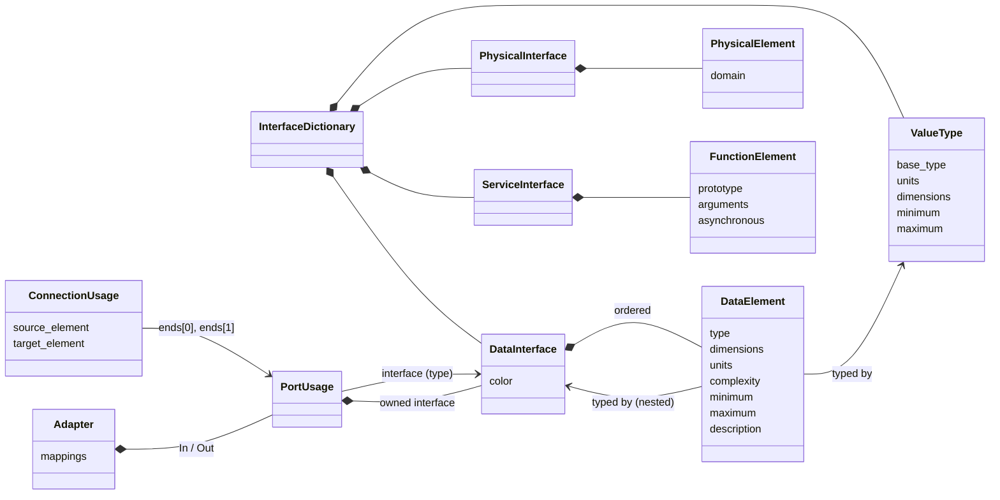
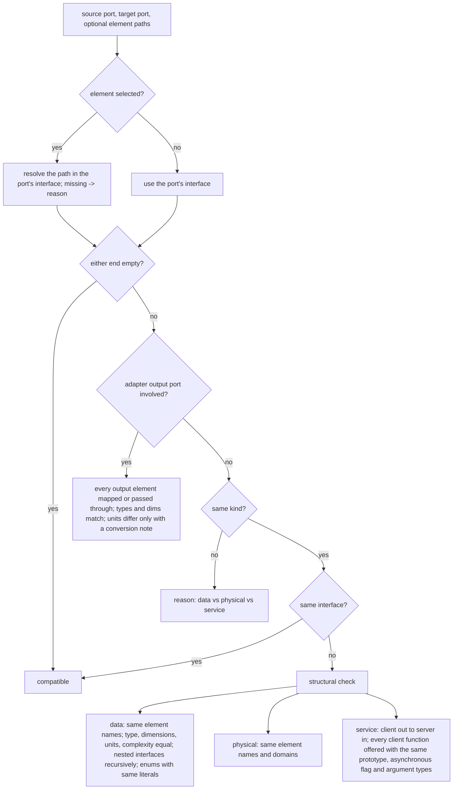

# Interfaces and the interface dictionary

System Composer style interfaces for the SysML v2 Studio: define what flows
through ports (data, physical, service), keep shared definitions in an
**interface dictionary**, assign interfaces to ports, check that connectors
join compatible ports, and adapt between interfaces. Built for avionics
architectures: ARINC 429 / ARINC 664 (AFDX) / MIL-STD-1553 messages, discrete
and analog signals, 28 VDC power feeds, client/server services.

| Layer | File |
|-------|------|
| Metamodel, rules, persistence | `engine/interfaces.py` |
| HTTP API | `webapp/routes/interfaces.py` |
| Interface Editor UI + inspector sections | `webapp/static/plugins/20-interfaces.js` |
| MCP tools | `mcp_server/tools/interfaces.py` |
| Tests | `tests/test_interfaces.py`, `tests/test_interfaces_http.py`, `tests/test_interfaces_mcp.py`, `tests/ui/scenarios/20_interfaces*.mjs` |

## Concepts

| System Composer | Here (SysML v2 class) | Kind name |
|-----------------|-----------------------|-----------|
| Interface dictionary (`.sldd`) | `InterfaceDictionary` (a `Package` named *Interfaces*) | `InterfaceDictionary` |
| Data interface (bus) | `DataInterface` (a `PortDefinition`) | `DataInterface` |
| Data element | `DataElement` (an `AttributeUsage`) | `DataElement` |
| Value type | `ValueType` (an `AttributeDefinition`) | `ValueType` |
| Physical interface / element | `PhysicalInterface` / `PhysicalElement` | `PhysicalInterface`, `PhysicalElement` |
| Service interface / function element | `ServiceInterface` / `FunctionElement` | `ServiceInterface`, `FunctionElement` |
| Enumeration | `EnumerationDefinition` with `EnumerationUsage` literals | `EnumerationDefinition` |
| Named constant (architectural data) | `NamedConstant` (an `AttributeUsage`) | `NamedConstant` |
| Owned interface | an interface owned by one `PortUsage` | (same kinds, `owned: true`) |
| Adapter | `Adapter` (a `PartUsage`) with element mappings | `Adapter` |

A port's interface is its SysML type (`PortUsage` typed by the interface), so
every feature that reads `engine/structure.py` sees the same assignment. A data
element's type is either a primitive (`double`, `single`, `half`, `int8` …
`uint64`, `boolean`, `string`; the feature is then typed by the matching KerML
scalar: Real, Integer, Natural, Boolean, String) or a model type written the
System Composer way: `ValueType: Altitude`, `Bus: Position` (nesting) or
`Enum: FlightPhase`.



## Using the Interface Editor (web UI)

Open it with the **Interfaces** tab, the toolbar button **Interfaces › Interface
Editor**, or **Alt+I**. The left pane lists the dictionary grouped by kind
(data, value types, physical, service, enumerations, constants) followed by
port-owned interfaces, each with its colour swatch and element count; type in
the filter box to narrow it. The right pane edits the selected item.

| Task | How |
|------|-----|
| Create an interface | Toolstrip **New › Data Interface / Value Type / Physical / Service / Enumeration / Constant**. The new item is selected with its name ready to type; press Enter to rename. |
| Create from an avionics template | Toolstrip **Template…**: ARINC 429 word, ARINC 664 (AFDX) message, MIL-STD-1553 message, discrete, analog signal, 28 VDC power. |
| Rename, recolour, describe | Edit the name box (Enter commits, Escape reverts), the colour swatch, or the description under it. Names must be identifiers and unique in the dictionary. |
| Add an element | Toolstrip **Element › Add** (or **Insert**). It is inserted after the selected row and its name cell is focused. |
| Edit element fields | Click any cell: Name, Type (built-ins, value types, nested interfaces, enumerations), Dimensions (`1`, `3`, `[3 3]`), Units (suggestions from the known-units list), Complexity, Minimum, Maximum, Description. Tab or Enter commits (Enter moves down a row like a spreadsheet), Escape reverts. Invalid values are rejected with the reason shown on the red cell and in the Output pane; unknown units are accepted but flagged amber. |
| Reorder / remove elements | Select a row, then **Up / Down** (or **Alt+↑ / Alt+↓**) or **Remove**. Order is saved with the project. |
| Expand a nested interface | Click ▸ next to an element typed `Bus: …`; nested rows are read-only (edit the nested interface itself). Cycles are refused. |
| Value type properties | Selecting a value type shows one editable row: base type, dimensions, units, complexity, minimum, maximum. Elements typed by a value type show its values greyed out. |
| Physical elements | Name, Domain (electrical, three-phase, mechanical translational / rotational, hydraulic, isothermal / thermal liquid, thermal, magnetic, gas, moist air, two-phase fluid, pneumatic), Description. |
| Service functions | Name, Function prototype (`[y1, y2] = name(u1, u2)`, the name must match), Asynchronous. Click ▸ to edit argument types, dimensions and units. |
| Enumerations / constants | Literal, value (integer), description, and a **Default** literal; constants have value, type and units. |
| See who uses an interface | Bottom pane **Ports using this interface**: click a port to select it (tree + Properties), **Highlight** emits a `highlight` event for the canvas. Value types / enumerations show the elements typed by them. |
| Delete | Toolstrip **Edit › Delete** (or Delete in the list) asks for confirmation; ports using it end up with no interface, elements typed by it fall back to `double`. |
| Export the dictionary | Toolstrip **Dictionary › Export** downloads `Interfaces.json`. |
| Import a dictionary | **Dictionary › Import** picks a JSON file. When names collide a dialog lists them with **Keep existing**, **Replace existing** or **Rename** (to `name_1`), per item or for all. The import is all or nothing. |
| Save all owned interfaces | **Dictionary › Save Owned** moves every port-owned interface into the dictionary (renaming on collision). |

### Ports, connectors and adapters (Properties tab)

* **Port › Interface**: select a port in the tree; the *Interface* section has a
  dropdown with `<empty>`, `<owned>` and every shared interface / value type
  (plus plain SysML port definitions). The section previews the elements and
  lists the port's connectors with ✓ / ✗ and the reasons. Buttons:
  *Edit in Interface Editor*, *Convert to owned* (copy the shared interface into
  the port), *Convert to shared…* (save the owned interface into the dictionary
  under a name; on a name clash choose rename, keep existing or replace
  existing), *Connect to…* (pick a sibling / parent port, see the compatibility
  preview, optionally select a bus element at either end). For a service
  interface a *Role* picker sets client (out) or server (in).
* **Connector › Interface compatibility**: source and destination with their
  interfaces, a bus element picker per end (`(whole port)` or an element path
  such as `pos.lat`), and the live result: *✓ Compatible* or *✗ Incompatible*
  with the reasons.
* **Adapter**: select an architecture or component and click toolbar
  **Interfaces › Adapter**. The adapter gets an *In* and an *Out* port. Its
  *Adapter mappings* section maps output elements from input elements, with a
  note for unit conversions (e.g. `ft x 0.3048`).
* Ports show their interface name as a tree badge (`owned` for owned ones) and
  carry `style.stroke` = the interface colour; incompatible connectors get an
  `incompatible` badge and a red dashed style.
* **Validate** (F5) reports every incompatible connector
  (`interfaces.compatibility`) together with the other rules below.

## Compatibility rules

`check_compatibility(source_port, target_port, source_element=None,
target_element=None)` returns the reasons a connector would be invalid (an
empty list means compatible):



* A port with no interface is compatible with anything.
* Element order and minimum / maximum do not affect compatibility.
* A port typed by a value type is a single signal: it connects to another
  value type or to a selected bus element with the same type, dimensions,
  units and complexity.

## Validation rules

| Rule | Severity | Meaning |
|------|----------|---------|
| `interfaces.compatibility` | error | connector joins incompatible ports (message lists the reasons) |
| `interfaces.cycle` | error | nested interfaces contain themselves |
| `interfaces.dimensions` | error | dimensions are not positive integers |
| `interfaces.range` | error | minimum exceeds maximum |
| `interfaces.complexity` | error | complexity is not real / complex / auto |
| `interfaces.prototype` | error | function prototype is malformed or names another function |
| `interfaces.domain` | error | unknown physical domain |
| `interfaces.units` | warning | a unit symbol is not in the known-units list |
| `interfaces.name` | warning | element / interface name is not an identifier |

The API rejects the same mistakes immediately (HTTP 400, 404 for unknown
references, 409 for name collisions) with a message saying what to do.

## HTTP API

| Method | Path | Body / query | Result |
|--------|------|--------------|--------|
| GET | `/api/interfaces` | | `{dictionary, items, owned, port_definitions, meta}`; `meta` has primitive types, complexities, physical domains, units, palette, templates |
| POST | `/api/interfaces` | `{kind, name?, color?, description?, elements?, literals?, …fields}` or `{template, name?}` | item detail |
| GET | `/api/interfaces/item/<ref>` | | detail: fields, `elements`, `ports`, `used_by` |
| PATCH | `/api/interfaces/item/<ref>` | `{name?, color?, description?, base_type?, units?, …}` | detail + `warnings` |
| DELETE | `/api/interfaces/item/<ref>` | | `{deleted, unassigned_ports}` |
| POST | `/api/interfaces/item/<ref>/elements` | `{name?, index?, type?, dimensions?, units?, complexity?, minimum?, maximum?, description?, domain?, prototype?, asynchronous?, value?}` | `{element, interface}` |
| PATCH | `/api/interfaces/item/<ref>/elements/<name or id>` | any element field, `name` renames | `{element, warnings, interface}` |
| DELETE | `/api/interfaces/item/<ref>/elements/<name or id>` | | `{interface}` |
| POST | `/api/interfaces/item/<ref>/elements/<name or id>/move` | `{delta}` or `{index}` | `{index, interface}` |
| GET | `/api/interfaces/port/<port>` | | port, interface detail, element paths, connectors with compatibility |
| POST | `/api/interfaces/assign` | `{port, interface: ref | "owned" | null}` | port info |
| POST | `/api/interfaces/make-owned` | `{port}` | port info |
| POST | `/api/interfaces/make-shared` | `{port, name?, on_conflict?: error|keep|replace|rename}` | `{interface, port}` |
| POST | `/api/interfaces/move-owned` | `{on_conflict?}` | `{moved: [...]}` |
| GET | `/api/interfaces/compatibility` | `?source=&target=&source_element=&target_element=` or `?connector=` | `{compatible, reasons, source, target}` (each end lists `element_paths`) |
| GET | `/api/interfaces/candidates/<port>` | | ports it can be wired to, with compatibility |
| POST | `/api/interfaces/connect` | `{source, target, source_element?, target_element?, name?, parent?}` | connector + compatibility |
| POST | `/api/interfaces/connector-elements` | `{connector, source_element?, target_element?}` | compatibility |
| GET | `/api/interfaces/dictionary/export` | | `{filename, text, document}` |
| POST | `/api/interfaces/dictionary/import` | `{text, dry_run?, default?: error|keep|replace|rename, resolution?: {name: choice}}` | `{added, replaced, renamed, kept}` or, for a dry run, `{items, collisions}` |
| POST | `/api/interfaces/adapter` | `{parent, name?}` | adapter info |
| GET / PATCH | `/api/interfaces/adapter/<ref>` | PATCH `{mappings: [{target, source, note}]}` | `{mappings, inputs, output, source_paths, target_paths}` |

`<ref>` is an element id, a qualified name or a dictionary name. Generic
element routes stay valid: `POST /api/element {kind: "DataInterface" | "DataElement" | "ValueType" | "Adapter" | …}`
creates the new kinds, and `PATCH /api/element/<id>` with interface fields
(`units`, `dimensions`, `type`, `typed_by` on a port, `source_element` on a
connector, `mappings` on an adapter, …) goes through the same validation.

Element JSON (`GET /api/element/<id>`, `/api/tree`) gains: on ports
`interface {id, name, kind, color, owned}`, a badge and `style.stroke`; on
interfaces and elements `interface_category` (`Interface`, `DictionaryItem`,
`InterfaceElement`), `interface_kind`, `color` and the element fields; on
connectors `compatibility {compatible, reasons}`, `source_element`,
`target_element` and, when incompatible, an `incompatible` badge with a red
dashed `style`; on adapters an `Adapter` badge, `style.icon = "adapter"` and
`mappings`.

## MCP tools

| Tool | Purpose |
|------|---------|
| `sysml_list_interfaces` | dictionary listing + vocabularies |
| `sysml_create_interface` | create a data / physical / service interface, value type, enumeration or constant (optionally with `elements`, or from a `template`) |
| `sysml_add_interface_element` | add an element / literal (type, dimensions, units, complexity, range, domain, prototype, …) |
| `sysml_set_interface_element` | edit, rename (`new_name`), clear the range or move (`move=-1/+1`) an element |
| `sysml_remove_interface_element` | delete an element |
| `sysml_create_value_type` | create a value type |
| `sysml_assign_interface` | set a port's interface (`"owned"`, a shared one, or null) |
| `sysml_make_interface_shared` | save a port's owned interface into the dictionary (`on_conflict`) |
| `sysml_check_compatibility` | check two ports (and selected elements) or a connector |
| `sysml_connect_ports` | (architecture tool) connect two ports; `source_element` / `target_element` select bus elements |
| `sysml_set_connector_elements` | select / clear the bus element at a connector end |
| `sysml_create_adapter`, `sysml_set_adapter_mappings` | adapters |
| `sysml_export_dictionary` | export (to a `path` or returned as JSON) |
| `sysml_import_dictionary` | import from a `path` or `text`, with `on_conflict`, per-item `resolution` and `dry_run` |

## Python API

```python
from engine import Repository
from engine import interfaces as I
from kerml.features import FeatureDirection
from sysmlv2 import PartDefinition, PartUsage, PortUsage

repo = Repository("Avionics")
I.create_value_type(repo, "Altitude", units="ft", minimum=-1000, maximum=60000)
air = I.create_item(repo, "DataInterface", "AirData", elements=[
    {"name": "altitude", "type": "ValueType: Altitude"},
    {"name": "cas", "type": "single", "units": "kn"},
    {"name": "valid", "type": "boolean"},
])
a429 = I.create_from_template(repo, "arinc429")          # A429Word

ac = repo.add(PartDefinition(name="Aircraft"))
adiru, fms = PartUsage(name="ADIRU"), PartUsage(name="FMS")
ac.own(adiru); ac.own(fms)
out = PortUsage(name="AirDataOut", direction=FeatureDirection.OUT); adiru.own(out)
inp = PortUsage(name="AirDataIn", direction=FeatureDirection.IN); fms.own(inp)
repo.registry.register_tree(ac)

I.assign_interface(repo, out, air)
I.assign_interface(repo, inp, "AirData")
conn = I.connect_ports(repo, out, inp)
assert I.check_compatibility(out, inp) == []

owned = I.make_owned(repo, inp)                           # owned copy on the FMS port
I.set_fields(repo, I.find_element(owned, "valid"), {"type": "uint8"})
print(I.connector_compatibility(conn))   # ["element 'valid': type boolean vs uint8"]

doc = I.export_dictionary(repo)                           # standalone JSON document
I.import_dictionary(repo, doc, default="rename")          # AirData_1, Altitude_1, ...
```

Other entry points: `add_element`, `remove_element`, `move_element`,
`set_fields` (validated, atomic; returns warnings), `rename`, `interface_of`,
`elements_of`, `find_element`, `element_paths`, `ports_using`, `make_shared`
(`on_conflict`), `move_owned_to_dictionary`, `set_connector_elements`,
`connector_compatibility` (reasons for an existing connector), `connector_report`
(the full report, as `GET /api/interfaces/compatibility?connector=` returns it),
`create_adapter`, `set_adapter_mappings`, `import_preview`, `list_dictionary`,
`describe_item`, `describe_element`. Errors are `InterfaceError` (a
`ValueError` with an HTTP-style `status`).

## Dictionary file format

```json
{
  "format": "sysml-interface-dictionary/1",
  "name": "Interfaces",
  "source_project": "Avionics",
  "items": [
    {"kind": "ValueType", "name": "Altitude", "base_type": "double", "units": "ft",
     "dimensions": "1", "complexity": "real", "minimum": -1000, "maximum": 60000,
     "description": "", "color": "#1f77b4"},
    {"kind": "Enumeration", "name": "FlightPhase", "default": "CRUISE",
     "literals": [{"name": "TAXI", "value": 0, "description": ""}]},
    {"kind": "DataInterface", "name": "AirData", "color": "#ff7f0e", "description": "",
     "elements": [{"name": "altitude", "type": "ValueType: Altitude", "dimensions": "1",
                   "units": "", "complexity": "real", "minimum": null, "maximum": null,
                   "description": ""}]},
    {"kind": "PhysicalInterface", "name": "Power28VDC",
     "elements": [{"name": "positive", "domain": "electrical", "description": "+28 VDC"}]},
    {"kind": "ServiceInterface", "name": "NavService",
     "elements": [{"name": "getPos", "prototype": "[lat, lon] = getPos(t)",
                   "asynchronous": false, "arguments": []}]},
    {"kind": "Constant", "name": "MaxAltitude", "value": "41000", "type": "int32", "units": "ft"}
  ]
}
```

Type references are by name, so a file can be imported into any project.
Imports are validated completely (format, names, kinds, type references,
nesting cycles) on a copy of the project before anything changes.

## For other features

* Profiles / stereotypes: interfaces and elements are ordinary elements; target
  kinds `DataInterface`, `ValueType`, `PhysicalInterface`, `ServiceInterface`
  (category *Interface*) and `DataElement`, `PhysicalElement`, `FunctionElement`
  (category *InterfaceElement*); the constants `INTERFACE_KINDS` and
  `INTERFACE_ELEMENT_KINDS` in `engine/interfaces.py` list them.
* Canvas: read `style.stroke` / badges from summaries, call
  `GET /api/interfaces/compatibility?source=&target=` before drawing a
  connector, and store bus element selections with
  `PATCH /api/element/<connector> {"props": {"source_element": "pos.lat"}}`.
* Everything created here goes through `engine.notify_created`; deletions use
  `Repository.remove`.

## System Composer parity

| Feature id | Status | Notes |
|------------|--------|-------|
| `data-interface-elements` | closed | name, type, dimensions, units (known-units warnings), complexity, min, max, description; add / remove / reorder / rename; order persists |
| `value-types` | closed | base type, units, dimensions, complexity, range, description; usable as element types and port interfaces |
| `nested-interfaces` | closed | `Bus: <name>` element types, expandable in the editor, cycle rejection + validator rule |
| `owned-vs-shared` | closed | `<owned>` per port, convert owned → shared and shared → owned |
| `interface-dictionary-sldd` | closed (copy semantics) | project dictionary package; export / import JSON. A *live* link to one external dictionary file shared by several models is deferred (single-user, browser-only file access) |
| `save-to-dictionary-collision` | closed | keep / replace / rename on save-to-dictionary and on import |
| `dictionary-api` | closed | HTTP, MCP and Python APIs, move all owned interfaces into the dictionary |
| `assign-interface-to-port` | closed | inspector dropdown, element preview, badge + `style.stroke` colour |
| `connector-compatibility` | closed | `check_compatibility`, validator rule over every connector, `GET /api/interfaces/compatibility` |
| `port-element-connections` | closed | `source_element` / `target_element` on connectors (persisted), element pickers, compatibility uses them; element renames follow |
| `physical-interfaces` | closed | 13 physical domains; domain mismatch detection |
| `service-interfaces` | closed | function prototypes, arguments with types / dimensions / units, asynchronous flag; client (out) to server (in) check |
| `adapter-block` | closed | `Adapter` kind with In/Out ports and element mappings with unit-conversion notes; compatibility through the adapter |
| `interface-stereotypes` | closed | stereotypes apply to interfaces and elements and round-trip; kinds exposed for profiles |
| `architectural-data-editor` | closed | enumerations (literals, values, default) and named constants |
| Adapter modes (bus creation, unit delay, rate transition, merge) | deferred | only element mapping is modelled; simulation semantics are out of scope |
| Interface "Port Interface View" (editor filtered to the selected port) | deferred | the port inspector shows the port's elements instead |
| Referenced dictionaries (a dictionary referencing others) | deferred | one dictionary per project |
| Physical element through/across variables and Simscape domain parameters | deferred | a physical element carries its domain only |
| Bus-typed function arguments | deferred | arguments use built-in types or value types |
| AUTOSAR interface flavours (sender-receiver, mode-switch, nv-data) | deferred | not needed for the avionics target |
| Undo / redo of interface edits | deferred | the studio has no undo stack yet |
