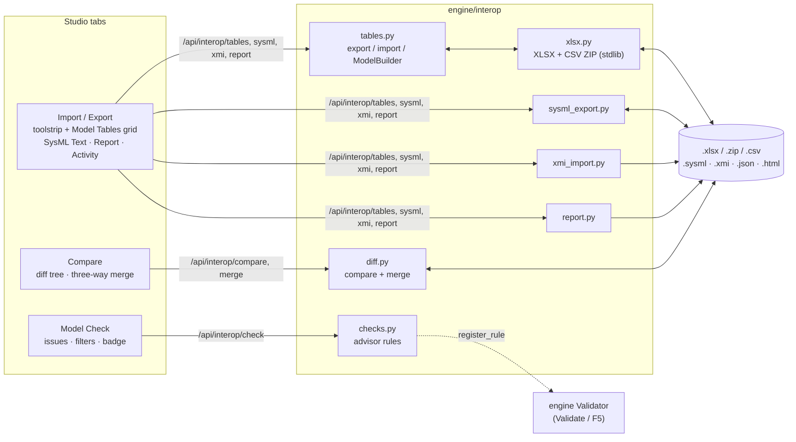
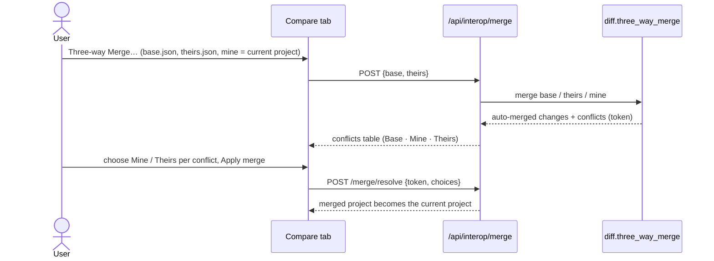

# Import / Export, reports, comparison and Model Check (`interop`)

System Composer's interop, automation and reporting for the studio: exchange the
architecture with Excel (XLSX) or CSV tables, edit it as tables, build it from Python,
export and import SysML v2 text, import SysML 1.x models from Cameo / MagicDraw (XMI),
generate an HTML architecture report, compare two versions, merge three versions, and run
Model Advisor style checks. Saved project files are deterministic so they diff cleanly in
version control.

| Piece | Where |
|-------|-------|
| Engine | `engine/interop/` (`tables.py`, `xlsx.py`, `report.py`, `diff.py`, `sysml_export.py`, `xmi_import.py`, `checks.py`, `common.py`) |
| HTTP API | `webapp/routes/interop.py` |
| Studio UI | `webapp/static/plugins/60-interop.js`: tabs **Import / Export** (`interop`), **Compare** (`compare`), **Model Check** (`checks`) |
| MCP tools | `mcp_server/tools/interop.py` |
| Tests | `tests/test_interop_*.py`, `tests/ui/scenarios/60_interop*.mjs`, fixture `tests/data/interop_avionics_cameo.xmi` |



## Using it in the studio

### Export the architecture as tables

1. Open the **Import / Export** tab.
2. In the **Export** group, click **Tables XLSX** (one Excel workbook, one sheet per table)
   or **Tables CSV** (a ZIP with one CSV file per table, UTF-8 with BOM so Excel detects
   the encoding). The file downloads as `<Project>.xlsx` or `<Project>_tables.zip`.

The **Activity** view lists every export and import with its counts and warnings.

### Edit the model as tables (Model Tables view)

The **Model Tables** view shows the same tables as the export, one sheet tab per table,
with row counts. It works like a spreadsheet:

- **Edit a cell**: double-click it, or select it and press Enter, F2 or just start typing.
  Enter commits and moves down, Tab commits and moves right, Esc cancels. Arrow keys move
  the active cell; Delete clears it. Edited cells are yellow and the sheet tab shows `●`.
- **Add an element**: **＋ Add row** appends a row (new rows are green) with a sensible
  `Kind` (for example `PartUsage` in Components) and starts editing its `Name`. Fill the
  owner column (`Parent` for components, `Component` for ports, `Owner` elsewhere) with a
  qualified name such as `Structure::FlightDeck`. The `Kind` cell suggests the kinds of the
  table.
- **Apply to model** imports only the edited and new rows (merge mode). The result banner
  shows created / updated / unchanged counts and the profile definitions changed through
  the Profiles sheet; on an error the banner shows the importer's message (for example
  `Ports row 3 (navIn): invalid direction 'sideways'` or `Components row 7 (fmc):
  Avionics.LRU.mass = -1 kg is below the minimum 0 kg`) and **the model is left
  unchanged**. **Revert** discards the edits, **Reload** re-reads the model.
- **Stereotype values** are edited in their `Profile.Stereotype.property` columns like in
  the Profile Editor's inspector: `2 lb` into a kg property is converted, `2*1.5` is
  evaluated, enumeration literals match case-insensitively, out-of-range values are
  refused with the property's name.
- **Profile definitions** are edited in the **Profiles** sheet (unit, type, default, range,
  literals, description, base, applies-to, style, defaults, version, ...). Changes go
  through the profiles feature, so stored values follow (a unit change `kg` → `g`
  converts every value) and a change that would strip applications is refused.
- **Go to an element**: click its row number.
- **Filter rows** narrows the grid to rows containing the text.

References come in pairs: `X ID` holds element ids and wins over `X`, which holds
qualified names. When you edit a name column (`Parent`, `Reference`, `Interface`, ...), the
grid clears the matching `X ID` cell so the new name is used. `ID` cells of existing rows
are read-only (they are the element identity); the Model sheet is read-only.

### Import tables

1. **Import / Export** tab → **Import** group → **Tables…**.
2. Choose the file: an `.xlsx` workbook, a ZIP of CSV files, or a single `.csv` file named
   after its table (`Components.csv`, `ports.csv`, ...).
3. Choose **As a new project** (replaces the current project; ids from the file are kept)
   or **The current project** (create / update elements by ID). Optionally name the new
   project.
4. Click **Import**. The tree refreshes and the Activity view shows the import report.

Rules: rows are matched by `ID`, else by owner + name; a row without `ID` creates an
element. Nothing is deleted. The import is atomic: it is rehearsed on a copy of the project
first, so any error (unknown kind, bad direction or multiplicity, missing owner or
reference, duplicate ID, ownership cycle, invalid stereotype value, profile conflict, ...)
is reported with table, row number and name and nothing changes (should the real run still
fail, the project is restored from a snapshot taken just before it). `export → import →
export` reproduces identical tables (ids, values and row order), profiles included.

What a workbook carries besides the elements, so that **XLSX export → import as a new
project → Compare** reports *No differences* (with **layout** ticked too):

- allocation sets with their source / target architecture and allocations with their
  ends (`source_architecture ID`, `target_architecture ID`, `source ID`, `target ID`
  columns of the Elements sheet);
- canvas layout and other tool data (block positions and sizes, port sides, connector
  waypoints, an enumeration's default literal) in the read-only **Tool Data** sheet;
- project-level feature state in `Data: <name>` rows of the Model sheet (JSON): the
  requirement links' change baselines (suspect flags), the architecture type (system /
  software), the profile import log.

An import into **the current project** gives tool data only to the elements it creates
(existing blocks keep their current layout) and ignores the `Data:` rows (the project's
own suspect baselines and settings stay).

### Export and import SysML v2 text

- **Export → SysML v2 Text** downloads `<Project>.sysml`. The **SysML Text** view shows
  the same text with **Copy**, **Refresh** and **Download .sysml**.
- **Import → SysML v2 Text…** opens a dialog: choose a `.sysml` file or paste text, choose
  the current project (default) or a new one. A syntax error keeps the dialog open with the
  parser's message and leaves the model unchanged.

The text uses standard SysML v2 notation: `package`, `part/port/attribute/item/action/
state/constraint/requirement/connection/interface def` and usages with types (`: T`),
multiplicities (`[0..*]`), specializations (`:>`), `enum def` literals, requirement
`id="..."` and text, `doc /* ... */` comments and `connect a to b` connections. Definitions
keep the model's order (the parser resolves forward references). Port directions (`in port navIn : A429Word;`,
`out port airData;`), usages with bodies (components with their ports), connectors inside
definitions (`connect ADC.airData to FMS.air;`), forward references and scoped package
usages are written as real SysML v2 syntax. Constructs the engine parser cannot read yet
are written as `//` comments in SysML v2 form so the file stays re-parsable: state
transitions (`// transition first Off then On;`), metadata definitions (stereotypes) and
stereotype values as metadata usages with unit literals
(`// #Avionics.LRU { mass = 2.5 [kg]; dal = "B"; }`). The exporter probes the parser
(`parser_capabilities()`), so these become real syntax as soon as the parser supports
them. The SysML Text view says which constructs are commented.

### Import a SysML 1.x model from Cameo / MagicDraw (XMI)

**Import → XMI…**, choose the `.xmi` / `.xml` file exported with *File → Export To → XMI*
(XMI 2.5.1), choose new project (default) or current project, click **Import**.

| XMI (UML + SysML 1.x) | Studio element |
|---|---|
| `uml:Model`, `uml:Package` | Package |
| `uml:Class` «Block» | PartDefinition |
| `uml:Class` «InterfaceBlock» (flow properties) | PortDefinition (directed attributes) |
| `uml:Class` «Requirement» with `Id` / `Text` | RequirementDefinition (`req_id`, `text`) |
| «ConstraintBlock», «ValueType» / DataType, Enumeration, Signal | ConstraintDefinition, AttributeDefinition, EnumerationDefinition, ItemDefinition |
| part property, value property | PartUsage (multiplicity kept), AttributeUsage |
| `uml:Port` «FlowPort» / «ProxyPort» / «FullPort» | PortUsage, direction from the flow port or the interface block (conjugated ports flipped) |
| `uml:Connector` with `partWithPort` ends | ConnectionUsage (ends + end contexts) |
| «Satisfy», «Verify», «DeriveReqt», «Refine», «Trace», «Copy», «Allocate» | links of the same kind |
| Generalization, owned comments | specialization, documentation |
| other profile stereotypes (e.g. `Avionics:LRU mass=2.5`) | stereotypes (created if missing) with values |

Profile stereotypes are looked up through the profiles feature: `Avionics:LRU` (namespace
URI ending in `/Avionics`) uses the project's `Avionics.LRU` when that exists, as defined
(typed values are checked and converted; attributes it does not declare are reported, the
profile is not changed); otherwise a stereotype of that name, else a new untyped one in the
package `XMI_Profiles`. XMI ids become element ids, so importing the same file again updates instead of
duplicating. Imports into the current project are wrapped in a package named after the XMI
model. Documents with a DTD, entity declarations or external entities are rejected, and
sizes are limited (`MAX_XMI_BYTES`, ZIP member limits for XLSX).

### Generate the architecture report

**Report → Generate Report** opens the **Report** view and renders the report in a
preview frame:

1. title page (title, model, author, date, contents),
2. model summary (counts, elements by kind),
3. architecture diagrams (Mermaid, one per root architecture, rendered with the vendored
   `/static/vendor/mermaid-*.min.js`) and the traceability diagram. Every connector is drawn
   to the component usage it reaches (its end context), so two reference components of one
   definition (`FCC-L`, `FCC-R : FlightControlComputer`) each get their own edges; edges
   carry the canvas connector label (interface names, `name : Interface` for a named
   connector),
4. component hierarchy,
5. per component: documentation, reference definition, stereotype property values (as the
   profiles feature displays them, with units, inherited properties first), ports
   (direction, kind, interface) and connectors,
6. interfaces with their elements,
7. requirements and traceability (implemented by / verified by / other links, coverage %),
8. validation issues (the Model Check result),
9. links appendix.

Set **Title** / **Author** and untick sections, then **Generate**. **Download HTML** saves
one file; with **embed diagrams library** (default) the Mermaid script is embedded so the
file renders diagrams offline (≈3 MB), otherwise it links to the studio. **Open in new tab**
shows the report full size. Print it from the browser to get a PDF.

### Compare two versions

Open **Compare** (or use the **Compare** group of the Import / Export tab):

- **With File…**: a project JSON (`.json`), a tables workbook (`.xlsx`) or a ZIP of CSV
  files is compared (old) with the current project (new).
- **With Last Saved**: every **Save JSON** in the header remembers the saved project;
  **Set Baseline** remembers the current state on demand. (The snapshot is cleared when
  another project is opened.)
- **Refresh** repeats the last comparison; **layout** also compares UI layout data.

The summary shows `+added`, `−removed`, `~modified` counts, or **No differences**. The
tree nests changed elements under their (grey, unchanged) owners; each modified element
expands to a property table (old value, current value): name, kind, owner (moved), type,
direction, multiplicity, documentation, short name, abstract, req id and text, connection
ends, specializations, stereotypes applied / removed and their property values (labelled
`Avionics.LRU.mass`, as the profiles feature names them), links
added / removed, and feature data stored through codecs. Filters: Added / Removed /
Modified, a search box (names, kinds, property names and values), **Expand all** /
**Collapse all**. Click a name (or press Enter) to select the element in the tree and
inspector; arrows move between rows, Left / Right collapse and expand.

### Three-way merge



1. **Compare → Three-way Merge…**: choose **Base** (the common ancestor) and **Theirs**
   (project JSON or tables files); leave **Mine** empty to use the current project.
2. The merge view lists conflicts (element, property, base / mine / theirs values, kind:
   `modify`, `add-add`, `delete-modify`) and, collapsed, everything merged automatically
   with its origin.
3. Choose **Mine** or **Theirs** per conflict (or **Take all Mine / Theirs**), click
   **Apply merge**. The result becomes the current project; notes report clean-ups such as
   connectors removed because a port was deleted on one side. **Discard merge** cancels.

Changes made on one side only merge automatically, per property (two people can edit
different properties of the same element), including stereotype values, links and feature
data (`ext`). An element deleted on one side and modified (or given new children) on the
other is a conflict.

### Model Check

The **Model Check** tab runs the whole validator (core rules, rules registered by other
features, and the advisor checks below) when it is opened and whenever the model changes
while it is open; **Run Checks** (or **Ctrl+Shift+K** from anywhere) runs it on demand, and
the studio's **Validate** / F5 refreshes it too. The tab title carries a badge with the
issue count (red with errors, amber with warnings, faded when the model changed since the
last run).

- Severity buttons (`● Errors`, `▲ Warnings`, `i Info`, with counts) toggle severities.
- The rule list filters by rule (with counts and titles); the search box filters by
  element name or message.
- Click an issue, or focus it and press Enter, to navigate (`studio.emit("navigate", {id})`);
  arrows, Home and End move between issues.

Advisor checks (registered with `engine.register_rule` / `register_repo_rule`, so they also
appear in Validate, `/api/validate` and `sysml_validate`):

| Rule | Severity | Reports |
|---|---|---|
| `advisor.empty-composition` | info | an architecture or inline component without components, ports or connectors |
| `advisor.unconnected-port` | warning | a component port no connector uses, or an unconnected boundary port |
| `advisor.duplicate-name` | warning | sibling components / ports whose names differ only by case, or a usage port repeating a port of its definition |
| `advisor.component-without-ports` | info | a component with sub-components or a reference but no ports |
| `advisor.missing-documentation` | info | architectures, components, ports and interfaces without documentation |

## Table format

Sheets, in order (first row = header):

| Sheet | Rows | Base columns |
|---|---|---|
| Model | export information | `Property`, `Value` (Format, Name, Root ID, Documentation, and `Data: <name>` rows: project-level feature state as JSON, continued on further rows of the same name beyond 32 000 characters) |
| Profiles | one row per stereotype property (a stereotype without properties and a profile without stereotypes get one row) | `Profile ID`, `Profile`, `Profile Version`, `Profile Description`, `Root Stereotype`, `Stereotype ID`, `Stereotype`, `Base`, `Applies To`, `Abstract`, `Stereotype Description`, `Style`, `Defaults`, `Property ID`, `Property`, `Type`, `Unit`, `Default`, `Min`, `Max`, `Literals`, `Description` |
| Components | architectures (`PartDefinition`) and components (`PartUsage`) | `ID`, `Name`, `Kind`, `Parent ID`, `Parent`, `Reference ID`, `Reference`, `Specializes ID`, `Specializes`, `Multiplicity`, `Abstract`, `Short Name`, `Documentation`, `Stereotypes` |
| Ports | ports | `ID`, `Name`, `Kind`, `Component ID`, `Component`, `Direction`, `Interface ID`, `Interface`, `Multiplicity`, `Short Name`, `Documentation`, `Stereotypes` |
| Interfaces | interfaces (port / interface definitions and kinds derived from them) and their elements | `ID`, `Name`, `Kind`, `Owner ID`, `Owner`, `Type ID`, `Type`, `Direction`, `Multiplicity`, `Specializes ID`, `Specializes`, `Abstract`, `Short Name`, `Documentation`, `Stereotypes` |
| Connections | connectors | `ID`, `Name`, `Kind`, `Owner ID`, `Owner`, `Source Component ID`, `Source Component`, `Source Port ID`, `Source Port`, `Target Component ID`, `Target Component`, `Target Port ID`, `Target Port`, `Type ID`, `Type`, `Short Name`, `Documentation`, `Stereotypes` (+ `Other End IDs` for n-ary) |
| Requirements | requirement definitions / usages | `ID`, `Req ID`, `Name`, `Kind`, `Owner ID`, `Owner`, `Text`, `Type ID`, `Type`, `Specializes ID`, `Specializes`, `Short Name`, `Documentation`, `Stereotypes` |
| Elements | everything else (packages, attributes, actions, states, ...) | `ID`, `Name`, `Kind`, `Owner ID`, `Owner`, `Type ID`, `Type`, `Specializes ID`, `Specializes`, `Multiplicity`, `Direction`, `Abstract`, `Short Name`, `Documentation`, `Stereotypes` |
| Links | typed links | `ID`, `Kind`, `Source ID`, `Source`, `Target ID`, `Target` |
| Tool Data | one row per `Element.tool_data` entry (read-only in the Model Tables view) | `ID`, `Name`, `Kind`, `Key` (`layout`, `port_layout`, `points`, ...), `Value` (JSON) |

- Qualified names are relative to the project root (`Structure::FlightDeck::gps`); several
  references are separated by `;`. Multiplicity is `1`, `0..1`, `1..*`, `*`; Direction is
  `in`, `out`, `inout`.
- In an attribute column, an empty cell keeps the attribute's default and `null` means *no
  value* (written for an attribute whose default is a value, e.g. `primitive_type` of a
  data element typed by a value type).
- **Stereotypes** are named by the profiles feature (`Stereotype.full_name`), which is the
  authority for stereotype names, lookup, typed values and units:
  - `Stereotypes` lists the applied stereotypes, in order (the first one's style wins), as
    `Profile.Stereotype` (`Avionics.LRU`); a stereotype kept in a plain package (the legacy
    `Stereotype(...)` API) has no profile and is just `LRU`;
  - each property value has a column `Profile.Stereotype.property` (`Avionics.LRU.mass`)
    holding the stored value: numbers are in the property's unit (the Profiles sheet's
    `Unit`). On import the column may also name a base stereotype
    (`Avionics.Equipment.mass` on an LRU) and any name `engine.profiles.find_stereotype`
    resolves (id, `Pkg::Stereotype`, unique bare name); `Package.Stereotype` columns written
    for plain-package stereotypes by earlier versions still import. An ambiguous name is an
    error that lists the candidates;
  - values are set through the profiles metamodel (`StereotypeApplication.set`): typed
    values are checked and converted (`3 lb`, `2*1.5`, `b` for literal `B`); text for a
    legacy *untyped* property is read like its current value (`4.2` stays a number);
  - a value cell that still shows the value from before the import is left alone, so a unit
    or type change made in the Profiles sheet (which converts the stored values) is not
    undone by the unedited value columns of the same workbook. Element rows exported with a
    stereotype or property name that the Profiles sheet renames still resolve;
  - the `Stereotypes` cell is authoritative (missing stereotypes are removed); only a row
    that *adds* an element to an existing project with an empty cell keeps the default
    stereotypes the profiles feature applied on creation (a port created inside an LRU gets
    the LRU's default port stereotype).
- **Profiles sheet**: profiles, stereotypes and properties are created and edited through
  `engine.profiles` (`create_profile`, `add_stereotype`, `add_property`, `update_*`), so the
  Profile Editor's checks, unit handling and change propagation apply; a profile named in
  the sheet that does not exist yet is created as a real profile. `Applies To` is a category
  (`Component`, `Port`, ...) or, for legacy stereotypes, element kinds (`PartUsage;...`);
  `Style` and `Defaults` are `key=value` pairs (`fill=#dbeafe; icon=computer`,
  `port=Avionics.A429Port`); `Literals` is comma separated; `Type` empty means a legacy
  untyped property. Profile and stereotype columns repeat on every row of their profile /
  stereotype: an edit in one row is applied, rows still holding the old value do not undo
  it. Stereotypes kept in plain packages (an `Elements` row for the package) are handled
  with the legacy API. The import report lists every definition change in `profile_changes`.
- **Columns other features add** (no change to this module): any JSON-able attribute
  whose value differs from the class default becomes a column named after the attribute
  and is set back on import with its type preserved. In particular:
  - interfaces / buses: attributes such as `port_kind`, `bus_type`, `data_type`,
    `units`, `rate_hz` on ports, interfaces and interface elements;
  - profiles: see *Stereotypes* and *Profiles sheet* above;
  - allocation: allocation sets' `source_architecture ID` / `target_architecture ID`,
    allocations' `source ID` / `target ID`, `allocate_from ID` / `allocate_to ID`
    (pre-registered element-valued attributes; a library element is written by its
    qualified name) and `allocate` links in the Links sheet;
  - requirements: `rationale`, `priority`, `status`, ... attributes and the link kinds the
    feature registers;
  - element-valued attributes of new features: `register_reference_attribute("<attr>")`
    adds an `<attr> ID` column.
  New element kinds registered with `register_table_kind(name, cls)` (or present in the
  web/MCP kind registries) are accepted in `Kind`. Importing `engine.interop` loads every
  engine feature module (`load_feature_modules()`), so all kinds, link kinds and
  persistence codecs are registered before an import runs: loading a module mid-import
  would register its codecs and change how every project serializes, so a failed import
  would no longer leave the project byte-identical.

## HTTP API (`webapp/routes/interop.py`)

Binary files travel as base64 inside JSON (`{base64, filename}`); uploads are content,
never server-side paths. Errors are `400 {"error": "..."}` with the reason.

| Method | Path | Body / query → result |
|---|---|---|
| GET | `/api/interop/info` | report sections, table names, parser capabilities, snapshot |
| GET | `/api/interop/tables?format=xlsx\|csv\|json` | `{filename, mime, base64, size}` or `{tables}` |
| POST | `/api/interop/tables/import` | `{base64, filename}` or `{tables}`, `mode: merge\|new`, `name?` → `{report, project}` (`report`: created / updated / unchanged counts and ids, links, stereotypes created / applied, `profile_changes`, warnings) |
| GET | `/api/interop/report?title&author&sections=a,b&mermaid=link\|inline\|none` | `{html, filename}` |
| GET | `/api/interop/sysml` | `{text, filename, parser_capabilities}` |
| POST | `/api/interop/sysml/import` | `{text, mode, name?}` → `{created, created_ids, project}` (atomic) |
| POST | `/api/interop/xmi/import` | `{text}` or `{base64}`, `mode` (default `merge`), `name?` → `{report, project}` |
| POST / GET | `/api/interop/snapshot` | remember the current project (`{label}`) / its label, time, size |
| POST | `/api/interop/compare` | `{text}` (project JSON), `{base64, filename}` (JSON / xlsx / zip) or `{against: "snapshot"}`, `include_layout?` → `{old, new, identical, summary, project, changes, tree}` |
| POST | `/api/interop/merge` | `{base, theirs, mine?}` each JSON text or `{base64, filename}` / `{text}` → `{token, conflicts, auto, notes}` |
| POST | `/api/interop/merge/resolve` | `{token, choices: {conflict id: mine\|theirs}, default?}` → merged project becomes current |
| GET | `/api/interop/check?severity=error,warning&rule=...` | `{issues, total, counts, by_rule, rules}` |

## MCP tools (`mcp_server/tools/interop.py`)

| Tool | Purpose |
|---|---|
| `sysml_export_tables` | `format` xlsx / csv / json; writes `path` or returns base64 / tables |
| `sysml_import_tables` | `path` (.xlsx / .zip / .csv / .json), `tables` or `base64_data`; `mode` merge / new |
| `sysml_generate_report` | HTML report to `path` (Mermaid embedded) or returned; `title`, `author`, `sections` |
| `sysml_compare_projects` | current project (or `current_path`) vs `other_path` / `other_json` (pass the path you saved to for "last saved") |
| `sysml_merge_projects` | `base_path` / `base_json`, `theirs_path` / `theirs_json`, `mine_path` (default current), `choices`, `default`, `apply`, `out_path` |
| `sysml_export_sysml_text` | SysML v2 text to `path` or returned |
| `sysml_import_sysml_text` | parse `text` / `path` into the current project (atomic) or a new one |
| `sysml_import_xmi` | XMI `path` / `text`, `mode` new (default) / merge |
| `sysml_model_check` | validator + advisor checks, filtered by `severity` / `rule` |

## Python API

```python
from engine.interop import (ModelBuilder, export_tables, export_tables_file, import_tables,
                            read_tables_file, tables_to_project, write_xlsx, read_xlsx)
from engine.interop.report import generate_report
from engine.interop.diff import compare, three_way_merge, merge_to_repo
from engine.interop.sysml_export import export_sysml, import_sysml
from engine.interop.xmi_import import import_xmi, xmi_to_project
from engine.interop.checks import run_model_check

b = ModelBuilder("Avionics")
deck = b.add_component("FlightDeck")                            # architecture
fms = b.add_component("fms", parent_id=deck)                    # component
gps = b.add_component("gps", parent_id=deck)
a429 = b.add_interface("A429Word")
b.add_element_in_interface("label", a429, type="ScalarValues::Integer")
out = b.add_port("navOut", "out", gps, interface_id=a429)
inp = b.add_port("navIn", "in", fms, interface_id=a429)
b.add_connection("navBus", out, inp, owner_id=deck)
req = b.add_requirement("NavAccuracy", req_id="SRS-001", text="Position within 0.3 NM")
b.add_link("satisfy", gps, req)
repo = b.build()                       # or b.build(existing_repo); b.tables() gives the sheets

data, filename, mime = export_tables_file(repo, "xlsx")
new_repo, report = tables_to_project(read_tables_file(data, filename))
diff = compare(repo, new_repo)         # diff["identical"] is True
html = generate_report(repo, title="SAR", mermaid="inline")
merged = merge_to_repo(three_way_merge(base, theirs, mine), {"c1": "theirs"})
```

(See the `ModelBuilder` docstrings for every `add_*` keyword: stereotypes and values,
multiplicity, documentation, kinds.)

## Version-control friendly project files

`engine.to_json` (Save JSON, `/api/save`, `sysml_save_project`) writes elements in
containment order, keys sorted, two-space indent and a newline at the end of the file.
References to library types are saved by qualified name (`lib:ScalarValues::Real`) instead
of per-process UUIDs, and the root documentation is kept. Tests (`tests/test_interop_vcs.py`)
check that save → load → save is byte-identical, two saves of the same model are identical,
saves are identical across processes, and order follows containment, not creation.

## Tests

- Engine: `test_interop_tables` (export, import, round trips, errors, ModelBuilder, XLSX
  reader safety), `test_interop_sysml`, `test_interop_xmi`, `test_interop_diff`,
  `test_interop_checks`, `test_interop_report`, `test_interop_vcs`, `test_interop_profiles`
  (stereotypes of real profiles next to a legacy plain-package one: naming, XLSX / CSV round
  trip, typed values and units, Profiles sheet edits and errors, report, SysML text,
  compare / merge, XMI, atomic imports in a fresh process and after a failing real run),
  `test_interop_fidelity` (on the acceptance model `tests/data/interop_ima_avionics_demo.json`:
  XLSX round trip identical with layout, allocation ends, suspect links, tool data, project
  data split over cells, report edges of two reference usages of one definition, and over
  HTTP the round trip and the Compare baseline).
- HTTP: `test_interop_http`; MCP: `test_interop_mcp` (in process and over stdio).
- Browser: `60_interop.mjs` (XMI import → XLSX export download → import into a new project
  via the file chooser → Compare: No differences → property diff → Model Check filter and
  navigate), `60_interop_merge.mjs` (three-way merge with a conflict, Compare with Last
  Saved, report preview with rendered diagrams, report download), `60_interop_tables.mjs`
  (grid editing, add row, rejected edit leaves the model unchanged, SysML text view /
  download / import, CSV export), `60_interop_profiles.mjs` (a real profile's stereotype:
  `Avionics.LRU.*` grid columns, a value typed in another unit, a unit change in the
  Profiles sheet, XLSX round trip into a new project, Compare "No differences" then a
  `Avionics.LRU.mass` diff, Model Check reporting and navigating to an invalid value).

## System Composer parity

Closed:

- [x] `table-export-model`: architecture → tables (components with parent and reference,
      ports with direction / kind / interface, connections with source / target component
      and port, interfaces with elements, requirements, links, profiles with their full
      definition, stereotype values as `Profile.Stereotype.prop`), as XLSX (stdlib
      SpreadsheetML) and ZIP of CSV.
- [x] `table-import-model`: tables → new or existing project, matched by ID (else owner +
      name), atomic with row-level error messages; plus in-studio table editing.
- [x] `excel-csv-roundtrip`: export → import → export gives identical tables (ids,
      values, order); compare reports no differences.
- [x] `model-builder-api`: `ModelBuilder` builds tables incrementally, then the model.
- [x] `report-generator-app`: HTML architecture report (title page, summary, diagrams,
      hierarchy, components, interfaces, requirements traceability, validation, links),
      previewed in the studio and downloadable (offline or linked Mermaid).
- [x] `model-comparison-tool`: compare with a file or the last saved version; added /
      removed / modified with property-level diffs; diff tree with filters, search and
      navigation.
- [x] `three-way-merge`: base / theirs / mine; automatic merge of one-sided changes;
      per-conflict Mine / Theirs in the UI; result becomes the current project.
- [x] `sysml-v2-textual-export`: SysML v2 text export / import; `parse(export(model))`
      recreates the structure the parser supports (tested), unsupported constructs kept as
      comments.
- [x] `sysml-xmi-import`: SysML 1.x XMI 2.5.1 subset (blocks, parts, flow / proxy ports,
      connectors, requirements, satisfy / verify / derive ..., profile stereotypes), safe XML.
- [x] `update-model-validation`: Model Check tab with severity / rule filters, search,
      navigation, counts badge; kept in sync with model changes and Validate (F5).
- [x] `model-advisor-checks`: empty compositions, unconnected ports, duplicate sibling
      names, components without ports, missing documentation (registered validator rules).
- [x] `vc-friendly-artifacts`: deterministic project JSON (tested byte-identical).

Deferred:

- [ ] SysML text for state transitions, metadata definitions and stereotype values is
      written as comments: the engine parser (`engine/parser.py`, outside this feature)
      does not read them yet. The exporter switches to real syntax automatically when the
      parser gains them (port directions, usage bodies, connectors inside definitions and
      forward references already did).
- [ ] XMI export, and XMI import of diagrams / layout, activity and state machine
      internals, item flows, binding connectors, constraint parameters and instance
      specifications: out of the subset Cameo models need for architecture exchange.
- [ ] Report formats other than HTML (System Composer also writes DOCX / PDF through
      MATLAB Report Generator): use the browser's print to PDF; a .docx writer is a separate
      effort.
- [ ] Two-way "merge selected differences" from the Compare view (System Composer's
      Comparison Tool can copy individual changes between models): the three-way merge
      covers combining versions; per-change copy is not implemented.
- [ ] Table import does not delete elements missing from the tables (like
      `importModel` updating an existing model): delete in the studio instead.
- [ ] Model Advisor auto-fixes ("Fix" actions) and authoring custom checks in the UI:
      custom checks are Python validator rules (`engine.register_rule`).

## Known limitations

- On import into a *new* project, siblings that come from different tables (for example a
  component's ports and its sub-components) are grouped table by table; order within each
  table is kept. The tables have no column for cross-table sibling order. Compare ignores
  order and reports no differences.
- "With Last Saved" knows saves made with the studio's **Save JSON** (or **Set Baseline**)
  in this session; the snapshot is cleared when another project is opened. MCP clients
  compare with the file they saved (`other_path`).
- The report's embedded-Mermaid download is about 3 MB; untick *embed diagrams library*
  for a small file that renders diagrams when opened next to a running studio.
- The tables do not carry a profile's provenance (the `.profile.json` file it was imported
  from; the project's profile import log is carried in the Model sheet) nor a profile's
  owning package when it is not the project root: a profile recreated from tables sits at
  the root without that history (Compare shows the difference in its `profiles` data). Use
  *Export* / *Import* of the Profile Editor to move profiles with their history.
- A ZIP of CSV files is text only: an attribute without a typed default (a data element's
  `minimum`, an enumeration literal's value) comes back as text, so Compare against the
  original lists those values (`0` → `"0"`). XLSX cells keep numbers.
- An empty stereotype value cell means "unchanged": values cannot be cleared from tables.
