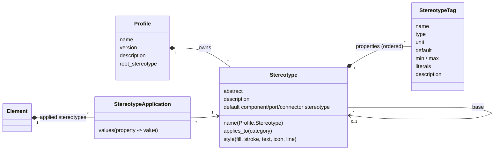
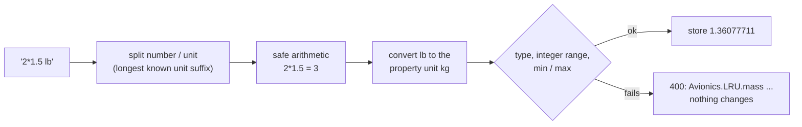

# Profiles, stereotypes and typed properties

The studio's counterpart of the MATLAB System Composer **Profile Editor**: a
*profile* is a named, versioned set of *stereotypes*; a stereotype declares
*typed properties* (with units, defaults and ranges), says which kind of
element it applies to, may inherit from a base stereotype and carries a display
style. Applying a stereotype to an element (an LRU, an ARINC 429 port, a bus
connector, a requirement, ...) gives that element the stereotype's properties,
whose values are checked and converted on entry.

Typical avionics use: a profile `Avionics` with an abstract `Equipment`
stereotype (mass, power, MTBF), derived `LRU` and `IMAModule` stereotypes (DAL,
ATA chapter, part number), port stereotypes per bus (`A429Port` with a bit
rate, `AFDXPort` with a BAG), connector stereotypes (`A429Bus` drawn dashed) and
requirement stereotypes (`SafetyRequirement` with a DAL). Mass, power and
latency budgets (the analysis feature) read those values.

| Where | What |
|-------|------|
| `kerml/stereotypes.py` | metamodel: `Profile`, `Stereotype`, `StereotypeTag` (property), `StereotypeApplication`, categories, value coercion |
| `engine/profiles.py` | repository operations (CRUD + change propagation, apply / batch / values, default stereotypes, profile files, persistence codecs, validator rules, display fields) |
| `engine/units.py` | unit table (132 units, 28 quantities), conversion, safe arithmetic expressions |
| `webapp/routes/profiles.py` | HTTP API, element JSON badges / style, generic PATCH hook |
| `webapp/static/plugins/30-profiles.js` | Profiles tab (Profile Editor), Stereotypes inspector section, Apply stereotypes dialog, styled tree badges |
| `mcp_server/tools/profiles.py` | MCP tools |

## Concepts



- **Profile** (a `Package` subclass, kind `Profile`) owns stereotypes and has a
  description, a version and an optional *model root stereotype* that is applied
  to root architectures (existing ones when it is set, new ones when created).
- **Stereotype** names are identifiers; a stereotype is addressed as
  `Profile.Stereotype` (`Avionics.LRU`). It applies to one **category**:

  | Category | Matches (by kind name, so features built in parallel fit in) |
  |----------|-----------|
  | *(all)* | any model element |
  | Component | `PartUsage`, `PartDefinition` |
  | Port | `PortUsage` |
  | Connector | `ConnectionUsage` (and kinds derived from it) |
  | Interface | kinds containing `Interface` (not `...Dictionary`), `PortDefinition` |
  | InterfaceElement | `DataElement`, `PhysicalElement`, `FunctionElement` kinds, `AttributeUsage` owned by an interface |
  | Requirement | `RequirementDefinition`, `RequirementUsage` |
  | Allocation | kinds starting with `Allocation` |
  | Function | `ActionDefinition`, `ActionUsage` (not calculations / states / transitions) |
  | Architecture | a `PartDefinition` not owned by a component (the model root) |

- **Inheritance**: a stereotype may name a *base*; it inherits the base's
  properties (shown grouped by the stereotype that declares them), its
  applies-to (a derived stereotype leaves applies-to empty to inherit it, or
  names the same category) and its style (own keys override). A derived
  stereotype cannot redeclare an inherited property. Cycles are rejected. An
  **abstract** stereotype cannot be applied; it only serves as a base.
- **Properties** have a type (`double`, `single`, `int8` .. `int64`, `uint8` ..
  `uint64`, `boolean`, `string`, `enumeration` with literals), and for numeric
  types an optional unit and min / max; a default and a description; their
  order is kept.
- **Applications**: an element may carry several stereotypes, each at most
  once. Every value is addressed as `Profile.Stereotype.property`
  (`Avionics.LRU.mass`); `Stereotype.property` and a bare `property` also work
  when unambiguous, and the stereotype part may name a base of the applied
  stereotype (`Avionics.Equipment.mass` on an `LRU`).

### Values: checks, units and expressions

Every value is checked and converted when it is entered (UI, HTTP, MCP, Python)
and stored in canonical form; a rejected value changes nothing and the error
names the property:




| Type | Accepts | Rejects (example message) |
|------|---------|---------|
| `double`, `single` | numbers; text `"2.5"`, `"2.5 lb"` (converted to the property's unit), `"2*0.75"`, `"(3+4)/2 kW"` | `Avionics.LRU.mass: cannot convert W (power) to kg (mass)`; `... = -1 kg is below the minimum 0 kg` |
| `int8` .. `uint64` | whole numbers in range, also from text / units / expressions | `Avionics.LRU.ata = 300 is outside the uint8 range [0, 255]`; `... must be a whole number` |
| `boolean` | `true/false`, `1/0`, `yes/no`, `on/off` | `... expects true or false, got 'maybe'` |
| `string` | any text | lists / objects |
| `enumeration` | one of the literals (case-insensitive match) | `Avionics.LRU.dal: 'F' is not one of the literals ['A', 'B', 'C', 'D', 'E']` |

Expressions are evaluated by a small AST walker over numeric literals and
`+ - * / // % **` with parentheses only: names, calls, attributes and
subscripts are rejected, nothing is ever `eval`-ed.

`engine/units.py` covers mass (kg, g, lb, oz, ...), length (m, km, ft, in,
nmi, ...), time (s, ms, us, ns, min, h, d, yr), frequency / rates (Hz .. GHz,
FIT, 1/h), current, voltage, resistance, capacitance, inductance, charge (Ah,
mAh), power (W, mW, kW, VA, hp), energy, temperature (K, degC, degF; affine),
angle (rad, deg, ...), angular rate, speed (m/s, km/h, kt, mph, ft/min, ...),
acceleration (m/s^2, gn), force (N, lbf), pressure (Pa, kPa, psi, inHg, bar,
...), information (bit, byte, kB, MiB, ...), data rate (bit/s, kbit/s,
Mbit/s, Gbit/s, byte/s, ...), area, volume, density, mass and volume flow, plus
`%` and `ppm`. Products and quotients of table units (`kg/m^3`, `N*m`) work
too. Two units convert when their dimensions match; anything else is refused.
Reliability: give MTBF in `h` and failure rates in `FIT` or `1/h` (`1 FIT` =
`1e-9 1/h`).

## Using it in the web UI

### Profile Editor (Profiles tab)

Open it from the **Profiles** tab or the **Profile Editor** toolbar button.
The toolstrip has three groups:

- **Profile**: *New Profile*, *Import* (a `.profile.json` file), *Export* (the
  selected profile), *Manage* (profiles in the model with version,
  stereotype and application counts, source file, Export / Remove buttons, and
  the import history).
- **Stereotype**: *New Stereotype* (in the selected profile: name, applies-to,
  base, abstract, description), *Add Property*, *Delete* (profile or
  stereotype; the confirmation says how many applications will be removed).
- **Model**: *Apply to Elements* (opens the Apply stereotypes dialog for the
  selected stereotype).

The left **profile browser** lists Profiles -> Stereotypes (abstract ones in
italics, with a colour tag and their applies-to). Keyboard: Up / Down move the
selection, Enter or F2 jumps to the name field, Delete deletes the selection
(after confirmation).

Selecting a **profile** shows its name, version, description and *model root
stereotype*, and a table of its stereotypes (click one to open it).

Selecting a **stereotype** shows, top to bottom:

1. **General**: name (renaming keeps every application), description,
   *Applies to* (a derived stereotype can inherit it), *Base stereotype* (the
   list leaves out the stereotype itself and those derived from it), *Abstract*.
   A change that would invalidate existing applications (an applies-to that
   stereotyped elements no longer match, making an applied stereotype
   abstract) asks for confirmation and then removes those applications.
2. **Properties**: an editable table: name, type, unit (with suggestions from
   the unit table), default, min, max, enumeration literals (comma
   separated), description; up / down to reorder, x to delete (confirmed when
   values exist). Properties inherited from base stereotypes are listed
   read-only above, grouped by declaring stereotype. Edits are saved on Enter
   or when the cell loses focus; Escape restores the cell. Choosing
   *enumeration* as the type waits (row highlighted) for the literals.
   Stored values follow every edit (see *Change propagation*).
3. **Style**: fill, border / line and text colours (with *none* to clear and
   the inherited colour shown), an icon from a fixed set (component, sensor,
   actuator, computer, display, network, power, antenna, software, storage,
   controller) and the connector line style (solid, dashed, dotted, dashdot),
   with a live preview.
4. **Default stereotypes for new elements inside** (component stereotypes
   only): stereotypes applied automatically to sub-components, ports and
   connectors created inside an element that carries this stereotype. A
   reference component keeps its ports and internals on its definition, so
   elements created there also get the defaults of stereotypes applied to the
   component usages typed by that definition.

### Stereotypes section of the Properties tab (inspector)

Select any model element in the containment tree. The **Stereotypes** section
(next to the element form) shows:

- *Add stereotype...*: the non-abstract stereotypes that apply to the element
  and are not applied yet;
- one collapsible group per applied stereotype with a typed editor per
  property: a number box with its unit (enter `3 lb`, `2*1.5` or `1.2 kW`; the
  stored, converted value is shown), a checkbox, a drop-down of literals, or a
  text box; inherited properties are headed by the stereotype that declares
  them. Invalid input is outlined in red with the reason; Escape restores the
  stored value;
- x on a group removes that stereotype (and its values); *Remove all* removes
  every stereotype; *Profile Editor...* opens the editor.

Stereotyped elements show a `«Name»` badge per stereotype in the containment
tree, coloured with the stereotype's style and showing its icon.

### Apply stereotypes dialog

Toolbar **Apply stereotypes...** (or *Apply to Elements* in the editor): pick
a stereotype, a scope (*Selected elements* from the current multi-selection,
*Current package / composition* = the selected element and everything inside
it, including the definitions of reference components, or *Whole model*) and
optionally an element category. Elements that already carry the stereotype or
do not match are skipped; the log reports how many were stereotyped and why
others were skipped.

### Validation

**Validate** (F5) reports, besides the core rules: invalid stored values
(`profile.value.invalid`), abstract / non-applicable / duplicate applications,
property definition problems (unknown unit, min above max, enumeration
without literals, invalid default), properties hiding inherited ones,
inheritance cycles, base / derived applies-to conflicts, unusable default or
root stereotypes, and names that are not identifiers (`profile.name`, e.g. a
stereotype created with the generic *Add: Stereotype* button). Files holding
such state still load (the loader restores saved applications as they are) so
they can be repaired.

## Change propagation

| Edit | Effect on stored values |
|------|-------------------------|
| rename a property, stereotype or profile | values and applications kept (values are keyed by the property object) |
| change a property's unit to a compatible one | values, default, min and max converted (`kg` -> `g`: 2 -> 2000) |
| change a property's unit to an incompatible one | numbers kept as they are (the property is being redefined) |
| change type / range / literals | values coerced; values that no longer fit are reset to the default and listed in the response (`reset`) and the log |
| rename literals in place (same count) | values follow the position |
| delete a property | its values are removed everywhere |
| delete a stereotype | its applications are removed; derived stereotypes lose their base |
| delete / remove a profile | every application (and value) of its stereotypes is removed |
| import with replace | stereotypes and properties are matched by id, then name; the above rules apply; anything missing from the file is deleted |

## Profile files

*Export* writes `<Profile>.profile.json`:

```json
{
  "format": "sysmlv2-profile/1",
  "exported_at": "2026-10-18T09:00:00+00:00",
  "profile": {
    "id": "...", "name": "Avionics", "description": "...", "version": "2.1",
    "root_stereotype": null,
    "stereotypes": [
      {"id": "...", "name": "LRU", "description": "", "applies_to": "Component",
       "base": "Equipment", "abstract": false, "style": {"icon": "computer"},
       "defaults": {"port": "A429Port"},
       "properties": [
         {"id": "...", "name": "dal", "type": "enumeration", "unit": "", "default": "C",
          "min": null, "max": null, "literals": ["A", "B", "C", "D", "E"], "description": ""}
       ]}
    ]
  }
}
```

References inside the file use local stereotype names; a base in another
profile of the target project is written `Other.Stereotype`. *Import* checks
the whole file (names, types, units, defaults, ranges, references, cycles,
applies-to conflicts) before anything changes. A profile with the same name is
refused (409) unless the user confirms *replace*. Each import is recorded in
the project's import log (profile, version, file name, time, created /
replaced). The web UI uploads the file content; the server never reads paths
given over HTTP.

## HTTP API

Errors are JSON `{"error": message}` with 400 (invalid), 404 (not found) or 409
(conflict). `<ref>` is an id, `Profile.Stereotype` or a qualified name.

| Method | Path | Body / result |
|--------|------|---------------|
| GET | `/api/profiles/meta` | types, categories, icons, line styles, units |
| GET | `/api/profiles` | `{profiles, ungrouped, imports}` |
| POST | `/api/profiles` | `{name, description?, version?}` |
| POST | `/api/profiles/import` | `{text, replace?, file_name?}` -> `{profile, created, report}` |
| GET / PATCH / DELETE | `/api/profiles/<ref>` | PATCH `{name?, description?, version?, root_stereotype?}` |
| GET | `/api/profiles/<ref>/export` | `{file_name, text}` |
| POST | `/api/profiles/<ref>/stereotypes` | `{name, description?, applies_to?, base?, abstract?, style?, defaults?}` |
| GET / PATCH / DELETE | `/api/stereotypes/<ref>` | PATCH also takes `force` (strip invalidated applications) |
| POST | `/api/stereotypes/<ref>/properties` | `{name?, type?, unit?, default?, min?, max?, literals?, description?, index?}` |
| PATCH / DELETE | `/api/stereotypes/<ref>/properties/<prop>` | same keys; PATCH returns `converted`, `reset` |
| POST | `/api/stereotypes/<ref>/batch` | `{scope: selection\|composition\|model, ids?, root?, category?, values?}` |
| GET | `/api/elements/<id>/stereotypes` | `{element, applied: [groups with typed values], applicable}` |
| POST | `/api/elements/<id>/stereotypes` | `{stereotype, values?}` |
| PATCH | `/api/elements/<id>/stereotypes` | `{values: {"Profile.Stereotype.prop": v}}` or `{property, value}` (all or nothing) |
| DELETE | `/api/elements/<id>/stereotypes[/<ref>]` | remove all / one |
| GET | `/api/units`, `/api/units/convert?value=3 lb&to=kg` | unit table, conversion |

Also: element JSON (`GET /api/element/<id>`, `/api/tree`) carries
`badges` (`«LRU»` per applied stereotype), `style` (merged `fill`, `stroke`,
`text`, `icon`, `dash` from the line style) and per-stereotype entries
`stereotypes: [{name, qualified_name, id, profile, style, values}]`.
`PATCH /api/element/<id>` with `{"props": {"Avionics.LRU.mass": "3 lb"}}` sets
a value, and generic edits of profiles, stereotypes and properties go through
the same checks. `POST /api/element` with kind `Profile` creates a profile.
The legacy `/api/stereotype/define` and `/api/stereotype/apply` keep working.

## MCP tools

| Tool | Purpose |
|------|---------|
| `sysml_list_profiles` | profiles with stereotypes and properties, ungrouped stereotypes, import log |
| `sysml_create_profile` / `sysml_update_profile` / `sysml_delete_profile` | profile CRUD (update sets the model root stereotype) |
| `sysml_add_stereotype` / `sysml_update_stereotype` / `sysml_delete_stereotype` | stereotype CRUD (applies_to, base, abstract, style, defaults, force) |
| `sysml_add_stereotype_property` / `sysml_update_stereotype_property` / `sysml_delete_stereotype_property` | property CRUD with propagation |
| `sysml_apply_stereotype` | apply with optional values (replaces the core tool of that name; same arguments, also accepts `Profile.Stereotype` and dotted value keys) |
| `sysml_remove_stereotype` | remove one or all stereotypes from an element |
| `sysml_set_stereotype_property` | set one (`property`, `value`) or many (`values`) values |
| `sysml_get_stereotype_properties` | applied stereotypes with grouped values, or one value |
| `sysml_batch_apply_stereotype` | apply over selection / composition / model |
| `sysml_export_profile` / `sysml_import_profile` | profile files as text or a path |
| `sysml_list_units` / `sysml_convert_units` | unit table and conversion |

## Python API

```python
from engine import Repository
from engine import profiles as P

repo = Repository("Aircraft")
prof = P.create_profile(repo, "Avionics", version="1.0")
eq = P.add_stereotype(repo, prof, "Equipment", applies_to="Component", abstract=True,
                      style={"fill": "#dbeafe", "icon": "computer"})
P.add_property(repo, eq, "mass", "double", unit="kg", default="1.5", minimum=0)
lru = P.add_stereotype(repo, prof, "LRU", base=eq)
P.add_property(repo, lru, "dal", "enumeration", literals="A,B,C,D,E")

fcc = ...                                    # a PartUsage created through notify_created
P.apply_stereotype(repo, fcc, lru, {"mass": "3 lb"})
P.set_property_value(repo, fcc, "Avionics.LRU.dal", "b")
P.get_property_value(fcc, "Avionics.LRU.mass")      # 1.36077711 (kg)
P.batch_apply(repo, lru, scope="model")
text = P.export_profile_json(prof)
P.import_profile(Repository("Other"), text)
```

The legacy API still works: `Stereotype(name, applies_to=[cls])`,
`define_tag(name, default=...)` (an untyped property that accepts any value),
`apply(target, values)` and `stereotypes_on(element)`.

## Cross-feature notes

- **Display contract**: the summary hook appends one `«Name»` badge per applied
  stereotype and sets `style` keys (first applied stereotype wins per key; the
  line style becomes `dash`). The canvas feature renders both.
- **Default stereotypes** run in an `engine.register_created_hook`, so they
  apply to elements created by any feature that calls `notify_created`.
- **Removal**: deletion goes through `Repository.remove`; a removal hook keeps
  the import log and application bookkeeping clean.
- Reading values from other features: `engine.profiles.get_property_value(e,
  "Avionics.Equipment.mass")` (unit = the property's unit) or
  `element_stereotypes(e)` for everything with units and display strings.
- **Interop** (tables, report, Compare / merge, SysML text, XMI; see
  [interop.md](interop.md)) names stereotypes by `full_name`, finds them with
  `find_stereotype`, creates and edits profiles, stereotypes and properties from the
  tables' Profiles sheet with the functions above, and sets values through
  `StereotypeApplication.set`, so imported values get the same checks and unit
  conversion as the inspector. A stereotype kept in a plain package (legacy API) has no
  profile prefix (`LRU`, not `Package.LRU`).
- The plugin styles the Properties pane as two wrapping columns (element form,
  inspector sections) and hides the core's raw-JSON *Define stereotype...* /
  *Apply stereotype...* buttons, the core's inline `«...»` tree text and the raw
  stereotype JSON line, which the badges and the inspector replace.

## System Composer parity

| Feature id | Status | Notes |
|------------|--------|-------|
| profile-editor-app | closed | Profiles tab with toolstrip, profile browser, details form, property table |
| profile-xml-file | closed (JSON) | standalone `.profile.json` files with export / import; MATLAB's XML profile schema itself is not read or written (deferred: no XML interchange with MATLAB yet) |
| profile-import-manage | closed | import (create / replace with diff report), import log, Manage view, remove profile strips applications, description / version |
| stereotype-definition | closed | `Profile.Stereotype` names, description, applies-to categories matched by kind name |
| typed-properties | closed | all numeric types, boolean, string, enumeration; unit, default, min, max, description, order; checks on assignment; validator rule |
| property-units | closed | 132 units in 28 quantities incl. avionics units; compatible-unit entry converts; incompatible refused |
| property-defaults-expressions | closed | defaults; arithmetic expressions via a safe AST evaluator |
| stereotype-inheritance | closed | base stereotypes, grouped inherited properties, cycles rejected |
| abstract-stereotype | closed | abstract cannot be applied; guarded when applied (confirm + remove) |
| stereotype-styling | closed | fill / stroke / text colour, icon (fixed set), connector line style, inherited; badges + style in element JSON |
| apply-stereotype-ui | closed | inspector section (order 10) with Add / remove / Remove all |
| multiple-stereotypes | closed | several stereotypes per element, duplicates rejected |
| property-inspector-editing | closed | typed editors, units, expressions, inline errors, Escape |
| batch-apply-stereotypes | closed | selection / composition / model scope, category filter |
| default-stereotypes | closed | component / port / connector defaults, model root stereotype, via created hook |
| profile-change-propagation | closed | renames, unit / type changes, deletions propagate to stored values |

Deferred (with reasons):

- **Live-linked profile files**: System Composer references an external
  profile file from many models; here a profile is copied into the project
  and updated by re-importing with *replace* (single-user local prototype,
  no shared file store).
- **Custom icon images**: only the fixed icon set (no image upload / asset
  store in the prototype).
- **Copy / paste stereotypes between profiles**: the studio has no clipboard
  for profile elements yet (core feature). Undo / redo is available: every
  Profile Editor and Stereotypes-section edit is one named step of the
  studio's global undo history ("Set Avionics.LRU.mass of FMS"), Ctrl+Z / Ctrl+Y.
- **View filters by stereotype / property value** and **analysis roll-ups**
  belong to the views and analysis features; they read values through
  `engine.profiles` (see *Cross-feature notes*).
- **Stereotype property values bound to model parameters** (System Composer
  parameters / expressions over other properties): values are literals or
  numeric expressions only; parameters are a separate feature.
