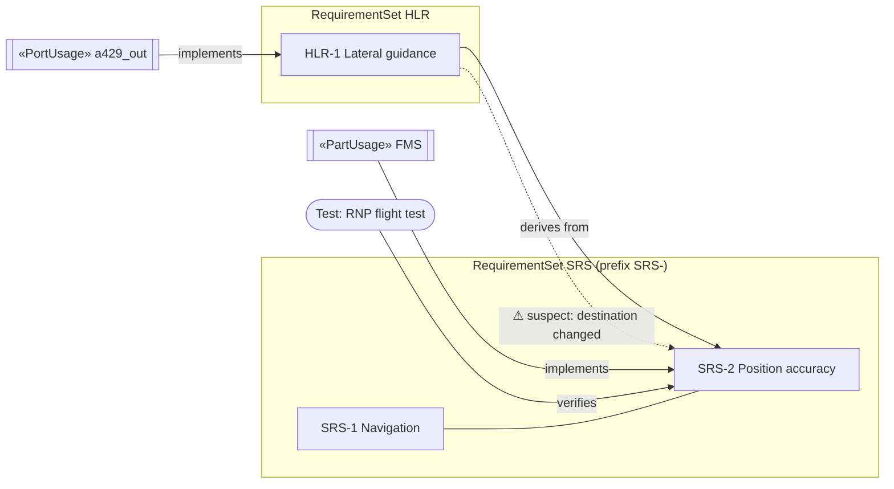

# Requirements and traceability

The System Composer *Requirements Perspective* / Requirements Toolbox experience on top of the
SysML v2 engine: hierarchical requirement sets, test cases, typed trace links, implementation and
verification roll-ups, change tracking (suspect links), a traceability matrix and diagram, CSV and
ReqIF import/export, and HTML/CSV traceability reports. Everything is available from the web UI,
the HTTP API, the MCP server and Python, and is saved in the project JSON.

| Layer | File |
|-------|------|
| Metamodel, logic, persistence, validation | `engine/requirements.py` |
| HTTP API | `webapp/routes/requirements.py` |
| Web UI | `webapp/static/plugins/40-requirements.js` |
| MCP tools | `mcp_server/tools/requirements.py` |
| Tests | `tests/test_requirements*.py`, `tests/ui/scenarios/40_requirements*.mjs` |

## Concepts

System Composer terms map onto SysML v2 like this:

| System Composer | Here | SysML v2 element |
|-----------------|------|------------------|
| Requirement set (`.slreqx`) | requirement set | `RequirementSet` (a `Package`) |
| Requirement | requirement | `RequirementDefinition`; children are nested by ownership |
| Test case (Simulink Test) | test case | `VerificationCaseDefinition` with a result |
| Implement link | `implement` | `Satisfy` (same relationship as the core `satisfy` kind) |
| Verify link | `verify` | `Verify` |
| Refine link | `refine` | `Refine` |
| Derive link | `derive` | `DeriveRequirement` |
| Relate link | `relate` | `Trace` (same relationship as the core `trace` kind) |
| Confirm link | `confirm` | `Confirm` (new relationship registered by this feature) |

Requirement fields:

| Field | Attribute | Rules |
|-------|-----------|-------|
| ID | `req_id` | auto-numbered `<set prefix><n>` (default prefix `REQ-`), editable, unique within the set |
| Summary | `name` | required, unique among siblings, no `::` |
| Description | `text` | free text (the "shall" statement) |
| Rationale | `rationale` | free text |
| Type | `req_type` | functional, performance, interface, safety, environmental, design-constraint, other |
| Priority | `priority` | high, medium, low |
| Status | `req_status` | draft, reviewed, approved, implemented, verified |
| Verification method | `verification_method` | test, analysis, inspection, demonstration |

Enumerations accept common spellings (`Design Constraint`, `H`, `Approved`, `T`, `pass` ...) and
store the canonical value; anything else is rejected with a message listing the allowed values.
Custom attributes (DAL, ATA chapter, owner, ...) come from stereotypes defined with the profiles
feature; the requirement detail panel shows their values and the Properties tab edits them.



### Link types and direction

Links always point from source to destination; the UI shows the verb in the right direction
(`FCC implements SRS-2` on one end, `SRS-2 implemented by FCC` on the other).

| Type | Icon | Source | Destination | Reads as |
|------|------|--------|-------------|----------|
| Implement | ⚙ | design element | requirement | *source* implements *destination* |
| Verify | ✓ | test case | requirement | *source* verifies *destination* |
| Refine | ⇣ | requirement | requirement | *source* refines (adds detail to) *destination* |
| Derive | ⇡ | requirement | requirement | *source* is derived from *destination* |
| Relate | ↔ | any linkable element | any linkable element | non-committal relation |
| Confirm | ☑ | any linkable element | requirement | *source* (analysis, review) confirms *destination* |

Linkable elements: components (`PartUsage`, `PartDefinition`), ports, connectors, interfaces
(`PortDefinition`, `InterfaceDefinition`, `InterfaceUsage`), functions (actions), requirements and
test cases. Wrong endpoints are refused immediately with a hint, e.g. *"Implement links need a
design element ... as source; got SRS-1 'Navigation'. Use Derive or Refine between requirements."*
Duplicate links and self-links are refused. `implement`, `relate` and `confirm` are also registered
as engine link kinds, so the core *Link…* dialog and `sysml_link` accept them.

### Implementation and verification status

- A leaf requirement is **implemented** when it, or one of its ancestors, has an Implement link. A
  parent's percentage is the share of its implemented leaves; a set's is the share of all its leaves.
- **Verification** comes from Verify links from test cases. A requirement verified directly is
  *failed* if any of its tests failed, *passed* if all passed, otherwise *unexecuted*; without
  tests of its own it inherits an ancestor's tests, else it is *missing*. Parents roll up: *failed*
  if any leaf failed, *passed* when all passed, *missing* when none is verified, otherwise
  *partial*. The percentage is the share of passed leaves.
- Both are shown as small bars (blue = implemented; green / red / amber = passed / failed /
  unexecuted) per row, per set and in the toolstrip roll-up.

### Change tracking (suspect links)

When a link is created, a hash of the summary, description and rationale of each requirement end is
stored with it. When either requirement's text changes afterwards the link becomes **suspect** (⚠).
Links created elsewhere (the core *Link…* dialog, `/api/link`) get their baseline before the next
requirement edit, so they are tracked too. Review the change, then **Clear** the flag (per link,
per requirement, per set or for the whole project). The validator reports every suspect link as a
warning (`requirements.suspect-link`). Changes to priority, type, status or the ID do not make
links suspect.

## Using the web UI

### Requirements tab (editor)

The **Requirements** tab has a System Composer style toolstrip:

| Section | Buttons |
|---------|---------|
| Set | set picker (one set or *All sets*), **New Set**, **Set Properties** (rename, ID prefix, description, delete) |
| Requirement | **Add** (after the selected requirement), **Child**, **Delete** |
| Arrange | **Up**, **Down**, **Indent** (under the previous sibling), **Outdent** |
| Link | link-type picker (the note below it shows the direction), **Link to Selection**, **Link from Selection**; the current model selection is shown under the picker |
| Verify / Track | **Test Case**, **Clear Suspect** |
| Share | **Import**, **Export**, **Report** |

Below it: a view switch (**Requirements**, **Test cases**, **Links**), a text filter, type and
status filters and the set roll-up bars.

1. **Create a set**: *New Set*, enter a name and an ID prefix (for example `SYS-`), *Submit*.
2. **Add requirements**: *Add* appends a requirement (`SYS-1`, `SYS-2`, ...) and puts the cursor in
   its summary. Type the summary and press Enter. Select a row and click *Child* for a
   sub-requirement. The `#` column shows the hierarchical index (1, 1.1, 2 ...); the twisty
   collapses a branch.
3. **Edit inline**: ID and summary are text cells; type, priority, status and verification method
   are drop-downs. Changes are saved when the cell loses focus; invalid values (duplicate ID, empty
   summary) are refused with a message in the Output pane and the cell reverts.
4. **Long text**: the detail form under the table edits summary, description and rationale
   (Ctrl+Enter saves), shows the status bars, the custom attributes and every link of the
   requirement with navigate, *Clear* (suspect) and delete. Drag the splitter to resize it.
   *Show in tree*, *Properties*, *Trace diagram* and *Highlight links* (emits a `highlight` event
   for the canvas) sit at the top.
5. **Arrange**: the Arrange buttons, the row context menu, or Alt+Shift+arrow keys.
6. **Filter**: type in the filter box (ID, summary, description, rationale) or pick a type /
   status; ancestors of matching rows stay visible, dimmed.

Keyboard (table focused):

| Keys | Action |
|------|--------|
| Insert / Shift+Insert | add requirement after / add child |
| Delete | delete the selected requirement (asks first) |
| Alt+Shift+↑ / ↓ | move up / down |
| Alt+Shift+→ / ← | indent / outdent |
| ↑ / ↓ (Enter in a text cell) | previous / next row, same column |
| F2 | edit the summary of the selected row |
| Esc in a cell | revert the cell |
| right-click | context menu (add, link as each type, arrange, diagram, delete) |

Dialogs: Enter submits, Esc cancels.

### Test cases

*Test Case* adds a test case to the set (optionally verifying the selected requirement). The
**Test cases** view lists them with an editable name, description and **result**
(unexecuted / passed / failed), the requirements each verifies (✕ removes a Verify link) and a
*+ verifies…* picker to add one. The result immediately drives the verification bars. The detail
form of a requirement also has *Verified by test case… / Add Verify link*.

### Linking

- **Link to Selection**: select a model element in the containment tree or on the canvas
  (multi-selection works), select a requirement row, pick the link type, click *Link to
  Selection*. For Implement / Verify / Confirm the selected elements become the source; for
  Refine / Derive / Relate the selected requirement is the source.
- **Link from Selection**: the selected elements are always the source.
- **Context menu** on a row: *Link to Selection as Implement / Verify / Refine / Derive / Relate /
  Confirm*.
- **Drag and drop**: drag a requirement (the ⠿ grip in the editor, or any row of the Requirements
  Perspective dock) onto a containment-tree node or onto a canvas element. The drag carries the
  requirement id as `application/x-sysml-element`. Dropping on a design element creates an Implement
  link, on a test case a Verify link, on another requirement a dialog asks for Derive / Refine /
  Relate and the direction.
- **Inspector**: select any linkable element; the *Requirements links* section of the Properties
  tab lists its incoming and outgoing links (navigate, clear suspect, delete) and offers
  *Link requirement…* (requirements of every set, grouped by set), *Highlight on canvas* and
  *Trace diagram*.
- **Traceability matrix**: click a cell (see below).

### Requirements Perspective dock

*Req Perspective* in the toolbar (or Alt+Shift+R) docks a compact requirements browser under
whatever tab is shown (architecture canvas, Properties, ...), as System Composer shows it under
the canvas. It shares the set, the selected requirement and the link type with the editor and has
a filter, *Link to Selection*, *Link from Selection* and the row context menu. Drag rows onto the
canvas or the tree to create Implement links; double-click (or Enter) opens a row in the editor.
It hides itself while the Requirements tab is active and remembers whether it was open.

### Links view and suspect links

The **Links** view lists every link of the shown set (or of all sets): type, source,
relationship, destination and *change information* (*Source changed* / *Destination changed* /
*No change*). Tick *Suspect only* to review changes, *Clear* one link or *Clear all suspect*. Rows
with suspect links show ⚠ in the requirements table and the matrix.

### Traceability tab

- **Matrix**: rows are the requirements of the chosen set; columns are components, ports,
  connectors, interfaces, functions, requirements (optionally of one set) or test cases. Cells show
  link icons (dashed with ⚠ when suspect). Unlinked rows and columns are highlighted amber. Click a
  cell to create a link: a dialog proposes the types valid for that pair, in both directions where
  it matters (Implement first for design elements, Verify for test cases, Derive for
  requirements). Click a link icon to delete it. *Matrix CSV* downloads the matrix; *Report* and
  *Report CSV* download the traceability report. Row headers navigate to the requirement.
- **Diagram**: a Mermaid graph of the links around an element, upstream and downstream, depth
  1–3. It follows the latest selection (a requirement row, or a traceable element selected in the
  tree or on the canvas) and can be re-centred with the element picker; buttons under the graph
  navigate to each node. Multi-level chains such as `HLR-1 derives from SYS-3`,
  `FCC implements SYS-3` show up together at depth 2.

### Import and export

- **Import** reads a file in the browser and uploads its content (the server never opens paths):
  - CSV with a header row; recognised columns `id, summary, description, rationale, type,
    priority, status, verification_method, parent_id` (common aliases such as `name`, `title`,
    `text`, `parent` work; `,` `;` and tab delimiters). `parent_id` builds the hierarchy.
  - ReqIF 1.2 XML: SPEC-OBJECTs with string, XHTML and enumeration attribute values (mapped by
    attribute name, e.g. `ReqIF.ForeignID`, `ReqIF.Name`, `ReqIF.Text`), SPEC-HIERARCHY nesting,
    and SPEC-RELATIONs whose type is named like a link type. Documents with a DOCTYPE or ENTITY
    declaration are refused.
  - Into an existing set (requirements with a known ID are updated, the rest created) or a new set
    named after the file / ReqIF title. Problems (bad enum value, unknown parent, duplicate summary)
    are reported per row in the Output pane; the rest is imported.
- **Export**: requirements as CSV (re-importable, with status columns) or ReqIF 1.2; the
  traceability report as HTML (status cards, per-requirement links, unlinked requirements, test
  results, suspect links) or CSV (one row per requirement and link).

## Validation

*Validate* (F5) runs these rules besides the core ones:

| Rule | Severity | Meaning |
|------|----------|---------|
| `requirements.suspect-link` | warning | a requirement changed after the link was made |
| `requirements.link-endpoint` | warning | a link made elsewhere has endpoints that do not count (e.g. Verify from a non test case) |
| `requirements.missing-id` | warning | requirement without an ID |
| `requirements.duplicate-id` | error | ID used twice in a set |
| `requirements.status-mismatch` | warning | status *implemented* / *verified* contradicts the computed status |
| `requirements.invalid-value` | error | an enumerated field holds an unknown value |

The API and MCP tools refuse invalid input up front with the same messages.

## HTTP API

All under `/api/req`; errors are `400 {"error": "..."}` (`404` when a referenced element is
missing).

| Method | Path | Body / query | Result |
|--------|------|--------------|--------|
| GET | `/meta` | | enumerations, link types, matrix column kinds, formats |
| GET | `/sets` | | sets with roll-ups |
| POST | `/sets` | `{name, prefix?, parent?, description?}` | set |
| PATCH | `/sets/<sid>` | `{name?, prefix?, description?}` | set |
| GET | `/table` | `?set=` | sets, requirement rows (fields, index, depth, statuses, link counts), test cases, link counts |
| POST | `/requirements` | `{parent (set or requirement), after?, id?, summary?, description?, rationale?, type?, priority?, status?, verification_method?}` | row |
| PATCH | `/requirements/<rid>` | any of the fields | row |
| DELETE | `/requirements/<rid>` | | deleted ids (children and links go too) |
| POST | `/requirements/<rid>/move` | `{direction: up\|down\|indent\|outdent}` | row |
| POST | `/test-cases` | `{parent, name?, description?, result?}` | test case |
| PATCH | `/test-cases/<tid>` | `{name?, description?, result?}` | test case |
| DELETE | `/test-cases/<tid>` | | |
| GET | `/links` | `?element=` | links of an element with direction and suspect flags |
| GET | `/links` | `?set=&suspect=1` | every link of a set / the project |
| POST | `/links` | `{type, source, target}` | link |
| POST | `/links/batch` | `{type, sources[], target}` or `{type, source, targets[]}` | `{created, errors}` |
| DELETE | `/links/<lid>` | | |
| POST | `/links/<lid>/clear-suspect` | | link |
| POST | `/clear-suspect` | `{element?}` (element, set, or nothing = project) | `{cleared}` |
| GET | `/status` | `?target=` (set or requirement; none = all sets) | roll-ups |
| GET | `/matrix` | `?set=&columns=&column_set=` | rows, columns, cells, unlinked rows / columns |
| GET | `/diagram` | `?element=&depth=1..3` | Mermaid text, nodes, edges |
| POST | `/import` | `{format: csv\|reqif, text, set? \| new_set?, prefix?}` | report (created, updated, linked, warnings) |
| GET | `/export` | `?format=csv\|reqif\|report-html\|report-csv\|matrix-csv&set=&columns=` | `{format, filename, text}` |

Core endpoints also understand requirements: `POST /api/element` creates `RequirementSet` and
`VerificationCaseDefinition`; `PATCH /api/element/<id>` validates requirement fields (and baselines
links before text edits); element JSON carries `requirement`, `traceable`, `verification_result`
and badges (the requirement ID, `n req` on design elements implementing requirements).

## MCP tools

| Tool | Purpose |
|------|---------|
| `sysml_create_requirement_set` | new set (`name`, `prefix`, `parent`, `description`) |
| `sysml_add_requirement` | add to a set (`set`) or under a requirement (`parent`), optional `after` and fields |
| `sysml_update_requirement` | edit fields and/or `move` (up, down, indent, outdent) |
| `sysml_link_requirement` | create a link (`type`, `source`, `target`) |
| `sysml_requirement_links` | links of an element (`ref`) or of a set / the project, `suspect_only` |
| `sysml_unlink_requirement` | delete a link |
| `sysml_clear_suspect` | clear one link, an element's or a set's links, or all |
| `sysml_add_test_case` | test case with result and optional `verifies` list |
| `sysml_set_test_result` | unexecuted / passed / failed |
| `sysml_trace_matrix` | compact matrix (JSON) or CSV |
| `sysml_requirement_status` | roll-ups for a set, a requirement or all sets |
| `sysml_trace_diagram` | Mermaid traceability graph |
| `sysml_import_requirements` | CSV / ReqIF from `content` (or a local `path`) |
| `sysml_export_requirements` | csv, reqif, report-html, report-csv, matrix-csv; text or written to `path` |

## Python API

```python
import engine.requirements as rq   # not "from engine import requirements" (that name is the DOT diagram)
from engine import Repository

repo = Repository("Avionics")
srs = rq.create_requirement_set(repo, "SRS", prefix="SRS-")
nav = rq.add_requirement(repo, srs, {"summary": "Navigation", "type": "functional"})
acc = rq.add_requirement(repo, nav, {"summary": "Position accuracy", "description": "RNP 0.3"})
rq.create_trace_link(repo, "implement", fms_part, acc)          # design element -> requirement
tc = rq.add_test_case(repo, srs, "RNP flight test", result="passed")
rq.create_trace_link(repo, "verify", tc, acc)
rq.update_requirement(repo, acc, {"description": "RNP 0.1"})    # links of acc become suspect
rq.requirement_status(repo, srs)            # roll-ups and rows
rq.trace_matrix(repo, srs, "components")    # matrix data
rq.trace_diagram(repo, acc, depth=2)["text"]  # Mermaid
rq.all_links(repo, srs, suspect_only=True)
rq.clear_suspect_for(repo, srs)
rq.import_requirements(repo, "csv", text, new_set="Supplier SRS")
rq.export_requirements(repo, "reqif", srs)["text"]
```

Errors are `rq.RequirementsError` (a `ValueError`) with user-facing messages. Every element created
goes through `engine.notify_created`; deletions go through `Repository.remove`.

## Persistence

Saved in the project JSON: sets (class and ID prefix), requirement fields and sibling order (codec
`requirements`), test results, the links themselves (core `links` list) and each link's
change-tracking baseline (repository codec `requirements-links`), so suspect flags survive a
save / load.

## Cross-feature contracts used

- Drag source: `dataTransfer` type `application/x-sysml-element` = requirement id; the plugin
  listens for `studio.on("drop-on-element", {dragged_id, target_id})` emitted by the canvas.
- Emits `navigate` `{id}` and `highlight` `{ids, color: "#f59e0b", reason: "trace"}`.
- Reads `studio.getSelection()` for Link to / from Selection and listens to `select`,
  `selection-changed`, `model-changed`, `tab-shown`.
- Summary hook: badges (requirement ID, test result, `req set`, `n req`) and `traceable`.
- Implementation status counts any linkable element; components, ports and connectors follow
  `engine/structure.py` (`PartUsage`, `PortUsage`, `ConnectionUsage`).

## System Composer parity

Closed:

- [x] `requirement-set-authoring`: sets with ID prefix; hierarchical requirements with ID
      (auto-numbered, editable, unique), summary, description, rationale, type, priority, status,
      verification method; custom attributes via stereotypes.
- [x] `requirements-perspective`: Requirements tab (tree-table, inline editing, add sibling /
      child, indent / outdent, move, delete, text / type / status filter, implementation and
      verification columns, detail form) plus the docked Requirements Perspective browser.
- [x] `link-types`: Implement, Verify, Refine, Derive, Relate, Confirm with direction shown in the
      UI; `implement`, `relate`, `confirm` registered as engine link kinds.
- [x] `linkable-elements`: components, ports, connectors, interfaces, functions, requirements,
      test cases.
- [x] `drag-drop-linking`: rows draggable (editor grip and dock) onto tree nodes and canvas
      elements (`drop-on-element`).
- [x] `context-menu-linking`: Link to / from Selection with a link-type picker, row context menu.
- [x] `implementation-status`, `verification-status`: roll-ups per requirement, parent and set,
      shown as bars; test case results editable in the UI.
- [x] `traceability-matrix`: selectable set and column kind, link icons, create by cell click with
      a type picker, delete by icon click, unlinked rows / columns highlighted, CSV export.
- [x] `traceability-diagram`: Mermaid graph around the selected element, depth 1–3.
- [x] `link-navigation`: *Requirements links* inspector section with navigate and highlight.
- [x] `change-tracking`: per-link text hash, suspect flags, change information, clear per link /
      requirement / set / project, validator warning.
- [x] `multi-level-traceability`: derive chains requirement → requirement → design shown in the
      diagram and the Links view.
- [x] `requirements-import`: CSV and ReqIF 1.2 subset (no DTD / entities), CSV and ReqIF export.
- [x] `reports-export`: HTML and CSV traceability reports, matrix CSV.
- [x] MCP tools for all of the above.

Deferred:

- [ ] *Justification* links and the "justified" implementation state (excluding a requirement from
      coverage): not requested; would need a new link type and a third status value.
- [ ] Change tracking of the design-element end (System Composer also flags a link when the
      linked model element changes): only requirement text is hashed, as specified.
- [ ] Custom-attribute columns in the requirements table: stereotype values are shown in the
      detail panel and edited in the Properties tab (profiles feature) so the two features do not
      write tag values differently.
- [ ] Full ReqIF: `.reqifz` archives, typed (integer / real / date) attribute definitions,
      enumeration datatypes on export, tool extensions. Export writes string attributes.
- [ ] Link sets stored as separate files (`.slmx`): links live in the project JSON.
- [ ] Clicking nodes inside the Mermaid diagram: navigation uses buttons under the diagram
      (keeps Mermaid in its strict security mode).
- [ ] Undo / redo of requirement edits: the studio core has no shared undo stack yet.
- [ ] Requirements Table blocks, requirement-based test generation, DOORS / Polarion
      synchronisation: out of scope for a local prototype.
